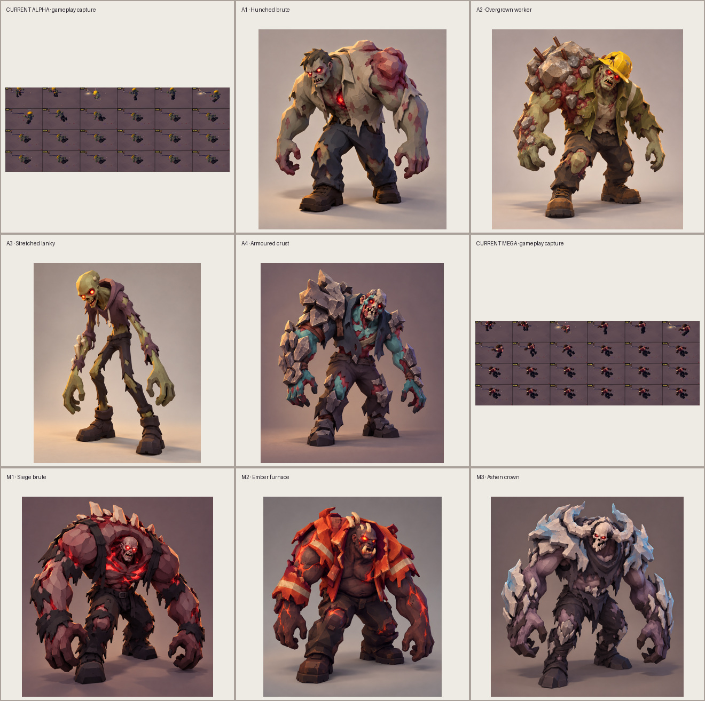

# Alpha and Mega Alpha concept drafts

All concept art and turnarounds here were generated with the built-in OpenAI imagegen tool on 2026-10-22. These are visual exploration sheets, not production meshes; preserve the readable shapes while simplifying them to the game's palette and runtime budgets during any later Blender build. Each image was opened and visually reviewed. No generated image contains visible text or a watermark.

The requested approved image references (`assets/char.courier-female/reference.png`, `assets/inf.brute/reference.png`, `assets/inf.bbq-dad/reference.png`) are not present in this checkout. The prompt used the supplied current Alpha/Mega gameplay captures for scale and the written art direction for style: chunky low-poly toy diorama, warm studio light, desaturated infected colors, and emissive red eyes. I also inspected all four supplied current Alpha captures, including the close corpse image. They show the current worker-derived model collapsing into broad smooth helmet/torso masses and a red crater-like maw, while the in-game animation strips are hard to judge for silhouette. This set tests distinct human silhouettes against that problem.

## Contact sheet

The current Alpha and Mega panels use the supplied gameplay animation-strip screenshots, so their labels distinguish those in-game captures from the neutral-background concept renders. The new directions are shown at matched card size for silhouette comparison.

## Drafts and recommendation

### Alpha

- [A1 · Hunched brute](../../../assets/inf.alpha/concepts/alpha-01-hunched-brute.png) — broad torn-clothing torso, one enlarged shoulder, long heavy hands; immediately reads as a tough infected human.
- [A2 · Overgrown worker](../../../assets/inf.alpha/concepts/alpha-02-overgrown-worker.png) — tilted hardhat and one-sided rubble growth turn the worker variant into a distinctive line-breaker with a strong side silhouette.
- [A3 · Stretched lanky](../../../assets/inf.alpha/concepts/alpha-03-stretched-lanky.png) — narrow waist, long bent limbs and low hands create a clear, unsettling contrast to the bulky Alphas.
- [A4 · Armoured crust](../../../assets/inf.alpha/concepts/alpha-04-armoured-crust.png) — irregular stone-like shoulder/forearm plates frame a visible human face and keep both arms readable.

**Recommend A2 and A4 for Blender exploration.** A2 gives the roster an occupational story cue without losing the adult human shape; its hardhat and asymmetric shoulder remain legible from the high camera. A4 gives a separate armor-driven silhouette with exposed limbs and a visible face, making it a useful robust variant. A1 is clear but too close to a conventional brute, and A3 is the most distinct but risks looking too tall and thin at gameplay zoom. The selected [A2 turnaround](../../../assets/inf.alpha/concepts/turnaround-alpha-02-overgrown-worker.png) and [A4 turnaround](../../../assets/inf.alpha/concepts/turnaround-alpha-04-armoured-crust.png) each include front, side, back and elevated isometric views.

### Mega Alpha

- [M1 · Siege brute](../../../assets/inf.mega-alpha/concepts/mega-01-siege-brute.png) — broad sloping shoulder arch, low-reaching arms and short back-spike ridge communicate a boss-scale human silhouette.
- [M2 · Ember furnace](../../../assets/inf.mega-alpha/concepts/mega-02-ember-furnace.png) — torn orange turnout coat, dark body and ember seams provide an immediate fire/ember variant read.
- [M3 · Ashen crown](../../../assets/inf.mega-alpha/concepts/mega-03-ashen-crown.png) — pale outward-swept crown and ash mantle establish a colder, high-contrast boss variant.

**Recommend M1.** Its large shoulder mass and low hands read as a siege threat from the isometric angle, while the visible recessed face and red chest seams retain the infected identity. The compact blunt spine ridge is easier to simplify and animate than M3's wide horn crown. [M1 turnaround](../../../assets/inf.mega-alpha/concepts/turnaround-mega-01-siege-brute.png) includes front, side, back and elevated isometric views.

## Imagegen prompt ledger

Prompts are reproduced below for provenance. References were visual guides, not subjects to reproduce. All images were generated on neutral backgrounds with no intended text or watermark. A1's written prompt mentions a second close-up corpse image, but the generation call attached only the Alpha gameplay screenshot; the corpse image was inspected separately and was not an image input to that call.

### A1 · Hunched brute

Tool: built-in OpenAI imagegen. Prompt:

> Use case: game-character-concept. Asset type: concept draft for a stylized isometric zombie action RPG. Input images: Image 1 current Alpha gameplay screenshot, reference for scale and setting only; Image 2 close-up corpse screenshot, reference for infected cues only. Create a NEW design, do not reproduce its worker helmet or lumpy silhouette. Primary request: Direction 1 of 4, a hunched brute Alpha: unusually resilient infected adult human, about 1.45x a normal human, with broad shoulders, thick forearms and a forward hunch; clear human anatomy and recognizable two arms/two legs. Give it a distinctive asymmetrical shoulder mass, torn muted work shirt and trousers, desaturated bruised skin, small bright emissive red eyes, a restrained red chest wound glow. Slightly comedic-creepy, strong readable silhouette at small isometric game scale. Scene/backdrop: plain warm light grey studio background, subtle grounding shadow. Style/medium: polished 3D render, chunky low-poly miniature toy diorama character, faceted surfaces, soft warm key light, saturated but controlled colors consistent with colorful survival game art. Composition/framing: full body, single character, front three-quarter view, upright hunched idle pose, centered, generous margins, portrait composition. Constraints: no gore realism, no weapons, no extra props, no text, no letters, no labels, no watermark.

### A2 · Overgrown worker

Tool: built-in OpenAI imagegen. Prompt:

> Use case: game-character-concept. Asset type: concept draft for a stylized isometric zombie action RPG. Input image: current Alpha gameplay screenshot, reference for game scale only. Design a DIFFERENT concept from the screenshot. Primary request: Direction 2 of 4, an overgrown infected construction worker: adult human with a compact powerful frame, bent knees, massive one-sided shoulder/upper-back growth shaped like a concrete rubble slab, torn olive work jacket, dusty yellow hard hat cracked and tilted but not oversized, one sleeve missing, heavy boots. Keep head, hands and legs distinct; readable chunky silhouette at 60px. Mutated bigger/tougher human, about 1.45x regular human. Desaturated olive-grey skin, red glowing eyes. Slightly humorous unsettling toy-like character. Scene/backdrop: neutral pale warm-grey studio background and soft ground shadow. Style/medium: polished chunky low-poly 3D miniature diorama, faceted clean forms, warm soft light, palette compatible with a colorful isometric action game. Composition/framing: single full-body character, front three-quarter view, standing hunched, centered with margin, portrait. Avoid smooth shapeless blobs, extreme gore, machinery, tools, weapons. No text/letters/labels/watermark.

### A3 · Stretched lanky

Tool: built-in OpenAI imagegen. Prompt:

> Use case: game-character-concept. Asset type: concept draft for a stylized isometric zombie action RPG. Input image: current Alpha gameplay screenshot for game scale only. Primary request: Direction 3 of 4, stretched lanky Alpha, still unmistakably a mutated adult human about 1.45x normal height: narrow waist, long bent arms reaching low, long shins and large hands, forward folded neck and an elongated skull with red glowing eyes. Silhouette should feel tall and wiry, contrasting a stocky brute, with torn plum-grey hoodie fabric stretched over limbs, a few angular bone ridges along one forearm only. Distinct head, torso, arms and legs, pose readable at 60px. Slightly comedic-creepy toy proportions, no monster tentacles. Scene/backdrop: warm light grey studio with subtle floor shadow. Style: chunky low-poly miniature diorama game character, clean faceted forms, simple material colors, soft warm studio light, colorful survival game aesthetic. Composition: single entire body visible, front three-quarter, standing hunched, centered, portrait. Avoid photoreal, muddy texture, excessive gore, extra objects. No text, labels, letters, watermark.

### A4 · Armoured crust

Tool: built-in OpenAI imagegen. Prompt:

> Use case: game-character-concept. Asset type: concept draft for a stylized isometric zombie action RPG. Input image: current suit Alpha screenshot, reference for game scale and infected cue only. Primary request: Direction 4 of 4, armoured-crust Alpha: oversized but human adult infected about 1.45x normal height, compact broad stance and deep forward hunch, distinct shoulder-to-forearm plates of cracked charcoal-grey bone-like crust over torn dark clothing, one battered shoulder visibly higher than the other, face partly visible with two bright red eyes. Keep limbs and fingers separated, armor plates angular and sparse so the pose remains readable at 60px; no full body shell, no helmet. Creepy but a little absurd toy-character charm. Scene/backdrop: plain warm grey studio background, subtle shadow. Style: colorful stylized low-poly miniature diorama game render, chunky clean faceted geometry, simple painted surfaces, soft warm light. Composition: single full body, front three-quarter, upright hunched idle, centered, portrait. Avoid photorealism, extreme gore, blobs, props, writing, labels, watermark.

### M1 · Siege brute

Tool: built-in OpenAI imagegen. Prompt:

> Use case: game-character-concept. Asset type: L10 boss concept for a stylized isometric zombie action RPG. Input image: current Mega Alpha gameplay screenshot, reference for scale and red infected cues only. Create a new clearly distinct silhouette. Primary request: Mega direction 1, a towering siege brute, roughly 2.3x human height and much broader than Alpha, still a mutated human with two arms and two legs. Distinctive silhouette: huge forward sloping shoulders like a low arch, long heavy forearms almost to knees, small recessed head with bright red eyes, a row of blunt bone spikes along upper back. Dark bruised skin, torn near-black clothing, restrained glowing red seams at chest. Must be readable from an elevated isometric game camera and feel like a final boss, imposing but slightly absurd toy miniature. Keep face visible. Scene: neutral warm grey studio with soft ground shadow. Style: stylized chunky low-poly 3D diorama game render, clean facets and simple painted materials, soft warm light, not photorealistic. Composition: one complete character, front three-quarter, standing lurch, centered, portrait. Avoid excessive gore, blur, smoke, props. No text, lettering, labels, watermark.

### M2 · Ember furnace

Tool: built-in OpenAI imagegen. Prompt:

> Use case: game-character-concept. Asset type: L10 boss concept for a stylized isometric zombie action RPG. Input image: current Mega Alpha screenshot for game scale only. Primary request: Mega direction 2, the ember furnace brute: a huge infected adult human boss, distinctly taller and wider than an Alpha, bent forward with legs apart and both arms hanging low. Silhouette is a broad pear-shaped torso with asymmetrical burnt-orange fire-retardant coat remnants flaring at the shoulders and three short horn-like bone ridges framing the head; keep the face and glowing red eyes visible. Charcoal skin, warm ember-orange cracks/veins as restrained accents, blunt jaw tusks. Preserve human anatomy and separated limbs, readable from isometric distance; toy-like, eerie and a little silly, not a demon. Scene: plain warm-grey studio background, soft floor shadow. Render style: chunky low-poly painted miniature diorama game figure, faceted clean surfaces, warm soft lighting, colorful survival game art. Single full-body front three-quarter idle pose, centered with margin, portrait. No fire effects or props. Avoid photorealism, viscera, confusing silhouette. No text, labels, watermark.

### M3 · Ashen crown

Tool: built-in OpenAI imagegen. Prompt:

> Use case: game-character-concept. Asset type: L10 boss concept for a stylized isometric zombie action RPG. Input image: current Mega Alpha screenshot, reference for scale only. Primary request: Mega direction 3, the ashen crown: huge boss infected adult human, much taller and broader than regular Alpha, with a forward hunch, long powerful arms and clear two-leg stance. Distinctive silhouette built around a cold blue-grey mantle of ash-crusted bone plates sweeping outward from each shoulder and a pair of outward-swept horns at the sides of a visible skull-like human face; two small emissive red eyes. Torn charcoal clothing and muted ash-purple skin, slight icy blue accent on mantle, no actual flame. Human anatomy remains obvious; materials are broad clean planes, not a smoky blob. Boss reads from elevated isometric camera, unnerving but a touch comic. Plain warm-grey studio background and soft shadow. Style: chunky low-poly painted 3D toy diorama game figure, simple facets and palette, soft warm lighting. One complete front three-quarter idle figure, centered with margins, portrait. Avoid realism, gore, props, text, letters, labels, watermarks.

### Selected turnarounds

#### A2 · Overgrown worker

Tool: built-in OpenAI imagegen. Prompt:

> Use case: 3d-character-turnaround. Asset type: concept reference sheet for a Blender character build. Input image: Image 1 is the selected overgrown worker Alpha concept; preserve this exact character identity, proportions, torn olive worker clothes, tilted yellow hardhat, asymmetric rubble shoulder and glowing red eyes. Create one clean four-view model sheet on a plain neutral warm grey background: three equally sized full-body orthographic views across the upper row (front, exact left side profile, back), plus a smaller elevated isometric three-quarter view in lower right. Same scale, pose, lighting and proportions in all views, neutral relaxed hunched A-pose with arms held slightly away from torso and fingers visible. Ensure back view shows rubble shoulder and clothing. Chunky low-poly toy diorama game style, simple painted facets, readable build reference, no scenery. No annotations, no text, no letters, no labels, no grid lines, no watermark; separate views only by clean whitespace.

#### A4 · Armoured crust

Tool: built-in OpenAI imagegen. Prompt:

> Use case: 3d-character-turnaround. Asset type: concept reference sheet for a Blender character build. Input image: Image 1 is the selected armoured-crust Alpha concept; preserve the exact identity, moderate 1.45x human scale, forward hunch, asymmetrical angular cracked bone shoulder and forearm armor, cyan-purple bruised flesh, dark torn clothes and red eyes. Four views on a plain neutral warm-grey studio background: front, exact left side profile, back, and elevated isometric game-camera angle, laid out in a clear 3-view upper row and smaller fourth view below right. Full body visible in every view, same proportions and relaxed slightly hunched A-pose, arms separated from torso, fingers and feet visible. Back view clearly shows crust/spine silhouette. Chunky low-poly painted toy diorama style, clean simple facets and soft light. No scenery, annotations, text, labels, letters, watermark, borders or grid.

#### M1 · Siege brute

Tool: built-in OpenAI imagegen. Prompt:

> Use case: 3d-character-turnaround. Asset type: L10 boss concept reference sheet for a Blender build. Input image: Image 1 is the selected siege-brute Mega Alpha concept; keep the same huge forward-sloped shoulder arch, long heavy forearms, recessed head with glowing red eyes, blunt back spikes, dark torn clothing and restrained red chest glow. Four view layout on neutral warm-grey studio: three equal full-body orthographic views across top row (front, exact left side profile, back) and smaller elevated isometric game-camera view at lower right. Keep the boss very large, same proportions and stance in every panel; all feet, hands, spikes and face fully in frame. Arms slightly out from torso in neutral build pose; rear shows spike line and silhouette. Style is chunky low-poly painted toy diorama game model, clean facets, soft warm light and floor shadow. No environment, no annotations, no text, no labels, no watermark, no border.
