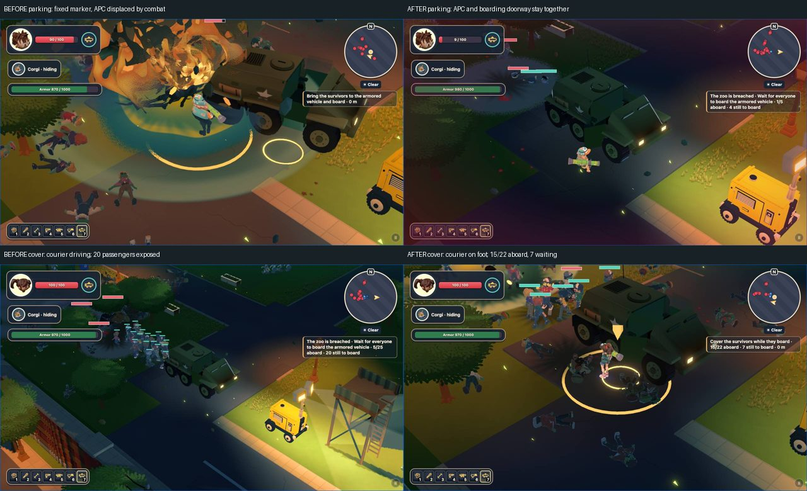

# L8 pre-UAT review — 2026-11-08

**Lane complete; two cause fixes committed. Suitable for PO play, with acceptance qualifications below still open.** This is not complete release sign-off. Brief baseline: main `f4bba5cf`; working baseline `27414470`; reviewed game revision `c463d595`. No push or deployment. No targets, specs, other-level tuning, or reference assets changed.

## Findings and fixes

| Severity | Reproduced finding | Cause and fix | Before → after |
|---|---|---|---|
| P1 | Combat moves the APC away from its fixed destination marker. The courier stands at “0 m” while the boarding door is elsewhere. | `7f84184f`: L8 already suppresses throttle while boarding, but impulses still move its dynamic body. Constrain horizontal translation and rotation while parked; retain suspension and damage. Checkpoint rebuild reapplies this policy; L9 uses the ordinary free vehicle body. | High WebGPU male preset: sampled APC displacement **3.333 m**, yaw **0.320 rad** → **0 m / 0 rad**. Same configuration completes in **309 → 148 s**, **2 → 0 deaths**, **100 → 21 rockets**. The impulse regression fails at **1.879 m** before the fix and passes afterward. |
| P2 | The HUD tells the courier to board immediately; boarding removes their weapons while a long passenger queue is exposed. The native competent controller already covers and boards last. | `c463d595`: apply that rule to manual E entry and dwell entry. The driver can board once every living passenger is seated. Show “Cover the survivors while they board” with the queue count; suppress the misleading missing-survivor cue during boarding. | Same actual 24-human carried save, high WebGPU: **8/24 → 20/24 humans escape**, **137 → 171 s**, **19 → 56 rockets fired**, **0 courier deaths** in both. Fresh-profile low WebGL2: **3/12 → 8/12 escape**, **138 → 132 s**, no deaths. Survivor invulnerability, damage, spawning and boarding speed were not changed. |
| P3 / open taste concern | Enclosure interiors can look very dark and sparse compared with the attractive public paths. | No missing floor or calm-phase fence collapse established. An attempted fixed-panel change was discarded: baseline replay already has **318/318 fixed panels**, zero tilted/displaced through tick 4008. Later loose/broken panels occur during the outbreak. | No speculative layout change retained. Independent art judgement remains open. |



The upper-right frame isolates the first fix and still has the old boarding wording; the lower-right frame includes both fixes. Full-resolution originals remain under `test-results/vqa59/`. Route comparisons are observed outcomes, not deterministic difficulty benchmarks. The carried-save **before** run used one logged navigation assist; the carried-save **after** run used none.

### Regression coverage

Extended the existing vehicle enter/drive/exit test; no registered case was added. It applies a lateral/lifting impulse and yaw torque to the L8 APC, repeats after sanctuary checkpoint restoration, checks a fixed doorway and real durability loss, rejects both E and automatic driver entry while passengers wait, then seats the group, enters, transfers to L9 and drives the same damaged APC. Both defects were observed failing before their corresponding changes.

## Physical-input coverage

All browsers were headless on macOS Metal; at most two owned contexts. No server was started on 3300. Completed playtests use the repository keyboard/mouse driver, no god mode, no skips, and actual saved L9 handovers. Art tours use physical WASD with read-only navigation guidance and **protected courier only**; they are not mortal difficulty or performance qualification.

| Coverage | Evidence / result |
|---|---|
| Empty profile → L8 debug selection, low WebGL2 | `pre-uat-l8-fresh-low` before; `pre-uat-l8-cover-fresh-low` after both fixes. The level selector supplies the normal L8 boundary loadout; this is not a fresh L1-to-L8 campaign. Final save reaches L9 with APC 406, 930/1000 durability and ten occupants: courier, corgi, eight humans. |
| Persisted canonical L8 preset, high WebGPU, zoom 1.5 | `pre-uat-l8-progressed-high` before; `pre-uat-l8-fixed-high` after parking. The parking fix alone still lost the entire human cohort; that exposed the separate cover defect. |
| Actual progressed save, high WebGPU, zoom 1.5 | `pre-uat-l8-carried-high` before cover; `pre-uat-l8-cover-high` after. Restore the versioned final-c completed-L7 boundary, not a fabricated roster. Final L9 save retains APC 466, 940/1000 durability and 22 occupants: courier, corgi, twenty humans. |
| Actual progressed saves, low WebGL2 and high WebGPU; zoom 1 and 1.5 | Two enclosure tours built at `7f84184f`, **52 captures each**, no browser errors. Their art assets are unchanged by the later cover fix; the final boarding HUD is reviewed separately in the physical replays. Low seed carries 23 humans; high carries 24. Backend readback confirms WebGL and WebGPU respectively. The tour's WebGPU launch does **not** use the unsafe WebGPU flag. |
| Remaining save/quality combinations, both fixes | `pre-uat-l8-final-fresh-high`: fresh high WebGPU, **134 s**, zero deaths/assists, **10/12 humans**, APC 406 at 950/1000. `pre-uat-l8-final-carried-low`: actual progressed low WebGL2, **168 s**, zero deaths/assists, **23/23 humans**, APC 721 at 980/1000; 25 occupants including courier/corgi. Both saved into L9. |
| Female and male courier, gear 0–4, both qualities and both PO zooms | **40 walking captures** within those tours. Cosmetic `survivor.select(variant, tier)` only; no stat edits. Legal earned L8 saves require prerequisite upgrades and arrive at gear 4, so tiers 0–3 here are explicitly visual fixtures, not alleged earned L8 campaigns. |

### Capture review

Personally opened every retained tour panel: four ten-panel gear sheets and eight eight-panel art sheets, **104 source captures total**, plus six selected full-resolution boarding/parking captures and the committed sheet. [evidence.json](evidence.json) records each tour image's hash, tick, backend, zoom and observation. Original images and large sheets remain in `test-results/pre-uat-l8/`.

- **Gear sheets:** every female/male tier 0–4 at both zooms has intact walking limbs, recognizable loadout and a legible courier silhouette; no stretched body or weapon shard reproduced.
- **Sanctuary / gates:** warm lamps, trees, paving, bins and curbs make the public loops readable. Quiet frames have no objective text. Elephant approaches expose the dark enclosure-floor concern; they do not establish a geometry hole.
- **Healthy animals:** elephant trunk/ears/feet, gorilla mass/face, zebra stripes and four legs, flamingo forms and the lion silhouette read from the iso camera. All five species are present. Zebra legs stay separated at both PO zooms.
- **Outbreak:** red attack rings, muzzle flashes, following civilians and infected remain distinguishable. Natural infected flamingos occur in both tours, a gorilla in low and zebra in high. This does **not** establish every infected species/state at both tiers; the old final-c all-species review is not silently promoted to fresh evidence.
- **Return / boarding:** APC hull, wheels and headlights are whole. Fallen bodies around the queue have recognizable limbs; no stretched corpse reproduced in the selected frames. The courier remains readable while covering. Long light shadows and damaged fence modules are visible during combat; a calm-phase panel-collapse suspicion did not survive comparison.
- **Observer correction:** files called `L8-result` after transition actually contain L9 tick 0. Excluded from L8 APC displacement and visual claims.

### Audio and performance

Both tours report an unlocked, running, unmuted audio engine, no registry errors, and voices below their limits: maximum **13/16 low**, **29/32 high**. Positive telegraph gain is recorded for flamingo (low tick 7208 / high 6530), and gorilla roar (low 10667). These prove cue dispatch, not personal listening or a mix-quality pass; the host browser was muted.

The completed real-time input runs expose no remaining parking/boarding stall; the approximately 60-second no-progress warning is the authored calm phase. Optional fixed-step art touring cannot qualify frame hitches. The two final crossed-matrix real-time runs enabled the repository RAF probe: low records **217/650 ms** near startup and **433 ms** at APC approach; high records **350 ms** at APC approach. The latter pair occurs together around **02:06:46 UTC**, under two-context shared load above eight. These are retained as a P2 diagnostic observation, with no game cause assigned from coincidence alone. A profiled matrix replay found **84–97% CPU idle** during its long intervals, and its optional node-build guard exited 1 on 84 builds, including deliberate photo-quality rebuilds; it is not a zero-build pass. The follow-up `pre-uat-l8-steady-low` disables the capture matrix and periodic shots, holds low WebGL2 throughout, and completes in **149 s**, zero deaths/assists, **22/23 rescued**, APC 721 at 970/1000, with **zero recorded gameplay frames >200 ms**. [Profile and follow-up summary](profile-summary.json). This supports no speculative simulation patch; shared-load low evidence does not establish a quiet/cold high-tier or <=6-second transition timing pass. Those acceptance clauses remain open.

## Final checks

| Check | Result |
|---|---|
| `npm run verify -- E30`, outer 150-second cap, Vitest maximum four workers | **PASS**, 87.4 s. Runs `npm run typecheck`, `npm run lint`, `npm test`: **107 tests / 27 files passed**. Repository budget: 150/150 cases across its projects, 43/45 files admitted. [Checks](checks.json). |
| `npm run build:qa` | **PASS** after dropping the exploratory layout change. |
| `npm run qa:accept -- --level L8 --skip-browser` | Finished, **0 fresh failing rows, 10 incomplete**; exit 1 for incomplete coverage. L8-06 `currentStatus` freshly PASS; its historical `status: FAIL` remains retained pending PO closure. All six low/high sanctuary, breach and escape-route checkpoint checks PASS; fixture errors zero. Current [L8 report](../fix51-verify/L8.json) and eight L8 receipts retained; unrelated generated tracker/global edits restored. |
| Remote `npm run qa:threat -- --levels L8 --maxWorkers=2` via `tools/remote/run.sh` | Skilled and passive routes complete, **zero L8 flags**. Exit 1 solely for `PARTIAL_LEVEL_SELECTION:diagnostic run, not a complete gate`. Explicit branch/main provenance supplied. [Summary](threat-summary.json); raw audit in `test-results/qa-threat/`. |
| Stable-quality physical RAF follow-up | Finished successfully: 149 s, no >200 ms L8 gameplay frame recorded. Shared-load diagnostic, not quiet full performance acceptance. Optional matrix/node-guard diagnostic failure is disclosed above. |
| `git diff --check` | PASS before report commit. |

An earlier remote unit attempt failed on the runner's absent Git HEAD and an overloaded navigation timeout. The final standard local verification above completed normally; those unrelated tests were not altered.

### Reproduce / inspect

Run from the worktree root. Full playtest outputs are `test-results/vqa59/<label>/{source.json,runs-*.json,log-*.jsonl,profile/pool-storage.json,captures/}`. Tour producer/receipts are `test-results/pre-uat-l8/tour.mjs` and `tour-{low-webgl,high-webgpu}/receipt.json`. The compact committed evidence preserves run summaries, saved transport identities/HP, exact source hashes and reviewed image hashes. Some replay provenance names parent HEAD `7f84184f` while its working-tree source hash already equals final `c463d595`; no parent-HEAD label is used to override that source hash.

```sh
BROWSER_POOL_JOB_ID=pre-uat-l8 PLAYTEST_GOD=0 PLAYTEST_REVEAL_AUDIT=1 \
  PLAYTEST_AUDIO_CUES=1 PLAYTEST_SHOT_SECONDS=10 \
  node --import tsx/esm tools/qa/vqa59-run.ts \
  L8 low webgl2 1.5 fresh <new-label> 360
```

For progressed replay, extract `docs/reports/final-c/campaign/L8-{low,high}-campaign.json.gz` with `git show HEAD:<path>` (slim worktrees omit the binary), seed that decoded save in the new label's `profile/pool-storage.json` under `minor-incident.campaign`, then use `keep` instead of `fresh`. The wrapper relocates its localhost storage origin to the preview's ephemeral port.

## Still open / PO verdict

- **P2 timing observation:** capture-matrix runs contain >200 ms intervals; the steady-quality low follow-up does not. Quiet/cold high-tier performance and attribution of the earlier stalls remain open.
- **L8-11:** independent Opus “stunning” judgement requested on `test-results/pre-uat-l8/sheets/L8-taste.jpg`; no response received during this pass. Do not count the author score below as the required independent pass.
- The ten incomplete acceptance rows still require their remaining browser/visual, listening, timing or census clauses. In particular, fresh infected lion/elephant views, every animal state at both tiers, and quiet transition/frame timing are not fully established by this review. No tracker row was forced to PASS.
- Survivors can still die during the route and active cover: four of 24 in carried high and four of 12 in fresh low; the added carried-low replay rescues 23/23 and fresh high rescues 10/12. The fix removes forced disarmament during the queue; it does not promise a perfect rescue.

**Stunning:** **6/10, not yet a pass** in my judgement. Public paths, warm lights and the whole APC are attractive; enclosure interiors are comparatively dark and sparse. **Boring:** the deliberate one-minute calm phase provides a useful sanctuary contrast; the outbreak and return have visible pressure. **Babysitting:** boarding now asks for armed cover and permits action throughout the queue; it no longer forces an unarmed wait inside the driver seat. The two reproduced defects are fixed and verified; the taste and strict acceptance qualifications above remain explicit for the PO.
