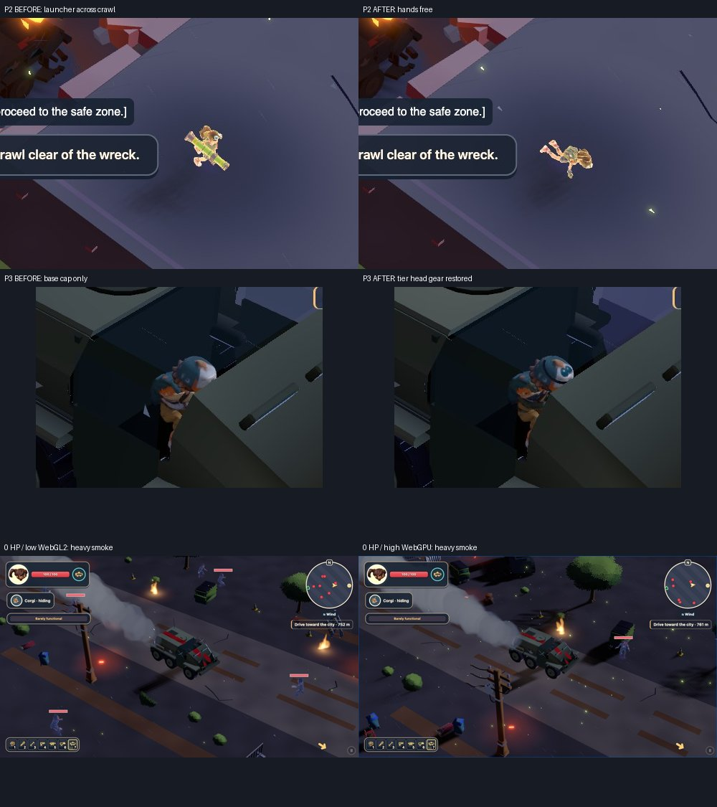

# L9 pre-UAT — pre-uat-l9

## Result

Two presentation defects were reproduced and fixed at their causes. No fresh P1 or unresolved P2 was confirmed in the completed coverage. No L9 gameplay tuning, acceptance targets, specifications, dependencies, or protected reference assets changed. No push or deployment.

The review uses the current branch, starting at `27414470`. The named historical reports were read first; their smoke/road dispositions were treated as hypotheses to recheck.

## Findings and fixes

### P2 — Carried weapon corrupts the scripted crawl

**Before:** the selected rocket launcher remained drawn across the prone courier, and its gun-arm override competed with the crawl clip. The renderer continued ordinary held-weapon presentation during the scripted survivor clip.

**Fix:** `2ee1abc9`, `ActionView.ts`: suppress aiming, gun-arm application and held-weapon visibility while `scriptedClip === 'crawl'`. The campaign inventory reset remains at its existing atomic L10 transition.

**After:** the normal-clock physical run recorded 39 crawl samples with clip `crawl` and neither held prop visible; the L10 view restored the axe. Both combat loadout and both racks contain exactly the axe; the ability remains. A separate high WebGPU zero-HP run also completed the crawl and axe handover. [Before/after hashes and measurements](crawl-proof.json).

### P3 — Seated courier loses progression gear

**Before:** the tier-4 actor had no `courier-tier-gear` in its seated copy. Its head-mounted tier accessory disappeared on boarding because `VehicleOccupant` loaded only the base body, while the on-foot renderer separately loaded the tier mesh.

**Fix:** `763b9ce1`: reuse the existing skeleton-bound gear loader for the seated courier, apply the current cumulative tier draw range during prewarm and each seated pose, and retain the existing texture/disposal paths. This fixes a shared render copy; it changes no level tuning.

**After:** tier-4 head gear is visible in the cab. Tier 0 hides the mesh; tiers 1–4 draw their authored cumulative indices. All 20 cells (five tiers × two couriers × two qualities) completed without browser errors; both macro sheets were opened. [Before/after and tier diagnostics](gear-proof.json).

### Historical P2 — Zero-HP smoke: reproduced as working

The conflicting final-c/rr-b reports were resolved with fresh physical tests. Infected attacked the stopped APC from 1000 to 0 HP. Low WebGL2 and high WebGPU captures show a continuous thick grey plume at zoom 1 and 1.5 after four seconds of unpaused driving. Both runs drove away at zero and reached the one scripted bridge crash and L10. At the same parked ground position, the high run’s damaged/healthy surface cap ratio is exactly 0.6. No smoke patch was warranted.

The high run held physical fire/ability/brake input for 307 simulation ticks at zero: still in APC 406, no player attack events; physical exit remained blocked. All 12 human passengers reached shelter, and the corgi reached L10 at 100 HP. This run preserves the transported female character through handover. Both runs recorded exactly 100 positive durability hits, each −10; scheduled and resolved attack windups were at least 36 ticks (0.6 s). [Physical damage/audio/transition measurements](zero-proof.json).

### Historical P2 — Road threat gap

The baseline already places opening route groups and roadside wanderers earlier. Current production-clock route measurements are listed below. No further encounter changes were made without a current counterexample.



## Method and evidence limits

- Headless Chromium, real Metal GPU (`--use-angle=metal`), maximum two owned browser contexts. Local preview port 3839; shared port 3300 untouched.
- Actual keyboard driving/crawl and mouse/fire input. Normal, unpaused game clocks during play. Pausing is used only for settled inspection photos. No runtime HP, AI, inventory, physics or actor-position edits.
- A fresh browser save and valid progression fixtures cover tiers 0–4. Early-progression saves are deliberately loaded into L9 as visual QA fixtures, not represented as a naturally completed campaign. They stop before an invalid late-level campaign commit.
- Canonical progressed cases use the production L8 transport transaction as **setup**, then physically play L9. The fixture contains APC 406 at 1000/1000 with the courier, corgi and 12 humans. The L8 prefix itself was native simulation, not claimed as physical play.
- Raw captures, JSON receipts, physical input taps and full browser logs are retained under `test-results/pre-uat-l9/`. Only reviewed images support visual conclusions. No images outside `test-results/`.
- Audio captions, cues, voice state and error telemetry were inspected. The headless host is muted: this does not certify subjective mix/listening quality.
- Shared-host runs support visible continuity and successful input, not a quiet-host FPS benchmark. The supplied fresh-route driver's frame log records only intervals over 200 ms; it is not a full percentile trace.

### Observer corrections / excluded evidence

The initial paused-step matrix did not advance production streaming time and had zero detailed terrain residents. It is excluded from landscape, streaming and performance conclusions. Its frozen crash flash is not a game defect. An early waypoint follower drifted into a tree; its corrected lateral check and physical recovery completed the route. A zero-HP pilot used reverse instead of the actual handbrake and was replaced. Earlier low transport comparisons changed the campaign cosmetic while retaining a female transported actor; they support smoke/weapon findings, **not** character-carry claims. The corrected canonical female runs cover carry.

## Current route / gear matrix

All 12 WebGL2 cells used canonical tier-4 transport, actual keyboard input, and completed the one crash/crawl → L10 transaction. Both cosmetics and tiers 0–4 are separately covered by the 20-cell gear matrix.

| Route | Quality | Zoom | Driving absence bound (sim s) | HP before crash | Detail peak |
|---|---|---:|---:|---:|---:|
| road | low | 1 | 55.75 | 890 | 9 / 9 |
| road | low | 1.5 | 11.60 | 750 | 9 / 9 |
| road | high | 1 | 32.17 | 760 | 25 / 25 |
| road | high | 1.5 | 17.85 | 830 | 25 / 25 |
| countryside | low | 1 | 12.63 | 880 | 9 / 9 |
| countryside | low | 1.5 | 12.20 | 880 | 9 / 9 |
| countryside | high | 1 | 27.25 | 870 | 25 / 25 |
| countryside | high | 1.5 | 13.57 | 840 | 25 / 25 |
| dry-shortcut | low | 1 | 20.93 | 860 | 9 / 9 |
| dry-shortcut | low | 1.5 | 42.45 | 930 | 9 / 9 |
| dry-shortcut | high | 1 | 21.33 | 870 | 25 / 25 |
| dry-shortcut | high | 1.5 | 22.78 | 880 | 25 / 25 |

The conservative absence bound includes sampling edges and the final driving tail, including stationary time: worst **55.75 s < 60 s**. These are simulation seconds, not shared-host wall time or FPS. Drawn living enemies were measured from the production view, not proximity alone. The baseline mitigation is confirmed for these driven detours; no new road-placement patch was needed.

All 12 cells have zero missing input taps over their recorded driving windows, actual terrain recycling, no browser errors, no visible held props during crawl, and exact axe-only weapon ownership/racks at L10. Every case delivered all 12 humans to shelter, the corgi at 100 HP, and the female courier at 100 HP. This input continuity ledger does not certify wall-clock hitch latency.

Final-source WebGPU spots: low shortcut **through risk groups**, full crash/handover, 480 HP before the crash; high tier-4 seated-gear inspection at zoom 0.5/1/1.5. Both explicitly reported backend `webgpu`, with no unsafe-WebGPU flag or fallback. The risky shortcut took more durability in this input sample than the detours (750–930 HP); this is not an exhaustive difficulty calibration. The earlier high WebGPU zero-HP run supplies the damaged-state/crawl comparison.

[Measurements, receipt hashes, native QA and seam provenance](final-proof.json).

All 172 neighboring terrain detail boundaries were freshly evaluated from the actual 96 GLBs using the production height evaluator: 43,140 samples, maximum mismatch 0.0100000003 m, zero missing supports. Both qualities use these same geometry assets. Horizon structural/curb faces are not treated as neighboring terrain-cell seams.

## Capture review

Opened full-size before/after crawl and seated-gear comparisons; all relied-on route/damage/crawl captures are opened through labelled contact sheets, with key smoke/cab/crawl/handover frames also inspected full-size. The [capture manifest](capture-review.json) records hashes and concrete descriptions (353 original reviewed panels, plus the final crawl check below).

Observed: six APC wheels and hull stay together during the fall; legs remain within the open cab; the hidden corgi is absent from the hull; headlight beams and distant bridge flares read clearly. Heavy smoke is conspicuous at zero. The crawl has free hands after the fix. Long vehicle shadows can make tyres appear suspended, but settled driving/smoke inspection points have tyre-bottom/drawn-ground gaps of approximately 1 mm. No floating-vehicle defect was confirmed. No black void, stretched corpse, giant world arrow, or confirmed z-fighting was found in the reviewed frames. This is sampled observation, not an exhaustive guarantee over every possible camera pose.

## Reproduction

The committed [physical probe](physical-probe.ts), [zero-HP probe](zero-probe.ts) and [transport fixture](transport-fixture.ts) preserve the lane producers, with import paths adapted, an optional output suffix, and the corrected durability-panel observation selector. The older producer’s `vehicle-health` selector did not exist, so no numeric HUD DOM qualification is inferred from its missing field. Use a current `build:qa` preview at port 3839 (or set `L9_ORIGIN`). Run individual cells to respect the 10-minute browser reservation cap:

```sh
mkdir -p test-results/pre-uat-l9
node --import tsx/esm docs/reports/pre-uat-l9/transport-fixture.ts
L9_RUN=recheck L9_TRANSPORT=1 L9_GEAR=4 BROWSER_POOL_JOB_ID=pre-uat-l9 sh tools/e2e-lock.sh node --import tsx/esm docs/reports/pre-uat-l9/physical-probe.ts road-low-1 webgl
```

Cells use `<road|countryside|dry-shortcut>-<low|high>-<1|1.5>` and backend `webgl` or `webgpu`. `gear-low` / `gear-high` with `L9_SAMPLE_TICKS=330` inspect the ten cosmetic/tier fixtures; omit both `L9_GEAR` and `L9_TRANSPORT` for that matrix. `L9_RISK=1` follows the risk trace. The zero probe takes `zero-low` / `zero-high`; omit `L9_GEAR` and keep `L9_TRANSPORT=1`. Choose a new `L9_RUN` to preserve earlier captures. Transport generation is native setup, not physical L8 play.

## Checks

Code revision `763b9ce1`; full details and retained failure logs: [checks.json](checks.json).

| Check | Result |
|---|---|
| `npm run typecheck` | PASS (both TS projects) |
| `npm run lint` | PASS |
| `npm test -- --maxWorkers=1` | PASS: 107 tests / 27 files; registered case budget 150/150; 95.3 s |
| `npm run build:qa` | PASS |
| `npm run qa:accept -- --level L9 --skip-browser` | Exit 1: 0 fresh failures, 8 incomplete rows; L9-08 PASS |
| `qa:threat -- --levels L9`, remote | Exit 1: both policies complete, 0 L9 flags; only global `PARTIAL_LEVEL_SELECTION` |
| Actual-GLB seam producer | PASS: 172 shared edges, max 1 cm, no missing supports |

`npm run verify -- E31` was executed: typecheck/lint passed, while its four-worker unit phase hit explicit 30-second timeouts in L4 contact and gate-tools. A serial run during browser work timed out navigation. After owned browser work stopped, the **complete** suite passed with one worker and unchanged source/timeout targets. An earlier uncommitted-source freshness assertion (STALE) was separately resolved by committing the crawl fix and rerunning the complete suite; it was not a timeout. No tests or acceptance targets were edited. Generated shared QA reports were restored after retaining lane receipts.

Eight formal rows remain incomplete: L9-01/02/03/04/05/06/07/09. This report’s manual samples do not replace complete adapter/review provenance for every clause. The native/diagnostic exit codes are not labelled as full acceptance PASS.

A final suspected armor-bar issue was a contact-sheet reading error: opened full-size road/shortcut crawl originals and a fresh physical shortcut run show the panel correctly absent after ejection. No HUD defect was confirmed; the fresh follow-up’s gameplay remained unchanged.

## PO verdict / still open

- **Stunning?** The intact APC, headlight cones, damage plume and bridge collapse form a strong readable set piece. The repeated open-field dressing is comparatively plain; this pass does not rate the entire level as stunning.
- **Boring?** The competent shortcut is brisk. The deliberately stationary zero-HP tests are not pacing measurements. All measured route windows stay below 60 simulation seconds without a drawn threat. The open fields still repeat visually; no new 123-second road gap was reproduced.
- **Babysitting?** No passenger micromanagement was required. The courier and dog stay protected through the scripted sequence; the zero-HP test delivered every human to shelter.

Formal acceptance rows that lack complete fresh evidence remain incomplete. Subjective audio listening, quiet-host performance qualification, and exhaustive camera coverage are not claimed by this pass.
