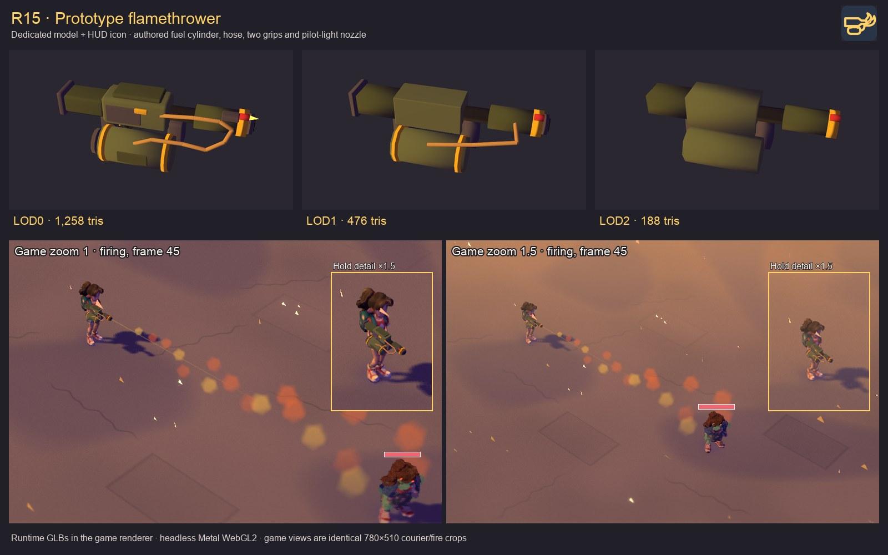

# R15 · Flamethrower model and icon

The L10 hangar prototype now uses its own Blender model (`wpn.flamethrower`) and HUD icon (`icon.flamethrower`). The olive military prototype has an under-barrel fuel cylinder, yellow safety bands, routed brass fuel hose, two grips, burner shroud, and a small emissive pilot flame. Its palette, bevels and held scale follow the machine-gun/rocket-launcher kit.



The 140 KiB sheet shows the three **shipped runtime GLBs**, followed by courier firing captures at game-camera zoom **1 and 1.5**. The firing panels use identical native-pixel crops; labelled insets show the earlier hold pose at 1.5× image scale. These are real game-renderer frames from one pooled headless Metal WebGL2 context. Full captures remain in `test-results/r15-flamer/`; [the capture receipt](evidence.json) records the camera positions, actual discharges, visible GLB attachments and zero console errors.

## Delivery and wiring

| Runtime tier | Triangles / cap | Draw calls | KiB |
| --- | ---: | ---: | ---: |
| LOD0 | 1,258 / 1,800 | 8 | 18.2 |
| LOD1 | 476 / 700 | 7 | 11.0 |
| LOD2 | 188 / 200 | 6 | 7.6 |

- Source: `assets/wpn.flamethrower/build.py`; raw authored tiers: `assets/wpn.flamethrower/model{,.lod1,.lod2}.glb`; compressed runtime tiers: `public/assets/models/wpn.flamethrower{,.lod1,.lod2}.glb`.
- The catalog's standard `gun('flamethrower', …)` mapping resolves the dedicated model/icon IDs. The new icon uses the weapon set's 64×64 tile, dark background, rounded gold 4 px strokes, fuel cylinder and flame silhouette.
- `grip`, `muzzle`, `flameOrigin` and `pilot_light` survive optimization at every LOD. The muzzle and flame origin are at the burner tip: local game-space `(0.645, 0.297, 0)` m. `ActionView.muzzle()` uses `flameOrigin` for this weapon, feeding the existing cover-clipped fire cone and muzzle light.
- The courier uses the existing long-gun IK at 0.65 scale, with the support palm 0.42 m forward of the rear grip in asset space. Both zooms measured grip/socket error below `3e-17` m and support-hand error below `7e-9` m. The ordinary wrist/palm offset remains 4.5 cm.
- Two independent headless Blender exports produced the same geometry hash. [Validation details](validation.json) record the hashes, named-node/dimension/material checks and error-free runtime tiers. Materials are palette-only; the tiny pilot emissive is decorative and adds no dynamic light.

## Validation

- Headless Blender 5.2.2 build and selected asset validation: **pass**.
- Runtime preview for all LODs, courier hold/fire at both zooms, icon render, actual attack events and 18 active fire particles per firing capture: **pass**; zero console errors or model placeholders.
- `npm run typecheck` and `npm run lint`: **pass**.
- `npm run verify -- E06`: **pass** — typecheck, lint and all **107/107 unit tests** (27 files). [Gate receipt](checks.json).
- [Asset vision review](../../../assets/wpn.flamethrower/review.md): **pass** against the requested military prototype and existing weapon-kit style.

## Reproduction

```sh
python3 tools/blender/run.py assets/wpn.flamethrower/build.py --lod 0 --glb assets/wpn.flamethrower/model.glb
python3 tools/blender/run.py assets/wpn.flamethrower/build.py --lod 1 --glb assets/wpn.flamethrower/model.lod1.glb
python3 tools/blender/run.py assets/wpn.flamethrower/build.py --lod 2 --glb assets/wpn.flamethrower/model.lod2.glb
npm run assets:build -- wpn.flamethrower
npm run assets:validate -- --ids wpn.flamethrower,icon.flamethrower
SCENE_PORT=4351 BROWSER_POOL_JOB_ID=r15-flamer sh tools/e2e-lock.sh node --import tsx tools/scenelab/r15-flamer.ts
python3 tools/scenelab/r15-flamer-sheet.py
npm run verify -- E06
```

No deployment or push was performed.
