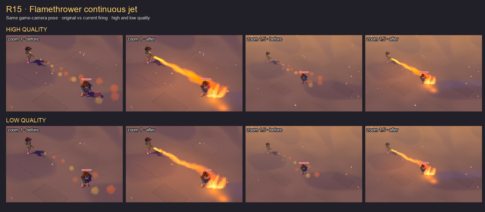

# R15 · Continuous flamethrower jet

## Done

The sparse orange spray is replaced by overlapping, flow-aligned flame billboards: 32 on high, 16 on low. They widen and rise toward the end, with a white-yellow nozzle core, orange body, red edges and soot. The nozzle follows the courier between attack events; the stream clips against cover and destructible geometry. Upright persistent-fire cards retain their existing shader.

Ground impacts create three-second fuel patches through the existing fire hazards. Nearby fire is refreshed, expired patch identities are recycled, and the shared live-fire cap remains enforced. The stream owns one removable, flickering E25 light at a point between courier and targets. Fuel patches use the existing ground glow without allocating additional transient lights. All flame/smoke/particle capacities remain unchanged.



The 99 KiB sheet compares **original firing against current firing**, at the same seed, frame 45, game camera, viewport and target position. Rows are high/low quality; each pair is zoom 1 or 1.5. Panels use identical 780×510 crops from 1280×720 captures, scaled to 385×252. Original code comes from the Git revision in [evidence.json](evidence.json), served by read-only Vite source overrides; no production debug switch is added.

Temporal samples at frames 46–80 retain an active stream on both tiers; frame 120 has no stream and retains the burning patch. Full captures, including sustained fire and release, remain in `test-results/r15-flamevfx/`.

## Native performance

One pooled headless native Metal WebGL2 Chrome context, exclusive pool admission, uncapped cadence, 180 warm frames, then at least 600 intervals and five seconds of sustained production input per row. Each measured window contains 15 actual discharges. Infinite fuel is enabled only for timing.

| Quality | Original p50 / p95 | Current p50 / p95 | Added p50 / p95 |
| --- | ---: | ---: | ---: |
| High | 2.9 / 3.6 ms | 3.5 / 4.3 ms | +0.6 / +0.7 ms |
| Low | 2.3 / 3.2 ms | 2.9 / 3.7 ms | +0.6 / +0.5 ms |

No foreign build, Blender, test or browser work was detected at sample boundaries. Admission passed the load gate; load during the browser's own measurement was 3.6–4.0 and is retained in the receipt. These are local isolated-scene costs, not whole-campaign performance claims. Frame-45 draw calls change from 55 to 59 on high and 48 to 52 on low; the added field/fire/glow passes and shared pools stay bounded. Console errors: zero.

## Open / Browser QA needed

- Browser QA needed: independent visual review and manual WebGPU look check are still useful before merge.
- Automated moving/turning and night-light checks pass. Across 65 successive moving/turning frames per tier the jet-to-drawn-nozzle gap is zero. Night checks observe exactly one transient source and changing uploaded light radiance. Frozen on/off body rectangles brighten by 3.5–5.2/255 mean luminance; [runtime receipt](runtime.json), [spill measurements](light-spill.json), and [night/motion sheet](runtime.jpg).
- The main matched captures/native timing receipt are being regenerated after the final render-phase attachment correction.
- `npm run verify -- E27` passes: typecheck, lint and all 107 tests in 27 files. The fuel checks extend the existing weapons battery, retaining the 150-case repository budget. [Gate receipt](checks.json).

No deploy or push has been performed.

## Reproduction

```sh
SCENE_PORT=4351 BROWSER_POOL_JOB_ID=r15-flamevfx sh tools/perf/quiet-run.sh node --import tsx tools/scenelab/r15-flamevfx.ts
python3 tools/scenelab/r15-flamevfx-sheet.py
npm run verify -- E27
```

The browser command is capped by the shared pool at ten minutes and uses private ports 4351/4352. Native timing and browser captures run before static/unit gates so test/build work does not overlap timing.

Supplementary runtime reproduction: `SCENE_PORT=4351 BROWSER_POOL_JOB_ID=r15-flamevfx sh tools/e2e-lock.sh node --import tsx tools/scenelab/r15-flamevfx-runtime.ts`, then regenerate the sheets.
