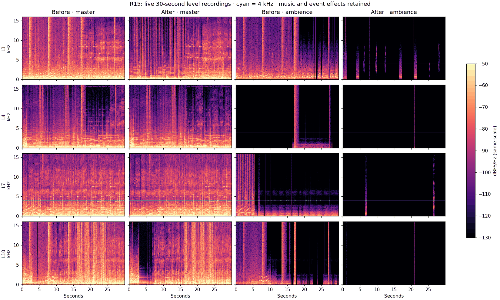
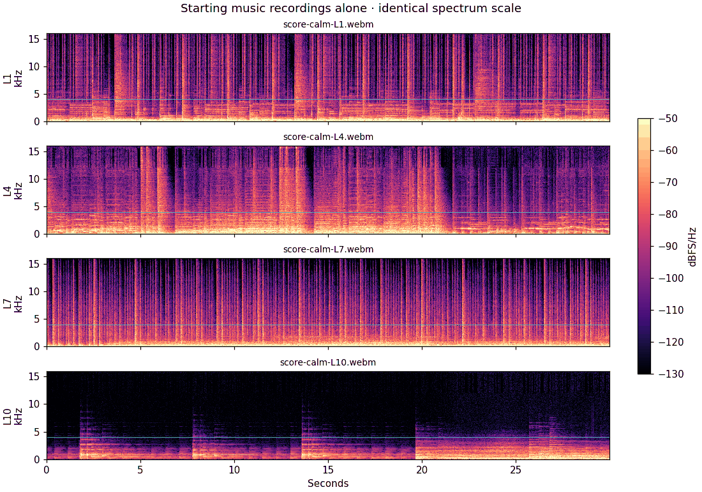

# R15 · background hiss removed

The recurring “pfffft” was added by the game: `weather.gust` played a generic,
non-positional noise burst every **3–7 seconds**, at full cue gain even in clear
weather. The L10 baseline recorded five such bursts in 30 seconds. Other randomly
scheduled scenery placeholders synthesized the same decaying random-noise shape.
Continuous ambience, rain, horde and chatter beds supplied an additional noise
floor. These effects were independent of the current song.

`AudioGraph.play` now rejects those scenery puffs, all looping ambience cues, and
looping damaged-vehicle fire/sputter noise before allocating a voice or node. This
single playback rule covers all ten levels, every world tier, weather overrides,
and future callers of the existing cue IDs. Wind/weather physics still run. The
sprite cue table, offsets, encoded banks and score recordings are unchanged.
Recorded ambience one-shots and short action effects still play.

## Recordings and spectra



Each row is one real level: L1, L4, L7 and L10. All panels use the same colour scale
(−130 to −50 dBFS/Hz); cyan marks 4 kHz. The broad vertical curtains in the baseline
ambience panels are the unwanted noise bursts. They disappear after the fix;
short recorded vocal/animal events and music remain.

Eight **29.995-second** captures came directly from the live production Web Audio
graph at **48 kHz**, using seed 1, low quality and headless WebGL2 on ANGLE/Metal.
One pooled browser and one page ran sequentially. A ScriptProcessor recorder
captured five synchronized stereo taps: master after limiting, plus music,
ambience, SFX and voice before master gain. The physical output stayed silent.
The baseline served the current code with only the new playback guards removed;
it did not rebuild or alter any audio file.

The script walks during seconds 5–14 and introduces nearby threats during
seconds 16–25. L7/L10 use their existing enemies rather than exceeding actor caps.
L10 fires the handgun during that interval: **28 weapon reports before and 28
after**, plus 21 survivor footstep cues in each. All eight recordings have zero
missing-audio errors. After recordings contain zero accepted wind-puff or
continuous-ambience voices. The numerical records include capture hashes, tick
ranges, player positions, music decks and cue counts in
[capture-metrics.json](capture-metrics.json).

### Quiet music passages · 4–16 kHz

These are band RMS levels in the same matched half-second passages before and
after. Passages are outside the walking/firing interval, ranked by music-bus
energy, with quiet voice/SFX where available. This measures the mixed signal's
noise floor during quiet music; musical energy and permitted event tails are
still included. Exact window indices and selection are recorded in the JSON.

| Level | Master before | Master after | Reduction | Ambience before | Ambience after |
| --- | ---: | ---: | ---: | ---: | ---: |
| L1 | −41.32 dBFS | −48.73 dBFS | 7.42 dB | −52.46 dBFS | −69.16 dBFS |
| L4 | −41.37 dBFS | −43.13 dBFS | 1.76 dB | −54.83 dBFS | digital silence |
| L7 | −40.25 dBFS | −42.65 dBFS | 2.40 dB | −43.91 dBFS | digital silence |
| L10 | −46.36 dBFS | −58.64 dBFS | 12.29 dB | −55.19 dBFS | digital silence |

“Digital silence” means every recorded PCM sample in the selected ambience
passages was zero; JSON uses `null` for its logarithmic level. L1 retains short
recorded birds/traffic/voice events rather than a permanent ambience layer.

### Full 30-second per-bus RMS · dBFS, before → after

| Level | Master | Music | Ambience | SFX | Voice |
| --- | ---: | ---: | ---: | ---: | ---: |
| L1 | −16.3 → −17.4 | −25.4 → −25.4 | −31.8 → −55.6 | −60.0 → −60.3 | −38.8 → −39.0 |
| L4 | −19.8 → −20.3 | −36.6 → −36.6 | −50.0 → −80.9 | −29.6 → −30.3 | −36.9 → −36.9 |
| L7 | −15.8 → −16.0 | −23.8 → −23.7 | −36.3 → −56.5 | −41.6 → −41.1 | −35.3 → −35.2 |
| L10 | −17.7 → −18.4 | −34.1 → −34.8 | −36.2 → −70.7 | −32.8 → −33.3 | −31.7 → −31.9 |

These are independent live runs, so voice variation and exact music crossfade
positions differ slightly. The removed sounds and the ambience reduction are
also verified directly at cue admission, independently of that variation.

## Source music and other noise sources



All **50 streamed score files** (25 recordings × Opus/AAC) were decoded alone,
with hashes, rates, peaks, quiet-passage spectra and high-band flatness recorded
in [music-source-audit.json](music-source-audit.json). All **66 music sprite
slices** (33 × both codecs) were separately decoded and measured without counting
sprite padding as silence; see [music-sprite-audit.json](music-sprite-audit.json).
L10's isolated calm/combat recording measures about **−89.23 dBFS** in the
4–16 kHz band of its quietest music passages. Its source spectrum has no matching
full-band wind curtains. The recurring game-added signature therefore required
no denoising or re-encoding of the recordings. Percussion and other musical
high-frequency content remain intact.

The complete cue inventory and actual playback decision are in
[cue-source-audit.json](cue-source-audit.json). The audit covers:

| Source | Result |
| --- | --- |
| Wind gusts and generic scenery/radio noise puffs | Suppressed; no recurring synthetic puff under any song. |
| Wind/fire/hum/traffic/bird/moan, horde, L1 chatter/panic/hush, zoo and rain beds | All continuous ambience loops suppressed. Cue declarations preserved for sprite compatibility. |
| Damaged-vehicle fire and sputter noise loops | Suppressed; the filtered/pitched engine layers remain. |
| Gunfire, rocket flight, minigun spin, prop movement, thunder and story scare hits | Deliberate event effects retained. |
| Heartbeats and cure hymn | L10 heartbeat is a decaying 56 Hz double pulse, not a random-noise bed; cure hymn uses filtered musical oscillators. Low-HP cues remain state-bound. |
| Reverb IR | Noise is only a convolution impulse, not an independent source. The silence render below proves the graph emits no floor by itself. |
| Compressor/limiter/distortion | No bitcrusher or additional noise generator. Compressor only attenuated (largest observed reduction 2.03 dB). All live captures have zero full-scale clipped samples. Four-times resampled true peaks are recorded in the metrics; limiting was not changed. |
| Sample rates and codecs | Live context, captures and all streamed sources are 48 kHz. Both shipped codecs decode; the wind/puff signature is a separate runtime source. |

An additional native OfflineAudioContext check loaded the actual sprite banks and
attempted **all 41 suppressed cues together**. It produced **exactly zero PCM and
zero active voices**. Gunfire, runner telegraph, thunder, minigun and engine probes
all remained admitted and produced nonzero PCM. See [graph-check.json](graph-check.json).
This verifies the shared rule beyond the four representative level captures.

The PO's “no permanent noise beds” instruction supersedes the older E16 ambience
and horde-bed criteria. No specification or source music file was edited.

## Validation and reproduction

`npm run verify -- E16` passed: typecheck, lint, and **107 tests in 27 default-suite
files**. The audio admission regression extends the existing core service test,
so the global collection stays within its 150-case budget. The first gate attempt
caught that budget limit; it was fixed by extending the existing test, not raising
the limit. Native PCM checks and source decoding also passed. Final receipts are
in [validation.json](validation.json).

From the repository root, with FFmpeg and a Python environment containing NumPy,
SciPy, Matplotlib and Pillow:

```sh
sh tools/e2e-lock.sh npx tsx tools/audio/hiss-capture.ts before
sh tools/e2e-lock.sh npx tsx tools/audio/hiss-capture.ts after
SCENE_PORT=3351 sh tools/e2e-lock.sh npx tsx tools/audio/hiss-check.ts
python3 tools/audio/hiss-analyze.py
```

Captures use `/tmp/r15-hiss-audio` by default (`R15_RAW` overrides it). The raw WAVs
were deleted after analysis; only spectra, numerical summaries and source hashes
are retained. No deploy or push was performed.
