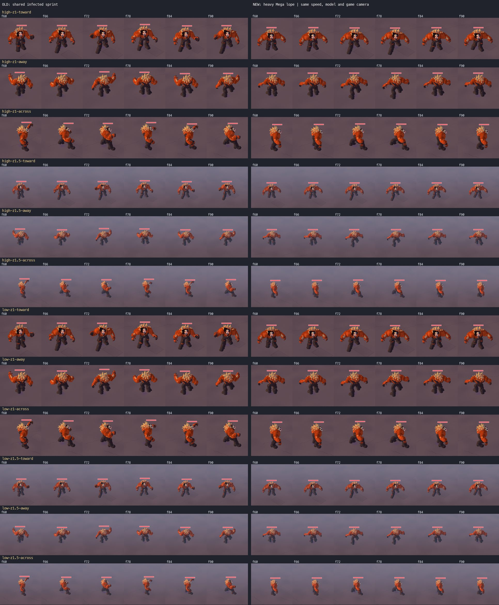

# R15 — Mega Alpha runs like a heavy predator

The Mega now carries its weight forward, takes longer low strides, plants its broad feet flat, and swings its arms low and wide. The existing infected sprint and lurch clips supply the motion; the model, all LOD meshes, and the slam/charge/throw animations are retained.

## Diagnosis

- **L10 clip:** `CrowdView.tierGait` selected `infected-sprint` because `MegaPursuit` sets the brain speed to 1.2 × the progression-adjusted player run speed (5.4 m/s without speed upgrades). The shared gait allowed 3 cycles/s: about 1.8 m per cycle at that speed. Its raised elbows, deep swing-knee flex and rapid repeated poses read like a human sprint enlarged onto the Mega.
- **Scripted chase:** L8 publishes its actual 11 m/s departure motion (and 14 m/s wall approach), while the underlying Alpha brain retains its ordinary 3.8 m/s speed. The old tier selector therefore chose the lurch by brain speed even during that fast translation. Mega locomotion now selects from actual ground motion.
- **Playback:** the old phase already followed travelled distance. There was no separate playback-rate multiplier to remove. L8 also incremented `mega.motion.distanceM` manually before `AgentMotion` published the same displacement during cleanup, doubling phase travel. Removing that duplicate publisher preserves the actual 11/14 m/s movement. Phase and foot placement now use the same stride calculation.
- **Foot sliding:** the Mega's broad, asymmetric shoes do not fit the generic short human heel/toe roll. Its right shoe extends roughly 0.27–1.06 m forward of its semantic ankle in local bind space. Generic ankle probes hid the problem. Measuring the authored shoe soles on both old and new renders exposes old contact-speed p95 ratios of **137–143%** of ground speed. Flat plants and per-foot sole fitting bring the new matrix to **1.32–1.75%**, below the requested 10% limit.
- **Bounce:** the human knee/contact solver and whole-body sole correction lifted the large body during the stride. The old sampled head-height span is **16.2–16.6 cm**. The new span is **0.19 cm**.

## Motion

The running cycle is 2.2 cycles/s (about 2.45 m per cycle at 5.4 m/s). Slow movement blends toward a 1.05 cycle/s stalk with a longer stance and the existing lurch clip. The torso pitches forward 28° while stalking and 32° while running. Upper-arm motion blends toward the model's rest carriage, retaining a small counter-swing and broad stance; elbows no longer fling the fists overhead. The hip remains at a low 1.15 m; sole fitting adjusts each leg rather than lifting the whole body. Actual rendered turn rate adds up to 11.5° of banking, including scripted actors without sim angular velocity.

Foot contact duration shortens at the fast scripted speeds to keep the support travel within the Mega's leg reach. Phase and both near/far foot solvers receive the same stride rate. These options are applied only to Mega locomotion. Attacks, special moves, knockdowns and deaths use their existing poses. No model, LOD, library clip, speed, health or pursuit logic was changed.

## Paired game-camera proof



`compare.jpg` is one 424 KB sheet: high/low × zoom 1/1.5 × toward/away/across, old on the left and new on the right. Every strip samples f60, f66, f72, f78, f84 and f90, a fixed 0.5 seconds of travel. The same seed-32 Mega appearance, 5.4 m/s pursuit, asphalt, viewport and production game-camera projection are used. Each cell is the same 400×400 viewport crop, reduced uniformly for the sheet; zoom 1 uses LOD0 and zoom 1.5 uses LOD1 on both quality tiers.

The baseline is commit `78219de9`, with only the read-only authored-sole diagnostics enabled identically for both versions. Captures run through the shared headless Metal/WebGL2 browser pool, one serial browser reservation at a time, each capped at 600 seconds. Raw frames and native traces are under `test-results/r15-megarun/`; compact measurements are in [evidence.json](evidence.json).

In the across strips the old f60/f78 raised fist, f66/f84 downward arm sweep, and f72/f90 forward fist repeat much faster than the body mass suggests. The new fists stay low throughout all six frames. In the toward and away strips, the old knees and shoulders alternately rise and drop; the new shoulders stay level while the feet reach forward and push back beneath them. The low tier retains that read at both zooms.

## Reproduction and checks

Capture the current version with:

```sh
E2E_UNITS=1 E2E_SERIAL=1 E2E_RESERVATION_SECONDS=600 SCENE_PORT=33971 \
  sh tools/e2e-lock.sh node --import tsx tools/qa/r15-megarun-capture.ts after
python3 tools/qa/r15-megarun-report.py
```

The `before` argument labels output; it does not restore baseline sources. Native foot-slide checks use the authored sole point that remains within 1.2 cm of the floor in consecutive 60 Hz frames, after the first 30 admission frames. They report sole horizontal speed / actual Mega ground speed at contact; p95 must be below 0.10, with at least 20 contact samples per view.

### Native motion checks

| Case | Sole-speed p95 / ground speed | Observation |
|---|---:|---|
| Required 12 running views, 5.4 m/s | 1.32–1.75% | 2.2 cycles/s; 32° torso pitch; sampled head bob 0.19 cm; maximum swing clearance 14.3 cm |
| Slow stalk, 1.2 m/s | 5.05% | Distinct 1.05 cycle/s lurch and longer planted stance |
| Progression pursuit, 6.48 m/s target | 1.69% | Real pursuit acceleration; 2.2 cycles/s |
| Scripted L8 departure, 11 m/s | 0.55% | Actual 11 m/s translation; 2.2 cycles/s |
| Scripted L8 wall approach, 14 m/s | 0.43% | Actual 14 m/s translation; 2.2 cycles/s; swing clearance below 16 cm |
| Turning pursuit | 2.40% | Heading changes 43.3° → 112.5° over one second; shoulder bank reaches 7.2° into the turn |
| Base Mega at LOD2, zoom 3 | 1.61% | Same low silhouette and contact solver at the far LOD |

The existing native charge, slam and grab/throw scenes each reach their active and recovery stages and pass their clipping checks. All 18 Mega model/LOD files (nine unique meshes across both quality tiers) and both baked clip libraries are byte-identical to the baseline; their SHA-256 values are in `evidence.json`.

### Validation

- `npm run verify -- E07`: passed (`typecheck`, `lint`, 27 unit-test files / 107 tests). `test:unit` aliases the same unit command.
- `npm run build:qa`: passed for the native captures and smoke run.
- `npm run build`: passed, including the public-build QA-hook exclusion check.
- WebGL2 smoke: 3/3 passed with `--workers=1`; the L8/L10 shader test passed on rerun after the fixture corrections below. The other two smoke tests passed on the initial run.
- Native proof: all 12 after views, six additional motion cases and three existing special-move scenes passed, with no console errors.

The QA run uses one headless Metal/WebGL2 browser; WebGPU remains a manual check under the repository guidance. Raw gate and smoke receipts are summarized in `evidence.json`.

The smoke selection was `--project=chromium --grep @smoke --grep-invert 'webgpu|WebGPU' --workers=1`, under `tools/e2e-lock.sh` with `E2E_UNITS=1`, `E2E_SERIAL=1` and `E2E_RESERVATION_SECONDS=600`. The corrected shader case was rerun alone with `--grep 'L1 handover.*@smoke'`.

The broader shader smoke uncovered two stale fixtures already incompatible with baseline mission rules: the isolated L8 boarding fixture omitted Hale's key/death prerequisites, and the L10 route used removed objective IDs plus the old pistol alias. The fixture now starts after Hale's handover/death, follows the authored L10 route and checks canonical handgun, shotgun, machine gun, rocket launcher and flamethrower grants. Each gun is explicitly equipped after the real mission grants so its held graph is exercised. Passenger seating, actual APC boarding, grant events, retained corpse pages and zero late shader builds remain asserted.

## Frame-by-frame review

`plant` means an authored sole point is within 1.2 cm of the floor. `+Ncm` is swing clearance; `H` is the rendered head-pivot height. Read H across a row to see bounce. Old rows have a 20.0–21.6° torso pitch; new rows hold 32°. Each cell describes the feet and body height in that exact image, including the matching low-quality views.

<!-- FRAME REVIEW -->

| View / version | f60 | f66 | f72 | f78 | f84 | f90 |
|---|---|---|---|---|---|---|
| high-z1-toward / before | L plant, R +11cm; H 1.835m | L +5cm, R +15cm; H 1.830m | L +14cm, R plant; H 1.823m | L +15cm, R plant; H 1.956m | L plant, R +15cm; H 1.793m | L +10cm, R +8cm; H 1.818m |
| high-z1-toward / after | L +5cm, R +4cm; H 1.648m | L plant, R +5cm; H 1.649m | L plant, R +5cm; H 1.649m | L +10cm, R plant; H 1.648m | L +5cm, R plant; H 1.650m | L +2cm, R +8cm; H 1.648m |
| high-z1-away / before | L plant, R +11cm; H 1.836m | L +5cm, R +16cm; H 1.830m | L +14cm, R plant; H 1.825m | L +16cm, R plant; H 1.956m | L plant, R +15cm; H 1.794m | L +10cm, R +8cm; H 1.817m |
| high-z1-away / after | L +5cm, R +4cm; H 1.648m | L plant, R +5cm; H 1.649m | L plant, R +5cm; H 1.649m | L +10cm, R plant; H 1.648m | L +5cm, R plant; H 1.650m | L +2cm, R +10cm; H 1.648m |
| high-z1-across / before | L plant, R +11cm; H 1.838m | L +5cm, R +16cm; H 1.830m | L +14cm, R plant; H 1.824m | L +15cm, R plant; H 1.956m | L plant, R +15cm; H 1.794m | L +10cm, R +8cm; H 1.818m |
| high-z1-across / after | L +5cm, R +4cm; H 1.648m | L plant, R +5cm; H 1.649m | L plant, R +5cm; H 1.649m | L +10cm, R plant; H 1.648m | L +5cm, R plant; H 1.650m | L +2cm, R +10cm; H 1.648m |
| high-z1.5-toward / before | L plant, R +11cm; H 1.834m | L +5cm, R +15cm; H 1.831m | L +14cm, R plant; H 1.824m | L +16cm, R plant; H 1.961m | L plant, R +15cm; H 1.794m | L +10cm, R +8cm; H 1.819m |
| high-z1.5-toward / after | L +5cm, R +4cm; H 1.649m | L plant, R +5cm; H 1.650m | L plant, R +5cm; H 1.650m | L +10cm, R plant; H 1.649m | L +5cm, R plant; H 1.651m | L +2cm, R +8cm; H 1.649m |
| high-z1.5-away / before | L plant, R +11cm; H 1.836m | L +5cm, R +16cm; H 1.831m | L +14cm, R plant; H 1.826m | L +16cm, R plant; H 1.960m | L plant, R +15cm; H 1.795m | L +10cm, R +8cm; H 1.818m |
| high-z1.5-away / after | L +5cm, R +4cm; H 1.649m | L plant, R +5cm; H 1.650m | L plant, R +5cm; H 1.650m | L +10cm, R plant; H 1.649m | L +5cm, R plant; H 1.651m | L +2cm, R +10cm; H 1.649m |
| high-z1.5-across / before | L plant, R +11cm; H 1.838m | L +5cm, R +16cm; H 1.831m | L +14cm, R plant; H 1.825m | L +16cm, R plant; H 1.961m | L plant, R +15cm; H 1.795m | L +10cm, R +8cm; H 1.818m |
| high-z1.5-across / after | L +5cm, R +4cm; H 1.649m | L plant, R +5cm; H 1.650m | L plant, R +5cm; H 1.650m | L +10cm, R plant; H 1.649m | L +5cm, R plant; H 1.651m | L +2cm, R +10cm; H 1.649m |
| low-z1-toward / before | L plant, R +11cm; H 1.835m | L +5cm, R +15cm; H 1.830m | L +14cm, R plant; H 1.823m | L +15cm, R plant; H 1.956m | L plant, R +15cm; H 1.793m | L +10cm, R +8cm; H 1.818m |
| low-z1-toward / after | L +5cm, R +4cm; H 1.648m | L plant, R +5cm; H 1.649m | L plant, R +5cm; H 1.649m | L +10cm, R plant; H 1.648m | L +5cm, R plant; H 1.650m | L +2cm, R +8cm; H 1.648m |
| low-z1-away / before | L plant, R +11cm; H 1.836m | L +5cm, R +16cm; H 1.830m | L +14cm, R plant; H 1.825m | L +16cm, R plant; H 1.956m | L plant, R +15cm; H 1.794m | L +10cm, R +8cm; H 1.817m |
| low-z1-away / after | L +5cm, R +4cm; H 1.648m | L plant, R +5cm; H 1.649m | L plant, R +5cm; H 1.649m | L +10cm, R plant; H 1.648m | L +5cm, R plant; H 1.650m | L +2cm, R +10cm; H 1.648m |
| low-z1-across / before | L plant, R +11cm; H 1.838m | L +5cm, R +16cm; H 1.830m | L +14cm, R plant; H 1.824m | L +15cm, R plant; H 1.956m | L plant, R +15cm; H 1.794m | L +10cm, R +8cm; H 1.818m |
| low-z1-across / after | L +5cm, R +4cm; H 1.648m | L plant, R +5cm; H 1.649m | L plant, R +5cm; H 1.649m | L +10cm, R plant; H 1.648m | L +5cm, R plant; H 1.650m | L +2cm, R +10cm; H 1.648m |
| low-z1.5-toward / before | L plant, R +11cm; H 1.834m | L +5cm, R +15cm; H 1.831m | L +14cm, R plant; H 1.824m | L +16cm, R plant; H 1.961m | L plant, R +15cm; H 1.794m | L +10cm, R +8cm; H 1.819m |
| low-z1.5-toward / after | L +5cm, R +4cm; H 1.649m | L plant, R +5cm; H 1.650m | L plant, R +5cm; H 1.650m | L +10cm, R plant; H 1.649m | L +5cm, R plant; H 1.651m | L +2cm, R +8cm; H 1.649m |
| low-z1.5-away / before | L plant, R +11cm; H 1.836m | L +5cm, R +16cm; H 1.831m | L +14cm, R plant; H 1.826m | L +16cm, R plant; H 1.960m | L plant, R +15cm; H 1.795m | L +10cm, R +8cm; H 1.818m |
| low-z1.5-away / after | L +5cm, R +4cm; H 1.649m | L plant, R +5cm; H 1.650m | L plant, R +5cm; H 1.650m | L +10cm, R plant; H 1.649m | L +5cm, R plant; H 1.651m | L +2cm, R +10cm; H 1.649m |
| low-z1.5-across / before | L plant, R +11cm; H 1.838m | L +5cm, R +16cm; H 1.831m | L +14cm, R plant; H 1.825m | L +16cm, R plant; H 1.961m | L plant, R +15cm; H 1.795m | L +10cm, R +8cm; H 1.818m |
| low-z1.5-across / after | L +5cm, R +4cm; H 1.649m | L plant, R +5cm; H 1.650m | L plant, R +5cm; H 1.650m | L +10cm, R plant; H 1.649m | L +5cm, R plant; H 1.651m | L +2cm, R +10cm; H 1.649m |
