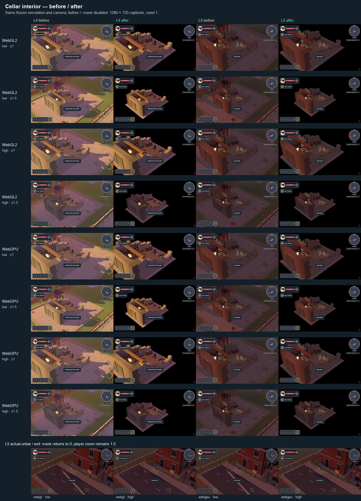

# r21-cellar — only the lit interior

The L4 cellar ending and L5 cellar opening now show Kessler’s cellar against black. The mask follows the cellar placement’s authored world bounds rather than the player or a screen circle, so moving inside the room and changing zoom preserve the complete interior. A 0.18 m feather softens the footprint edge. The existing lighting, roof cutaway, camera, HUD, mission timing, and threat definitions are retained.

The mask eases in after L4’s normal cellar descent and remains through its ending. L5 loads with the mask already settled, then eases it out during the existing exit transition. The exterior explosion/lightning flash overlay also fades out while inside; otherwise it brightened the black surround. Only L4/L5 compile the extra mask arithmetic. The implementation reuses the existing PostFx composite and WetReflections’ depth reconstruction; the existing roof cutaway has no district blackout mechanism.

## Browser evidence

One native headless Metal browser from the shared browser pool, with sequential contexts and short reservations. Each source image is 1280 × 720, seed 1. The first four rows are WebGL2; the next four are WebGPU. Columns are L4 before/after, then L5 before/after. The bottom row shows L5’s actual unbar/exit on each backend and tier.

“Before” is the same frozen scene with the presentation blend disabled; “after” enables it. All 16 pairs have identical simulation hashes, camera snapshots, HUD hashes, and threat counts. L4 starts from the existing `line-break` checkpoint prefix, then enters through the normal interact action. L5 uses its normal start and later performs the real unbar interaction. World labels are allowed to settle before capture. No actors are removed to create the images.

Receipts: [summary](visual-summary.json), [WebGL2](webgl.json), [WebGPU](webgpu.json). Full source frames are under `test-results/r21-cellar/{webgl,webgpu}/`. Run `npm run build:qa`, serve `dist` with Vite preview on an unused port (the capture used 4986), then run `BROWSER_POOL_JOB_ID=r21-cellar node --import tsx tools/qa/r21-cellar-capture.mjs webgl` and the same command with `webgpu`. `CELLAR_ORIGIN` overrides the default `http://127.0.0.1:4986`.

## Review

| Requirement | Result |
| --- | --- |
| Only the cellar footprint remains visible | PASS — all 16 final views hide the yard, street, houses, fence, and exterior particles; every sampled 80 × 80 exterior patch is exactly RGB 0,0,0, including L4’s active flash. |
| Lit, readable interior | PASS — the bulb, shelves, barrels, floor, courier, corgi, and objective remain readable on both tiers and backends. |
| Zoom 1 and 1.5 | PASS — the boundary follows depth-reconstructed world position; the sheet shows the full matrix without a framing change. |
| HUD and camera | PASS — paired HUD content hashes and complete camera snapshots are identical; the portrait, health, corgi status, objective, minimap, and slots remain visible. |
| Smooth transitions | PASS — 50 ms render samples rise monotonically from 0 to 0.982 in 0.5 s and fall to 0 within 1 s. All four real L5 exits return the mask to 0 and retain zoom 1.5. |
| Console/runtime errors | PASS — zero console errors and zero page errors in both backend runs. |

Threat counts in the frozen comparison fixtures are unchanged before/after on both backends and both zooms:

| Fixture | Low: director slots / visible living infected | High: director slots / visible living infected |
| --- | --- | --- |
| L4, 45 ticks after line-break setup and native cellar entry | 40 / 40 → 40 / 40 | 63 / 62 → 63 / 62 |
| L5 normal start, tick 0 | 100 / 100 → 100 / 100 | 150 / 150 → 150 / 150 |

The [scope audit](scope-audit.json) also confirms that all 684 tracked files in simulation, level data, level assembly, district layouts, and the camera implementation match baseline `d79e1594`; there are no new files in those paths. No specs or assets changed.

## Repository checks

- `npm run build:qa` and `git diff --check`: passed.
- E22/E23 per-change gates and smoke: results recorded in `checks.json` after completion.

The owned preview server has been stopped and all r21-cellar browser reservations released. No deploy or push.
