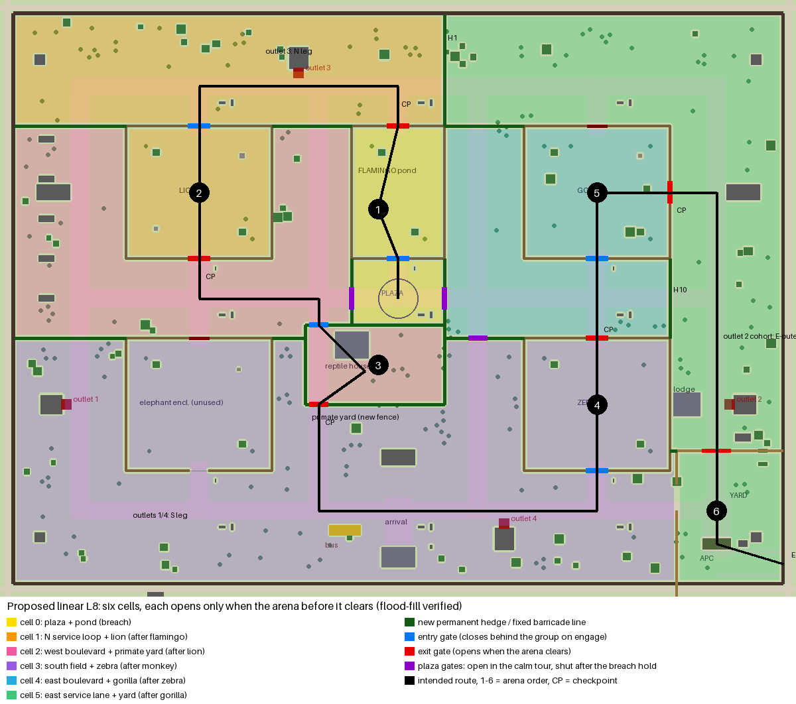

# r32-l8route-plan: a linear route through the L8 zoo (design plan, no game code)

PO, 2026-11-10 UAT on PROD (verbatim): "The L8 needs a clear path the user has to move, not just free 'find your way' bc then the user can just walk away from all animals. The level design needs improvement."
PO, 2026-11-09: "every arena blocks the route until its boss falls".

This lane only plans. Nothing in `src/`, `layouts/` or the data changed. The only code added is two diagnostic tools: `tools/qa/diag/r32-l8trace.ts` (traces the bot's route) and `tools/qa/diag/r32-l8route-map.py` (draws the map and runs the flood fill).

## 1. What the zoo is today (map + bot trace)

The map is built from the shipped `public/assets/layouts/D-ZOO.layout.json` (all 523 colliders, path surfaces, anchors) plus the runtime L8 blockers in `src/data/l8Bosses.ts` (yard walls and gates, keeper gates, APC, bus). A flood fill on a 0.25 m grid, with blockers grown by the 0.4 m courier radius, measures where the courier can walk. The bot's route comes from a native run of `LevelEightBot('complete')`, seed 1, `L8-default`: it finished in 600 s.

Map of today (scratchpad, not committed): `/private/tmp/claude-501/-Users-wesner-Workspace-minorincident/80ad2360-311d-4d06-a844-c0ced149d4ee/scratchpad/r32-l8route/current-small.png`

What the map and the trace show:

- **The whole zoo is one open area.** After the breach hold, with no fight running, the courier can reach **35.8k m²**. That is the full inside of the perimeter except the locked vehicle yard. The 5 enclosures are islands of fence on lawn. A 7×3 grid of paths (rows z = −64 / 0 / 64, columns x = −96 / −24 / 24 / 96) and plain lawn connect everything to everything. Nothing between the arenas holds the player.
- **Only two things gate progress.** First, the keeper "far" gates (`l8EncounterGates`) close only while a fight is running (phase 1–2, all victims turned). Second, the yard gates hold the APC until five arenas are cleared. An arena that has not started yet blocks nothing. A player can walk past every animal and wait at the yard fence. During a fight the authored entry stays open, so the player can leave the enclosure and the fight with it.
- **The arena order zig-zags across the map.** The order is set by the array order in `l8BossArenas`: flamingo (centre north) → zebra (south-east) → monkey (centre, next to the plaza) → lion (north-west) → gorilla (north-east) → elephant (yard, south-east). In the bot trace these engage at t = 86 / 160 / 220 / 316 / 398 / 487 s. Between fights it walked from the zebra paddock back past the plaza to the monkey house, across to the lion, then **120 m back east** to the gorilla: 884 m in total after the first engagement. A human gets no route to read from this. The marker simply jumps to the next disc.
- **The flamingo engages from the plaza.** Its entry (0, −9) is 9 m from the plaza centre, and the engage ring is 12 m. The bot engaged it at t = 86 s while still standing in the plaza during the "Protect the group!" hold. The monkey disc (centre (−5, 15), radius 13) also reaches within 2 m of the plaza ring. Two arenas sit almost on top of the rest point.
- **The elephant enclosure (−60, 32) has no arena.** The elephant boss lives in the yard. The paddock is an empty detour (the "idle turned elephant" finding belongs to another lane).

## 2. The plan

### 2.1 Order and route

**Arena order: flamingo → lion → monkey → zebra → gorilla → elephant.** The route goes **through** each enclosure: in by one keeper gate, out by the other. Every enclosure already has a 6 m gate on its north and south fences, and today's "far" keeper gate already sits on the side you leave by. The plan turns each enclosure into the only door between two parts of the zoo.

| # | Arena | In (entry, closes behind the group on engage) | Out (exit, opens when the arena clears) | Leg to the next arena (walk) |
|---|---|---|---|---|
| 0 | Plaza (rest + breach) | — | flamingo S gate (0, −12) | 12 m |
| 1 | Flamingo pond | S gate (0, −12) | N gate (0, −52) | north service path west to the lion N gate (−60, −52): 84 m. Outlet 3 (−30, −68) is on this leg. |
| 2 | Lion + lioness (rocks) | N gate (−60, −52) | S gate (−60, −12) | west boulevard (z = 0) east to the primate-yard NW gate (−24, 8): 56 m |
| 3 | Monkey pack (reptile house) | new primate-yard NW gate (−24, 8) | new primate-yard SW gate (−24, 32) | south across the arrival field, past the bus, to the zebra S gate (60, 52): ~128 m. Outlets 4 (32, 68) and 1 (−100, 32) are on this leg. |
| 4 | Zebra herd (paddock) | S gate (60, 52) | N gate (60, 12) | across the east boulevard (z = 0) to the gorilla S gate (60, −12): 24 m |
| 5 | Gorilla | S gate (60, −12) | **new E gate (82, −32)** | east service lane (x = 96) south to the yard N gate (96, 46): 92 m. Outlet 2 (100, 32) is on this leg. |
| 6 | Elephant (vehicle yard, APC) | yard N gate (96, 46) | drive-out east gate (116, 80) | — |

The walk legs total ~384 m, against ~143 s of transit between fights in today's bot run. At group pace (~4 m/s) the legs take ~95 s, so the level is no longer than today. The full centreline from the plaza to the east gate is 646 m.

Why this order:

- **The geometry allows only this order without backtracking.** The plaza sits in the middle, the pond is north of it, the lion and gorilla are north-west and north-east, and the zebra and yard are south-east. The story-script order (flamingo, zebra, monkey, lion, gorilla) cannot be walked as one line: zebra → monkey → lion → gorilla crosses the plaza twice and the zoo once. Mirroring the route (flamingo → gorilla …) would put the gorilla second.
- **The story beats still hold.** The flamingo stays the first, short tutorial at the pond where the keeper is pulled down (beat 2), and the elephant stays the finale at the APC (beat 4). The gorilla stays the last arena before the yard. What changes: the **lion moves from 4th to 2nd** and the **zebra from 2nd to 4th**. Spacing alternates small and big fights (flock / pair / pack / herd / single brute), and each fight is followed by a 24–128 m walk with background infected.
- **The lion line can land where the lion is.** "Nadia (at the lion)" plays when the group first sees the lion. The real lion fight now comes second, right after the north service path, so the payoff is close (the "lion line plays at the plaza" fix is another lane).
- **Needs PO OK:** `docs/design/story-script.md` beat 3 and the arena table in `boss-and-alpha-moves.md` list the old order (# column). Update both docs when the PO confirms.

Alternative if the PO wants the documented order kept: swap the **habitats** (put the lion in the south-east paddock and the zebra in the north-west rocks). That means redressing two enclosures (rocks, habitats QA in `tools/qa/l8-habitats.ts`, `look-l8-habitats-*` scenes) and is much more work. Not recommended.

### 2.2 Cells: what closes each bypass

The route splits the zoo into six cells. Each cell opens only when the arena before it clears. The flood fill in `tools/qa/diag/r32-l8route-map.py` checks this against the real colliders plus the barriers below (`plan-cells.json`):

| State | New area | Next arena reachable | Any later arena reachable | Yard reachable |
|---|---|---|---|---|
| breach hold over | 1,434 m² (plaza + pond) | flamingo yes | no | no |
| flamingo cleared | +5,498 m² (north path + lion) | lion yes | no | no |
| lion cleared | +4,871 m² (west boulevard + primate yard) | monkey yes | no | no |
| monkey cleared | +12,337 m² (south/arrival field + zebra) | zebra yes | no | no |
| zebra cleared | +3,873 m² (east boulevard + gorilla) | gorilla yes | no | no |
| gorilla cleared | +7,047 m² (east lane + yard) | elephant yes | — | yes |

**Permanent barriers** (built in `layouts/D-ZOO/layout.py`, present from level start). On lawn they are `prop.hedge` lines (2.53 m modules, 1.56 m tall, static collider, already used in D-ZOO). Where a line crosses a paved path they are **fixed** `prop.jersey-barrier` + `decay.makeshift-barricade` ("army sanctuary checkpoint": soldiers sealed the sectors). All are in metres, x/z as in the layout:

| ID | Line | Closes | Path crossing (barricade, not hedge) |
|---|---|---|---|
| H1 | x = 14, z −85.6 … −52 | north service path: the west half (cell 1) from the east half (cell 5) | z = −64 row |
| H2 | z = −52, x −38 … −14 | lawn between lion and pond: north path ↔ west boulevard | x = −24 path |
| H3 | z = −52, x 14 … 38 | lawn between pond and gorilla: north path ↔ east boulevard | x = 24 path |
| H4 | z = −52, x −115.6 … −82 | west outer lawn: north path ↔ west boulevard | x = −96 path |
| H5 | z = 12, x −115.6 … −82 | west outer lawn: west boulevard ↔ south field | x = −96 path |
| H6 | z = 12, x −38 … −28 | west boulevard ↔ south field (beside the primate yard) | — |
| H7 | z = 12, x 14 … 21.5 and 26.5 … 38 | east boulevard ↔ south field (gate G-S in between) | — (gate on the x = 24 path) |
| H8 | x = −14, z −12 … −3 and 3 … 8 | plaza ↔ west boulevard (gate G-W in between) | — |
| H9 | x = 14, z −12 … −3 and 3 … 12 | plaza ↔ east boulevard (gate G-E in between) | — |
| H10 | x = 82, z −12 … 12 | east boulevard ↔ east service lane (joins the gorilla and zebra east fences into one line) | z = 0 row |
| H11 | z = 46, x 82 … 84 | the 2 m slot between the zebra fence and the yard W wall | — |
| PY | new primate-yard fence around the reptile house, x −28 … 14, z 8 … 32 (`prop.crowd-fence`, `fixed`), 5 m gates at x −26.5 … −21.5 on the N and S sides | turns the monkey fight into a real compound on the x = −24 path, and keeps the plaza out of it | the x = −24 path runs through it |
| L1 | elephant paddock N gate (−60, 12): permanently closed keeper gate | west boulevard ↔ south field through the empty paddock | — |
| L2 | gorilla N gate (60, −52): permanently closed keeper gate | east service lane ↔ gorilla (the exit becomes the new E gate) | — |
| E-gate | 6 m opening in the gorilla **east** fence, z −35 … −29 at x = 82, plus a 5 m path to the x = 96 path | gorilla exit | — |

Every crowd-fence panel that forms a cell wall must be **`fixed: true`**, i.e. all panels of the five enclosures (`fence()` in `layout.py` today fixes only the zebra service corner). The panels are `pushable` 22 kg props. An unfixed panel is a door that the player, a zebra stampede or an elephant charge can open.

Sizes: about 236 m of hedge/barricade lines (~94 hedge modules, plus 6 path barricades of 2–3 jersey barriers each) and ~122 m of new crowd fence (~51 modules). All are instanced families already loaded for D-ZOO. Collider count rises by ~150 (523 today).

**Runtime gates** (sim barriers through `SolidGeometry.setBarrier` + `world.blocker.changed` nav events, drawn by `src/render/L8Gates.ts` the way the keeper gates are today):

| Gate | Box | Open | Closed |
|---|---|---|---|
| G-W plaza west (−14, 0) | halfX .25, halfZ 3 | calm tour | from the end of the breach hold (see below) to the end of the level |
| G-E plaza east (14, 0) | halfX .25, halfZ 3 | calm tour | same |
| G-S boulevard south (24, 12) | halfX 2.5, halfZ .25 | calm tour (Nadia walks the x = 24 path north) | same |
| entry gate of arena *n* | the 6 m gate on the "in" side (table 2.1) | from the clear of arena *n−1* | from engage until the clear of arena *n* (re-opens on fail/restore) |
| exit gate of arena *n* | the 6 m gate on the "out" side | after arena *n* clears | until then |
| yard N gate (96, 46) | existing `l8YardGates[1]` | after the gorilla clears | — |
| yard W gate (84, 60) | existing `l8YardGates[0]` | stays closed until departure: the yard has one way in | — |

The plaza gates close **only once the courier and every living follower are inside the plaza cell** (x −14 … 14, z −12 … 8) after the 30 s hold. Before that, the marker reads "Back to the plaza". A player who wandered off during the calm minute must never be locked out. Infected inside the cell are left to the fight; infected outside stay outside as background pressure for the later legs.

### 2.3 Engage, leave and walk-away rules (sim)

- **Engage on entering the enclosure, not near a point.** Use the layout zones `enclosure-<species>` (already exported: lion, flamingo, gorilla, zebra) plus a new zone `enclosure-monkey` (the primate yard). Engage = courier inside the zone, previous arena cleared, not `protecting()`. This also fixes the flamingo engaging from the plaza. The 12 m `entry` ring and the `centre < radius × .75` fallback in `L8BossArenas.update` go away for these five.
- **The entry gate closes behind the group.** It closes when the courier is ≥ 6 m inside and every living follower has crossed the gate line, or after 8 s if no follower is within 3 m of the line (never on a follower). A slammed keeper gate is the readable "arena" moment, and walking away mid-fight is impossible by construction. Today's follower rule (the group holds on the courier's flank inside the arena, `LevelEightZoo.follower`) stays. The group is inside with the courier, as it is today.
- **Fail.** The courier downed → restore checkpoint `arena-<id>` taken at engage, **before** the gate closes, so the restore has the gate open and the arena in phase 0.
- **Leash.** The animals stay leashed to their enclosure (today's arena radius). With the entry closed they can no longer be pulled out onto the paths.

### 2.4 The group through the gates

The group uses the shared follower formation (`formationSlot`) and the nav graph, which already learns about every barrier from `world.blocker.changed`. Gates are 5–6 m wide, so the column passes 2–3 abreast. Two additions:

- At every gate the courier passes, the followers get a **gate waypoint**: an anchor 3 m before and 3 m after the gate on the route, in `l8Route` (below). This avoids corner-hugging against the fence end posts.
- **No exit gate opens with followers still in the previous cell.** This cannot happen: the exit opens when the arena clears, and the group is inside the arena.

### 2.5 Objective marker and HUD

The escape step today sets the text "Defeat ⟨arena⟩ — ⟨counter⟩" and the marker on `arena-<id>`. The plan adds a route list in `src/data/l8Bosses.ts`. The marker always points at the next **route node**, never across a fence:

| Courier is … | Marker | HUD text |
|---|---|---|
| in the plaza after the hold | flamingo S gate (0, −12) | "Through the flamingo pond — the keepers opened the gate" |
| in the pond, flamingos engaged | — (fight) | "Defeat the Flamingo flock — ⟨counter⟩" (existing) |
| pond cleared | N gate (0, −52) → lion N gate (−60, −52) | "Take the service path to the lion rocks" |
| lion cleared | lion S gate → primate-yard NW gate (−24, 8) | "Through the primate yard" |
| monkey cleared | primate SW gate (−24, 32) → zebra S gate (60, 52) | "Cross the visitor field to the zebra paddock" |
| zebra cleared | zebra N gate → gorilla S gate (60, −12) | "Into the gorilla house" |
| gorilla cleared | gorilla E gate (82, −32) → yard N gate (96, 46) | "Down the service lane to the armored vehicle" |
| yard | existing elephant / boarding texts | existing |

The marker advances when the courier is within 4 m of a node (monotonic, the same method as the bot's `escapeLeg`). The minimap shows the next 2 nodes as a dotted line. After an arena clears, play one short keeper line (Nadia if alive, else a soldier): "North gate's open — go!" (new dialogue keys `L8.route-<id>`).

### 2.6 Checkpoints

The existing checkpoints stay: `sanctuary`, `breach`, `arena-<id>` at engage, and `escape-route`. Their `entry` anchor positions move to the new "in" side: lion (−60, −56), monkey (−24, 4), zebra (60, 56). Flamingo (0, −9) and gorilla (60, −8) stay. New: **`cleared-<id>` at the exit gate when it opens.** Today, dying on a walk leg restores the previous arena's engage checkpoint and replays a won fight. With six fights in a line, that becomes a real frustration. `MissionDef.checkpoints` in `src/levels/L8/mission.ts` gets the five new ids.

### 2.7 Files to change (for the build lane)

| File | Change |
|---|---|
| `layouts/D-ZOO/layout.py` | Hedge lines H1–H11 + path barricades (fixed). `fence()`: `fixed = True` for all enclosure panels. Gorilla east-fence opening + 5 m path stub to x = 96. Primate-yard fence + zone `enclosure-monkey` + gate anchors. Route node anchors `l8-route-<n>`. Re-export via the usual Blender layout build (`D-ZOO.layout.json`, `.base.glb`, `.w1–w5.glb`), then `tools/assets/compact-zoo-delivery.py`. Check `zoo_put` dressing: trees/flowers must not land on the new lines (it skips taken footprints; the new lines must be added before the dressing pass). |
| `src/data/l8Bosses.ts` | Array order `flamingo, lion, monkey, zebra, gorilla, elephant`. New `entry` points as in 2.6. Monkey centre (−6, 20), radius 12. Replace `l8EncounterGates` with `l8Route`: per arena `{ id, zone, entryGate, exitGate, nodes[], text }` plus `l8PlazaGates` (G-W/G-E/G-S). |
| `src/sim/missions/L8BossArenas.ts` | `updateGates()`: entry/exit/plaza gate states as in 2.2 (barrier ids stay `l8.arena-gate.*`, new `l8.plaza-gate.*`, nav ids 9008xx). Engage on zone. Close-behind rule. Emit `arena-<id>-cleared` before opening the exit, and take `cleared-<id>` there. |
| `src/sim/missions/LevelEightZoo.ts` | Marker/text from `l8Route` (2.5). Plaza gate close condition (2.2). Follower gate waypoints (2.4). Outlet cohorts after the breach: spawn only from outlets connected to the courier's current cell (outlet 3 → cell 1, outlets 1/4 → cell 3, outlet 2 → cell 5). The outlet-3 service route `[[-24,-64],[0,-56],[0,-44],…]` walks through the pond's N gate and must end at the pond N gate side once that gate is closed. |
| `src/render/L8Gates.ts` | Draw plaza gates and entry gates. Today it hides an arena gate in phase 0. Entry gates must show closed from engage, exit gates closed until cleared. |
| `src/levels/L8/mission.ts` | Checkpoint ids `cleared-*`. |
| `src/debug/bot/LevelEightBot.ts`, `L8ArenaBot.ts` | Walk `l8Route` nodes instead of the `road` shortcut `[(26,8),(26,60),(88,60)]` (that boulevard is now closed). `L8ArenaBot` targets the zone interior, not `def.entry`. |
| `tools/qa/l8-route-gates.ts` | Extend the runner proof: from each cell, the runner policy must not reach any later arena centre or the yard while the current arena is unbeaten (same check as the flood fill, but with real movement and props). |
| `src/data/dialogue.ts` | `L8.route-*` lines (2.5). |
| `docs/design/story-script.md`, `docs/design/boss-and-alpha-moves.md`, `docs/qa/level-acceptance.md` | New order. L8-07 ("≥ 2 escape paths ≥ 2.5 m wide from each enclosure") conflicts with the closed-behind entry and needs a PO rewording: "two gates per enclosure, one open outside a fight". |

Split for building: **lane A** layout (hedges, fixed fences, primate yard, gorilla E gate, anchors; needs Blender) and **lane B** sim/data/bot/HUD (on top of lane A's layout JSON). They are sequential, because B's tests need A's colliders.

## 3. Risks

- **Conflicts with tonight's lanes.** `src/data/l8Bosses.ts` is touched by the "too tanky" lane (hp values on the same array lines as this plan's order and entry changes). `LevelEightZoo.ts` is touched by the Nadia, plaza-ring and lion-line lanes. `L8BossArenas.ts` and the move render are touched by the animal-attack lane. The elephant idle lane may touch the elephant paddock. **Build this plan after those lanes merge**, rebased on that main. The order change must keep their hp/AI changes.
- **Bot routes.** `LevelEightBot`'s escape `road` and `L8ArenaBot`'s entry-then-centre walk are both wrong for the new layout. The single-seed complete-bot pass (the level's "can it be finished" check) fails until lane B updates both. Walker nav must route through 5–6 m gates. One run with `tools/qa/diag/r32-l8trace.ts` gives the new trace.
- **Followers through gates and the close-behind rule.** This is the most fragile part: a straggler outside a closed gate is separated for a whole fight. The close rule waits on followers, never on time alone, and the plaza gates wait for everyone. Needs a sim test per gate, e.g. "all living followers inside the zone within 10 s of engage, the gate closes, none is left in the previous cell".
- **Infected pathing.** Cohorts that spawn in a sealed cell queue at barriers ("alive but harmless", lessons 11-01). The per-cell outlet rule fixes this, and `npm run qa:threat` must stay green per phase. Expect the breach wave to need a check: during the 30 s hold all plaza gates are still open, so today's breach wave reaches the plaza unchanged.
- **Elephant entrance.** `L8BossArenas` relocates the elephant to (89, 42) on engage. That point is on the new east-lane approach the courier walks down. It must stay off-frame (lessons 10-27 Mega relocation rule): either engage after the courier is ≥ 8 m inside the yard N gate so (89, 42) is behind the camera, or stage the elephant inside the closed lodge compound.
- **Saves and fixtures.** `tests/fixtures/saves/qa`: `l8-before-lion` now means "flamingo cleared", and it sits 30 m from the old entry (−60, −8). That point is in the west-boulevard cell, so the fixture must be regenerated with the courier on the north path (`tools/qa/make-checkpoint.ts`). `l8-before-gorilla` (four cleared) and `l8-before-elephant` keep their cleared sets but need new courier positions. `l8-elephant-apc-yard-engaged` is unaffected. The arena state array order changes, and `routeOpen` uses array order, so old QA snapshots with the old order must be regenerated, not migrated. There are no player saves (L8 has no persisted mid-level save).
- **Tests and scenes that reference the old positions:** `tests/helpers/l8BossShoot.ts`, `tests/helpers/l8Story.ts`, `tests/engine/missions.test.ts`, `tests/engine/vehicles.test.ts`, `tools/qa/l8-route-gates.ts`, `tools/qa/accept/l8-policy-proof.ts`, `tools/qa/accept/fix55-l8-paths.ts`, the `tests/scenes/l8-district/*` path/walk scenes, `movement-l8-corgi-follow`, `qa-l9-q3-pair-zoo-departure`. The look-l8-habitats scenes are unaffected (habitats stay).
- **Perf.** ~150 new static colliders and ~150 instanced props, all from families D-ZOO already draws. Draw calls should not rise. The real number comes from the orchestrator's quiet-window perf run (perf pending). Nav: more barrier edges, so the nav rebuild on each `blocker.changed` must stay cheap. There are ≤ 13 gate toggles per run.
- **Calm-minute look and acceptance L8-02/03.** The hedge lines and closed paddock gates must not hide the five species from Nadia's tour (the tour stays on the open x = 24 path / z = 0 boulevard), and the "≥ 20 civilians … nobody idle" set must not end up behind a hedge. The sanctuary civilians' positions in `LevelEightZoo.prepare` need a check against the new cells.
- **Story order change** (lion 2nd, zebra 4th) needs PO confirmation (see 2.1).

## 4. Evidence and reruns

- Bot trace: `node --import tsx/esm tools/qa/diag/r32-l8trace.ts 1 <out.json> 900`, run under `tools/sim-lock.sh`, seed 1. Result: finished in 600 s. Engage ticks are in section 1.
- Maps and flood fill: `python3 tools/qa/diag/r32-l8route-map.py <worktree> <trace.json> <outdir>`, which writes `current*.png`, `plan*.png` and `plan-cells.json`. The barrier and gate coordinates in the script (`PERM`, `GATES`, `BREACH`) are exactly the tables in 2.2. The build lane can re-run the flood fill against its new layout JSON (drop the planned boxes that are then real colliders) as a cheap pre-check before the runner proof.
- No browser was used. The map is native, drawn from the exported layout, so it is exact for colliders and approximate for visuals.
