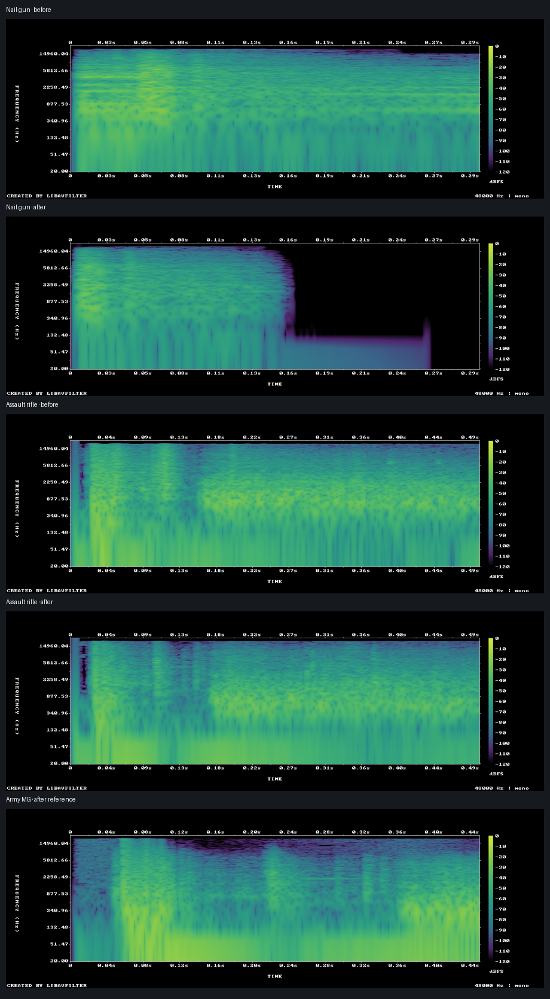

# s204 — nail gun and L10 assault-rifle audio

Date: 2026-11-20

## Research

- A field study of pneumatic nail guns identifies the piston impact/return and compressed-air exhaust as principal noise sources; the shot is a mechanical transient plus an air burst, not a sustained motor tone ([Lipping et al., *Identification of Noise Sources and Design of Noise Reduction Measures for a Pneumatic Nail Gun*](https://pmc.ncbi.nlm.nih.gov/articles/PMC4562896/)).
- That supports a short `ka-CHUNK`: pressure release, driver slap, material impact, and a brief exhaust tail. A tonal spin-up/down belongs to a cordless motorized nailer and was excluded from the usable shot.
- The licensed take is NinjaSharkStudios’ 48 kHz Freesound recording “Nail Gun Shoot and Wind Down,” CC0 ([source page](https://freesound.org/people/NinjaSharkStudios/sounds/712890/)); the original master is pinned by SHA-256 in `assets/audio/imports.json`.
- Rifle takes use the CC0 Free Firearm Sound Library, with its author and source recorded per file in the imports manifest and generated audio license table ([OpenGameArt source](https://opengameart.org/content/the-free-firearm-sound-library)).

## Findings and changes

### Nail gun

The old recipe started the 2.901 s recording at time zero and kept the first 300 ms. The main recorded strike peaks at about 54 ms, leaving a slow lead-in; the source title also describes a wind-down, and the old cut retained its resonant tail. All variants were shifted upward (0%, +0.625%, +1.25%, +1.875%) instead of spanning both sides of the original pitch. The old shipped slice measured **-22.4 LUFS**, about **9 LU louder** than the handgun at **-31.4 LUFS**. The before spectrogram shows a lingering narrow ridge around 1.6 kHz.

The updated takes start at 50 ms, close to the first recorded strike, preserve a broadband pneumatic/mechanical attack, and fade the tail by 150–180 ms. The four takes use original pitch and ±3% variants with different tails. Their slices remain 300 ms; the audible part ends by 180 ms. The 10%-to-peak attack in the shipped slice is **4 ms**. EBU R128 measurements from `tools/audio/weapon-loudness.ts` are **-31.8, -31.6, -32.0, -31.9 LUFS**, all within 0.6 LU of the handgun. In the after spectrogram, the resonant tail is cut off and no sustained tonal ridge remains.

The infected impact is a short soft/wet thud (Kenney `impactSoft_medium_002`); a prop/environment hit uses a light metallic tick (`impactMetal_light_000`). Both are CC0 and listed in the generated license table.

### L10 assault rifle (PO screenshot: `weapon.assault-rifle`)

The screenshot corresponds to the assault-rifle event, not the army-MG event. Before the change, its four takes were all cuts from one AK-47 file, passed through a **+26 dB soft clip**, and set to the general firearm level. The shipped cue measured **-26.6 LUFS** versus handgun **-31.4 LUFS** and army MG **-29.1 LUFS**. That made the rifle more than 2 LU louder than the MG and gave each automatic burst the same strongly pushed AK recording character.

It now uses four recorded semi/burst takes alternating between the Free Firearm Sound Library’s AR-15 and AK-47 recordings. It has no slow-down, bass boost, or pre-limiter boost. Per-take recipe levels put all four variants between the handgun and army MG: **-31.2, -29.8, -31.1, -29.7 LUFS** (handgun **-31.4**, army MG **-29.1**). The army MG remains the existing slowed, bass-forward AR-15/Carl Gustav recipe. The final spectrograms show the rifle’s immediate sharp strikes and short tails separate from the MG’s slower, lower-frequency body.

## Spectrograms

The sheet was generated from the shipped mono Opus sprite before and after the change. I inspected all panels. It includes the old and new nail-gun and assault-rifle slices and the final army-MG reference.

## Validation

- `python3 tools/audio/weapons_recipes.py /private/tmp/s184-masters` — passed; 271 sources / 616 cues.
- `AUDIO_MASTER_CACHE=/private/tmp/s184-masters node --import tsx/esm tools/audio/build.ts weapons` — passed; rebuilt WebM/AAC weapon sprites and both license tables.
- `AUDIO_MASTER_CACHE=/private/tmp/s184-masters node --import tsx/esm tools/audio/weapon-loudness.ts --json` — passed; values above.

Gate results and open items are recorded below.

## Remaining

The source publisher describes the CC0 take as a nail-gun shot but does not identify the tool’s power type on the source page. The recording is real and licensed, and the selected slice removes its wind-down; a pneumatic-only make/model is not documented in the public source metadata.

- `npm run typecheck` — passed.
- `npm run lint` — passed.
- Remote `npm test`: 104 passed, 1 skipped, 1 failed in `tests/engine/core.test.ts` because the generic nail impact fallback was suppressed. Restored the fallback; focused `npx vitest run tests/engine/core.test.ts --project default --configLoader runner --maxWorkers=4` passes 4/4. Full remote suite needs rerun on the final change.
- Time-box ending: source power type remains unverified, a listening check remains open, and the full remote suite is not yet green on the final change. Hard-surface tick currently covers environment hit events, not a verified wall-miss event.
