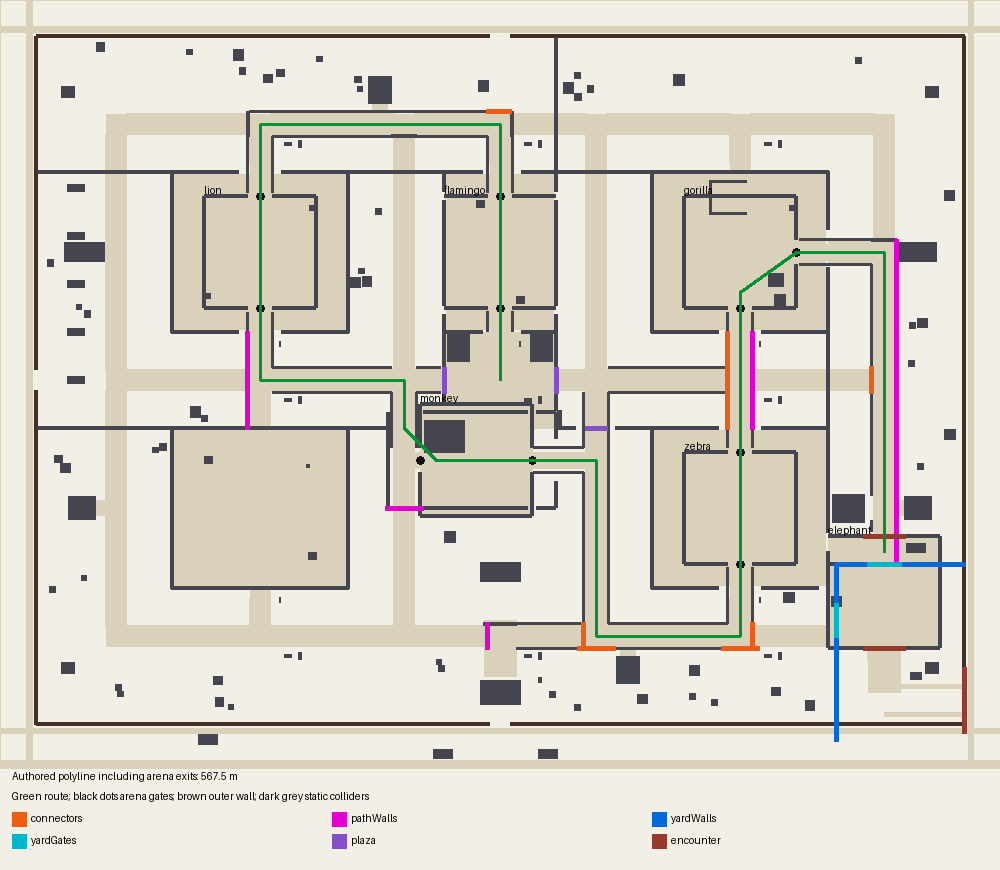
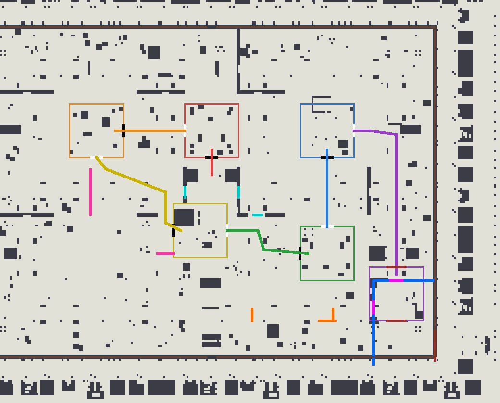

# s241 L8 route and street audit (in progress)

The [before map](barriers-before.png) overlays runtime barriers on the old layout. Brown marks the outer wall, orange connector gates, pink path walls, blue yard walls, cyan yard gates and purple plaza gates. The green line includes crossings from each entry marker to its exit and measures 567.5 m; the same full-polyline convention gives 401.41 m after the change. The original authored-leg diagnostic measured 445.31 m before the change.

The [current map](route-after.png) uses the orchestrator's native navigation diagnostic: coloured lines lead from each preceding exit to the next stage's marker, without including the walk across each arena. It reports **299.59 m** (13 + 36 + 66 + 49 + 40 + 95 m; individual values rounded), within the 300 m target. Orange marks connector gates, pink path walls, blue yard walls, magenta yard gates, cyan plaza gates, brown the perimeter, red-brown Elephant encounter gates, black entries and white exits. Opened map: the Flamingo west and Lion east gates face one another; Zebra's west approach now reaches its gate. The Lion-to-Monkey leg cuts across the former verge fences, and the Gorilla-to-Elephant leg runs down the eastern edge. The map alone does not prove the route can be walked or that every former gap is closed.

A centreline scan of the final rebuilt road graph and the native walk found the following 16 cut segments. The HIGH views show fixed concrete jersey barriers and 2.8 m keeper-fence panels across their respective road mouths. The Lion road endpoint now passes layout validation.

| Road graph segment | Cut on centreline | Disposition to verify |
| --- | --- | --- |
| p-96:-64--p-60:-64 | Jersey at x=-63 | Concrete barricade |
| p0:-64--p24:-64 | Jerseys at x=3 and x=14 | Concrete barricades |
| p-96:0--p-60:0 | Path wall at x=-63.1 | Drawn fence panel |
| p-24:0--p0:0 | Plaza west gate at x=-14 | Story seal |
| p0:0--p24:0 | Plaza east gate at x=14 | Story seal |
| p60:0--p96:0 | Jerseys at x=82 | Concrete barricade |
| p0:64--p24:64 | Connector at x=20.9 | Drawn keeper gate |
| p-96:-64--p-96:0 | Jerseys at z=-52 | Concrete barricade |
| p-96:0--p-96:64 | Jerseys at z=12 | Concrete barricade |
| p-24:-64--p-24:0 | Jerseys at z=-61 and z=-52 | Concrete barricades |
| p-24:0--p-24:64 | Path wall at z=32 | Drawn fence panel |
| p24:-64--p24:0 | Jerseys at z=-52 | Concrete barricade |
| p24:0--p24:64 | Plaza south gate at z=12 | Story seal |
| p96:-64--p96:0 | Jersey at z=-35 | Concrete barricade |
| p96:0--p96:64 | Elephant entry at z=39 and yard gate at z=46 | Encounter gate and keeper gate |
| p96:64--vehicle | Elephant exit at z=67 | Encounter gate, opens after the fight |

Five obsolete connector gates and three path walls were removed; a flood comparison with all eight absent kept each next cage reachable without reaching later cages. The scan covers 31 road-graph edges and detects centreline intersections. An isolated native walk attempted all 31 edges with the plaza sealed and arenas uncleared; [positions and outcomes](road-walk.json) distinguish reached edges from blocked or detoured attempts. This does not cover every paved spur. The appended paved spurs lead to the six arena approaches and exits; the 17-edge native route walk covers those used by the mission. The HIGH street captures were opened with the courier near each cut: the concrete barriers, full-height fence panels, and keeper gates are visible at the listed cuts. The unlisted opposite sides of blocked roads remain visually present beyond those closures.

The rebuilt D-ZOO layout passes the runtime validator. The native confinement probe passed all 17 edges, including links from each previous exit, and 12 shove checks. Mission interactions passed on the final layout after moving the pond keeper outside the closed north fence and updating the existing fixture for breach-time animal turns. Main commit `64e4fd96` was merged: camera and zebra changes are retained, while the conflict resolution keeps immediate breach-time infection because its north attacker cannot reach the scripted first flamingo bite through the newly closed fence. That opening-bite sequence therefore differs from main. A native skilled L8 run with the L8 progression preset completed in 456.03 simulation seconds with no reported failures ([result](skilled.json)). The all-level threat audit and remote unit suite remain outstanding.

The [door capture sheet](doors.jpg) is ordered HIGH then LOW, with new and old positions paired. Opened views show gaps at the Flamingo west exit, Lion east entry and Zebra west entry, and continuous inner fence at their former north or south openings. The shifted Lion outer south opening is visible beside the now-fenced former position. These captures use a paused inspection setup with the corresponding next gate open; they do not prove normal-play gate timing.

[Road components by clear count](road-components.json) lists every graph segment whose sampled centreline is outside the flood-filled plaza component in each simulated seal state. This is an inventory aid, not a claim that the courier can return to the plaza after later gates arm: the older flood model keeps prior cage gates open and does not fully model the perimeter gates.

The [gate runner probe](gates.json) passed: in the fully cleared setup the runner begins at the Gorilla exit and reaches the yard. Its five locked-state attempts stayed in the plaza, so they do not independently prove each later gate; the interaction fixture and flood check cover those states. The first attempt at the finale incorrectly started in the sealed plaza and failed; the runner now starts its final leg from the Gorilla exit.

The original [before map from the orchestrator](route-before.png) shows the old north and south detours; the coloured barrier overlay above adds the runtime walls and gates.

A native L8 fixture generation reached all six entries and the engaged Elephant yard. All seven regenerated fixtures restored and ran 300 ticks; the Lion start was (-41.1, -31.1) near its east gate and the Zebra start was (41.2, 30.8) near its west gate. [Fixture manifest](fixtures.json). The generator stops at the engaged Elephant snapshot and therefore does not prove level completion.

The L8-only threat diagnostic after widening the follower formation completed the skilled route in 462.3 s and produced no passive acceptance flags. Its aggregate retains `PARTIAL_LEVEL_SELECTION` because the other levels were not run. The skilled diagnostic separately records `UNREACHABLE_SHARE_OVER_30_PERCENT_FOR_OVER_20_SECONDS` during the sealed Gorilla fight and `WAVE_FIRST_ATTACK_OVER_20_SECONDS` for the original breach cohort; these are retained in [the L8 receipt](threat-l8.json), not treated as evidence of an all-level zero-flag pass. The earlier L8 run had four passive slow-follower flags; the formation change removes the extra per-row forward compression, while retaining the same catch-up speed and cage-wait rules. Mission interactions passed after that change.

The refreshed engaged-yard fixture carries 31 passengers with Hale alive and 30 when the test marks him fallen. The existing vehicle handoff check now refreshes its living-roster cache after that fixture change, boards the full group and checks the displayed count; its focused run passes. The first two remote full-unit runs reached the 240 s limit; the retry passed the previously failing save-progression case. A later run exposed the old 14-passenger fixture expectation and also timed out. A full unchanged suite with the corrected fixture expectations is queued with one runner slot.

The Elephant entry remains on the yard's north side. The staff lodge occupies x=83–91, z=28.5–35.5 between the Gorilla exit and a prospective north-west entrance, and the adjacent service-lane fences constrain that approach; a straight north-west route would run into the building. The marked route therefore retains the existing east service lane rather than moving the yard gate into that obstruction.
