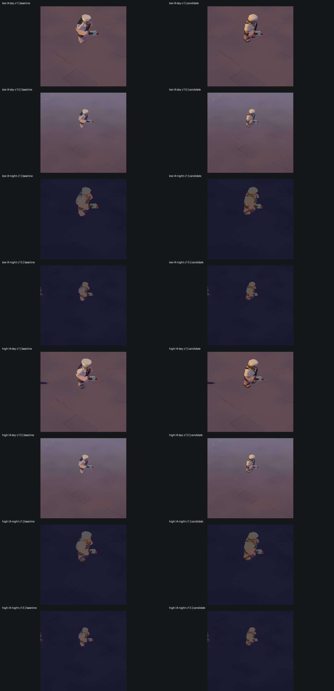
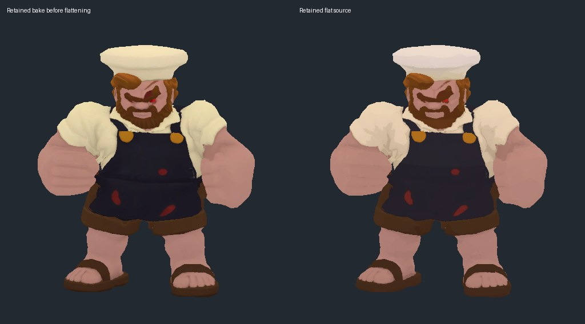
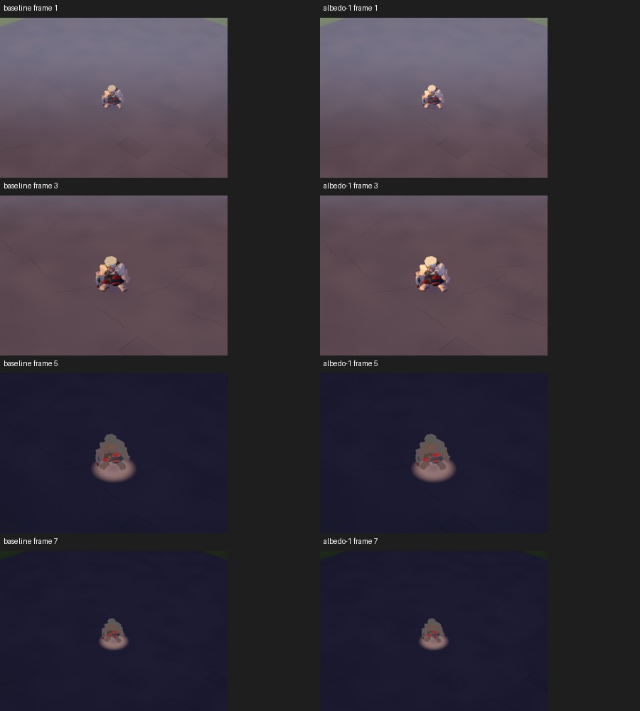
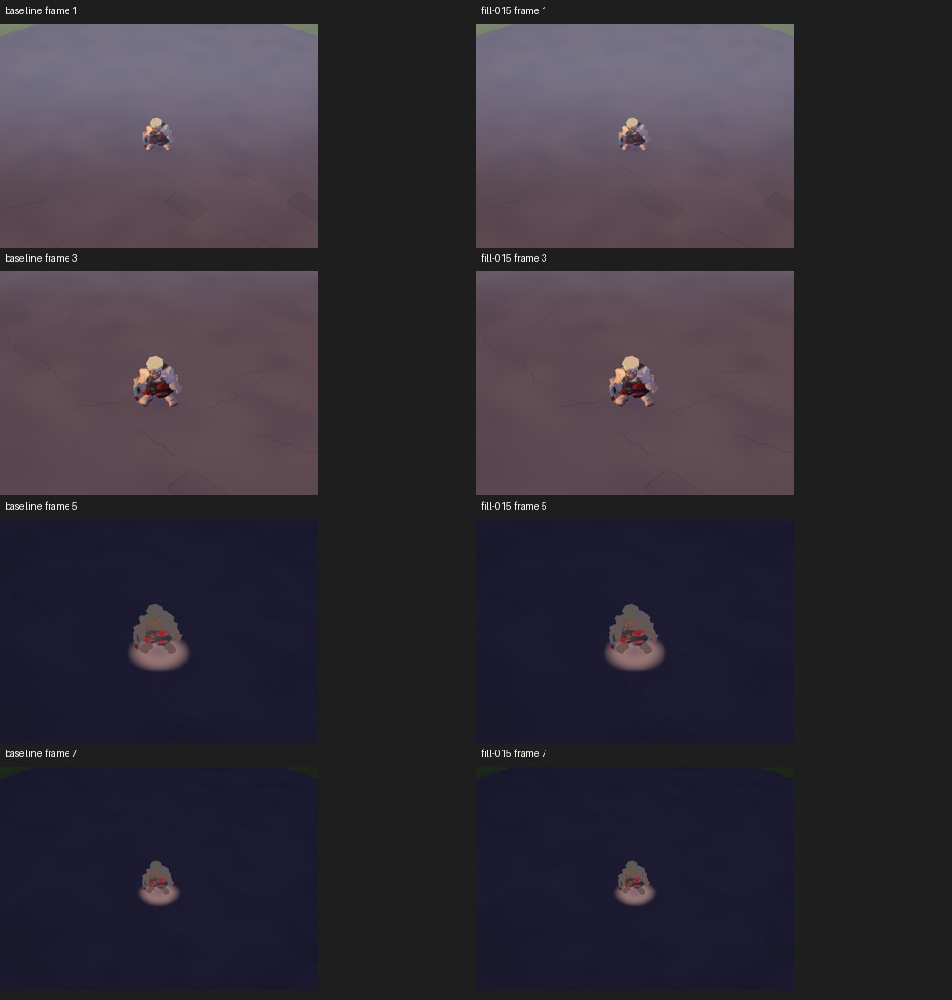
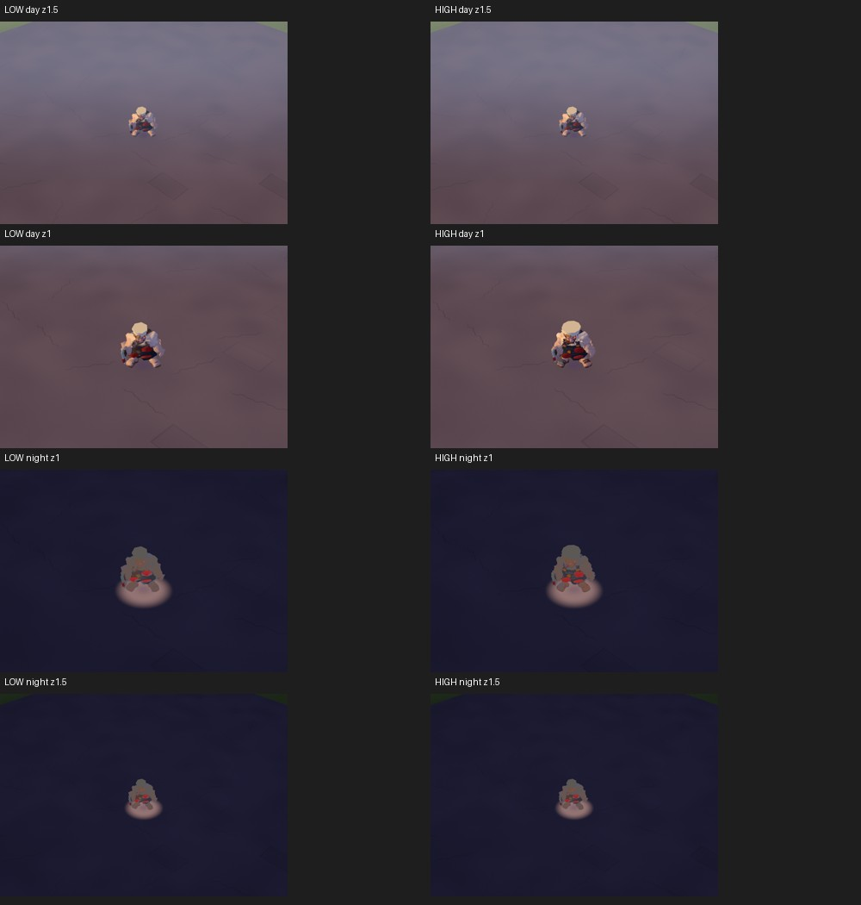
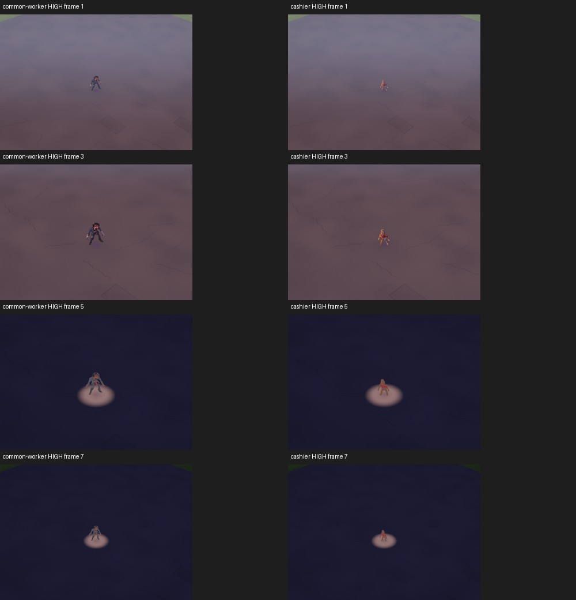
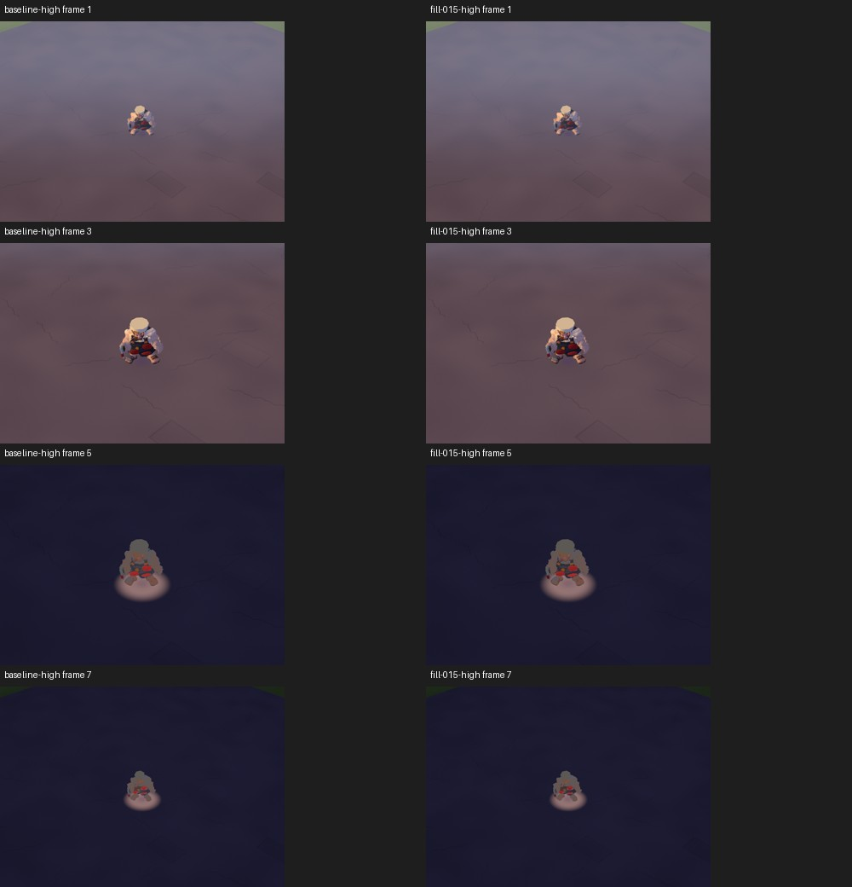
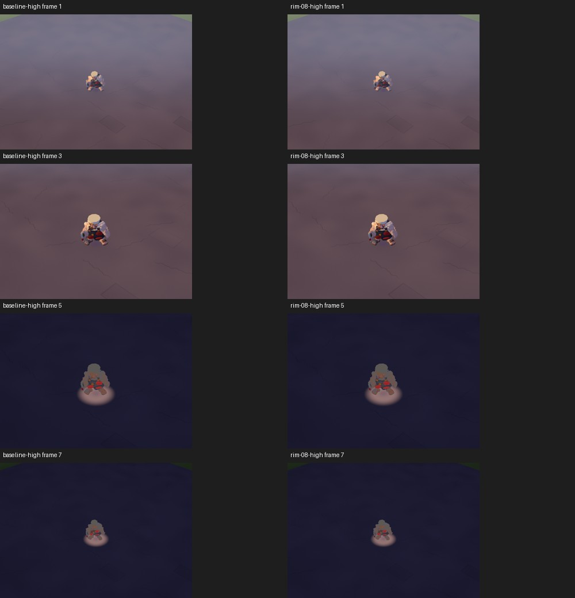
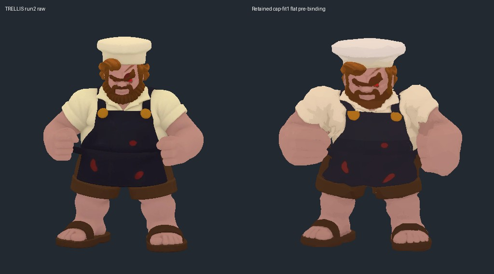

# S71 figure quality diagnosis

**Status: diagnosis in progress. HIGH quality is the primary in-game acceptance view (PO correction); LOW is secondary.** This report separates measured game scores from source-pipeline observations. The raw → bake → rig → game stage score series and controlled cheap-lever sweep are not yet complete; cells marked **unmeasured** must not be read as inferred scores.

## Current verified results

| HIGH primary view | Day | Night | Opened evidence |
|---|---:|---:|---|
| Common-worker | 5 | 3 | `ordinary-high-runtime.jpg`, corrected explicit variant |
| Cashier | 3 | 2 | `ordinary-high-runtime.jpg`, corrected explicit variant |
| Existing butcher | 4 | 3 | `butcher-tier-runtime.jpg` |

All three have fresh HIGH/WebGL2 day/night captures at zoom 1 and 1.5. No figure reaches 8/10. These game scores do not establish raw-to-game stage deltas: common-worker raw geometry is missing, cashier's retained delivery already includes binding, and the retained unique butcher pilot is a different lineage from this worktree's existing butcher.

| Tested lever | Scope | Measured overall score movement |
|---|---|---|
| Butcher figure fill .55 → .15 | HIGH and LOW, both zooms, day/night | +0 day / +0 night |
| Butcher authored-base multiplier .65 → 1 | LOW only | +0 / +0; HIGH untested |
| Quality LOW → HIGH | Existing butcher | +0 / +0 |
| Retained bake → flattened texture, identical mesh | Static unlit butcher source | No overall visual improvement; no runtime delta measured |

**Completion gaps:** matched raw/bake/neutral-rig scores and biggest-stage-loss attribution; same-lineage butcher game capture; texture-size/filter, normal/AO, rim/outline, LOD-distance and silhouette-scale experiments; expected recipe score supported by those results. No rendering fix is recommended for promotion on current evidence. The provisional recipe below remains a hypothesis, not a demonstrated route to 8/10.

The source-hash manifest now pins all three current game LOD0/1/2 GLBs as well as retained raw inputs. Different hashes alone do not prove or disprove derivation; they prevent silently comparing changing artifacts across later captures.

## Evidence and rubric

The strict rubric is the S53 rubric: silhouette, readable face/expression, material detail, colour, distinct identity, and pose readability; 10 is exceptional stylized-toy quality and 8 is the PO acceptance threshold. S53 scores are opened game-camera judgments, not raw-model ratings. Its all-figure summary is [S53 README](../s53-zombie-review/README.md) and [summary JSON](../s53-zombie-review/summary.json). The full opened sheets and captures live outside Git in `/private/tmp/claude-501/-Users-wesner-Workspace-minorincident/80ad2360-311d-4d06-a844-c0ced149d4ee/scratchpad/s53-zombie-review/`.

## Representative stage scores (HIGH is primary)

| Representative | TRELLIS raw (a) | Decimated / baked (b) | Neutral rig (c) | In game (d) | What the evidence establishes |
|---|---:|---:|---:|---:|---|
| Ordinary, higher S53 scorer: `inf.common-worker` (5 day / 3 night) | Unmeasured | Unmeasured | Unmeasured | 5 / 3 | The pipeline source sheet shows the high and matched LOD0/1/2 in the pipeline inspection views side by side. The raw GLB is not retained in the high archive; pipeline notes say it is unavailable. Pipeline note's 7.5/10 is a reconstruction-era score before the colour pass, not comparable to S53 and not used here. |
| Ordinary low scorer: `inf.cashier` (3 day / 2 night) | Unmeasured | Unmeasured | Unmeasured | 3 / 2 | A durable 300k / 2K raw high exists at `/Users/wesner/Workspace/trellis-highs/inf.cashier/`; S53's opened game evidence is in `motion-ordinary-matrix/cashier/`. The raw, pipeline LOD0 bake, and shipped skinned LOD0 files exist, but no same-camera stage sheet or stage scores were found. The previously opened pipeline `sheet.jpg` and `motion-sheet.jpg` are old-vs-new and neutral-game-motion reviews, not raw/bake/rig comparisons. |
| Heavy: `inf.butcher` (4 day / 3 night) | Unmeasured | Unmeasured | Unmeasured | 4 / 3 | S53 score is for the existing deployed derived model. The older deployed model derives from `inf.bbq-dad`; the S52 rebuild instead performed two unique butcher TRELLIS inferences and selected run 2. The S52 source report records a pipeline candidate improvement of 4/3 → 5/4 after 6.7 h and two HF runs; this is a pilot judgment, not an S53 re-score or a verified score for the current deployed asset. Its matched runtime sheet is attached below. |

The cashier pipeline `review.json` separately records a **3/10 versus old-model parity verdict** (5 = parity), citing weaker face and apron shape, hair dominance, and busy folds. This uses a different scale from S53 and is not a stage score. Its opened motion sheet shows severe triangular deformation in the LOD2 run pose at 400px, despite the LOD0 run view remaining coherent; that is concrete rig/LOD evidence but cannot be equated to the S53 overall score or attributed to a single stage without the matched neutral-pose comparison.

The available evidence does **not** support a numerical stage-by-stage drop attribution. In particular, a prior asset-development score, a studio source sheet, and a game-camera score are different evaluation contexts. A controlled same-camera series is still required before naming a single numeric “biggest drop.”

## Early loss diagnosis

The strongest directly supported loss is in the presented game scene, especially at night and native zoom: all three S53 examples score worse at night (common-worker 5→3, cashier 3→2, butcher 4→3); only common-worker drops by two points, while cashier and butcher each drop by one. Opened S53 contact sheets show the figures become small relative to the playfield at zoom 1 and night shading suppresses already-small face and garment cues. This establishes a presentation/readability risk, not proof that shader lighting alone causes the score loss. Source sheets show substantial shape and material limitations already exist before game integration (coarse angular hands/hair, uneven rear detail, fragmented clothing), so lighting cannot be the only cause. The cashier motion sheet also flags a likely rig/LOD deformation loss during running; the next diagnostic should separate neutral binding from moving-pose and LOD switching.

The butcher S52 runtime A/B sheet shows the candidate has a cleaner pale cap/shirt and fitted visible cleaver in both quality tiers, while its torso reads narrower and its night view remains low contrast. The pilot's recorded 4/3→5/4 improvement is modest and still below the 8/10 bar. The primary rebuild investment should therefore target authored silhouette/face/garment design and stable large colour regions; texture/render tuning is a secondary gain.

## Cheap-lever results

| Lever | Figure / evidence | Score change | Finding |
|---|---|---:|---|
| Region-aware colour matching | Common-worker pipeline before/after sheet, LOD0–2 | Not rescored in S53 rubric | Visible improvement in red tie/wounds and warm suit separation; original S53 game score remains 5/3. Color correction cannot repair missing silhouette/face detail. |
| Butcher bake + fit + rig candidate (compound pilot, not isolated) | Attached S52 low/high, day/night, zoom 1/1.5 sheet | Pilot judgment 4/3→5/4; not an isolated lever | Visible cleaner cap/shirt and retained cleaver; candidate silhouette narrows. Because this bundles geometry, bake, binding and prop fit, it does not identify which operation moved the score. |
| Atlas/texture size, mip/filter, normal/AO, crowd shader/rim/outline, night fill, LOD distance, silhouette scale | Not tested in this lane yet | — | No controlled score delta or S71 side-by-side evidence yet. |

### Opened side-by-side



This is the opened S52 pilot sheet, not a fresh S71 capture. It is useful evidence of the candidate's appearance and the narrowing issue, but it is not a valid controlled S71 lever sweep.

## Recommended rebuild-wave recipe (provisional)

1. Treat TRELLIS as mandatory for every figure, including a unique butcher base (already retained from S52 run 2); use its 1024 input, seed 42, 12 steps, 300k-triangle / 2K export recipe from the v2 playbook. Never substitute procedural or Blender-built figures.
2. Before running the wave, prepare full-body concepts specifically for game-camera silhouette, face/expression, and 3–5 broad garment/material regions. The current evidence shows detail/noise alone does not survive game scale.
3. Keep the proven pipeline stages: solidify and silhouette audit; emission base-colour bake; Lab colour match; regional flattening; per-class rig binding; existing delivery/compression. Validate after each stage, retaining matched cameras, lights, pose, and displayed figure height.
4. Make a game-scale gate decisive: open same figure at zoom 1 and 1.5, day and night, low and high. Score blind with the S53 rubric at raw, bake, neutral rig, and game. Reject below 8/10; do not infer acceptance from studio renders.
5. For the controlled lever sweep, first use one representative with a frozen rig and scene. Change one setting at a time (atlas 512/1024, filtering/mips, normal/AO, crowd rim/outline and night fill, then LOD distance/silhouette scale), saving an opened labeled sheet for every comparison.

**Expected score:** unproven. Existing evidence supports only a modest +1 day / +1 night butcher pilot under a compound 6.7-hour intervention (ending at 5/4), far below the PO's ≥8/10 bar. A numeric expected rebuild score would be false precision until the game-camera controlled sweep and another rebuild wave are scored.

## Remaining work

- Render matched raw/bake/neutral-rig stages for all three representatives; acquire a raw common-worker high or replace it with a higher-scoring ordinary figure whose high is durable. Resolve the Blender Metal startup crash or use an available working headless renderer before generating captures.
- Re-score every stage with the exact S53 rubric, same figure display size/camera/light, and report inter-stage deltas; include the requested in-game low/high × zoom 1/1.5 × day/night matrix.
- Run and open a one-variable-at-a-time cheap-lever sheet, recording score deltas and exact settings.
- Update this report with measured biggest drop and evidence-backed expected rebuild score.

## Lane checks for this report update

- `npm run typecheck`: passed.
- `npm run lint`: passed.
- `npm test` locally: passed, 27 files / 107 tests, 113.4 s under the 240 s budget.
- Required `sh tools/remote/run.sh "$PWD" -- npm test`: unavailable; the runner reported no healthy/provisioned Hetzner worker. `MI_LOCAL_FALLBACK=1` through the remote wrapper also refused this queue item, so the direct local `npm test` result above is a fallback, not a remote result.
- Fresh Blender stage-sheet attempt: blocked by Blender 5.2.2 crashing during Metal backend initialization before Python ran. No new stage captures were produced.

## Fresh CPU inspection follow-up

Opened `/private/tmp/s71-cashier-raw-cpu.png` and `/private/tmp/s71-cashier-baked-cpu.png`, rendered with the existing pipeline CPU base-colour renderer. The raw high preserves fine hair strands, distinct apron straps, a clear face and shoe details. The decoded pipeline delivery is visibly more faceted, with stronger red patches and weaker hair/clothing separation. This establishes visible loss by delivery, but does not isolate baking: the pipeline LOD0 contains 22 rigid parts and is already bound. Its forward orientation differs from the raw high, so the renderer's default view labels do not correspond across these files. These captures are unlit, individually framed inspections, not the required matched stage comparison or game-lighting evidence.

The pipeline file required meshopt/KTX2 decoding via the existing `v2/l1_decode_reference.mjs`; direct trimesh loading failed. The decoder succeeded and the CPU render completed. Use explicit forward alignment and fixed framing for the next comparison, and locate the pre-binding bake to separate stages b and c.

## Butcher lineage correction and retained artifacts

The retained S52 pipeline worktree final checkpoint confirms two unique butcher inferences, selected run 2, and the cap-fit3-shared integration. The earlier S71 draft incorrectly conflated the older BBQ-dad-derived deployed model with this pilot; the stage table above is corrected. Run 2 used resolution 1024, seed 42, 12 steps, 300k triangles and 2048 texture, with a downloaded 11,294,020-byte raw GLB. Its local job record reports SHA256 `5254824e5f5daaf07de36794baf55de388fa9aad437aae5206a5a9d2b204fef8`. The final S52 checkpoint scores the integrated pilot 5 day / 4 night and explicitly withholds release approval.

Raw stages are retained at `/Users/wesner/Workspace/trellis-highs/s52-inf.butcher/run1/raw.glb` and `run2/raw.glb`. Pre-binding bakes and flattened sources exist under `/Users/wesner/Workspace/3dp-s52-trellis-heavies/cast/s52-inf.butcher-anatomical/`; the selected cap-fit provenance must be followed rather than choosing an arbitrary historical bake from this directory. This resolves the raw-source availability question for butcher. No new inference was made by S71.

## Retained butcher pre-binding inspection

Rendered and opened `/private/tmp/s71-butcher-prebind-cpu.png` from pipeline `cast/s52-inf.butcher-anatomical/source-cap-fit1/flat-lod0.glb` using the CPU renderer with `--forward +z`. This is a single static mesh before binding, unlike the 22-part cashier delivery. The unlit view shows broad simple garment colour regions, rounded hands and limited fine shirt/face detail already at this stage. Final eye geometry is added downstream; its absence here is not evidence of eye loss. This historical cap-fit1 source still requires exact final-provenance matching and aligned raw/neutral-rig captures before scoring or attributing a drop.

## Texture-only retained flatten comparison



The two retained `source-cap-fit1` files have exactly identical vertex and triangle arrays (5,625 vertices / 5,500 triangles; see `flatten-comparison.json`). Both were rendered unlit with the same CPU renderer, forward direction and settings, then placed side by side. Flattening produces cleaner broad colour regions, but removes shirt, cap and apron shading that describes volume. My static inspection finds **no overall visual improvement** from this texture-only intervention. This is not a runtime score delta: the requested day/night and native-size game test remains outstanding. The observed tradeoff argues for tuning flatten strength on the actual game camera rather than applying maximum simplification automatically. These are retained pipeline outputs; no new HF inference or runtime asset replacement was performed.

## Runtime shader path traced

`src/render/CrowdView.ts` builds infected atlas colour using `texel.pow(.85)` and an 8% source-colour modulation, then applies `albedo.mul(.65)` for infected-atlas authored base before shared game shading. Thus the in-game albedo is intentionally transformed from the decoded atlas. This is a specific test candidate: compare the current 0.65 multiplier with 0.8 and 1.0, holding atlas, pose, camera, lighting and all other shader operations fixed. No runtime improvement is claimed until those captures are opened and scored.

`src/render/PaletteMaterial.ts` already supplies continuous figure fill plus a Fresnel rim; figure fill uses `surface.max(vec3(.12))`, a tint, figure fill amount, `lighting.rim` and a 0.9 factor. Night-fill experiments should adjust this existing path, rather than add a second lighting system. `src/assets/registry.ts` raises figure-map anisotropy to at least 8. These source facts constrain the planned filtering and lighting experiments; they do not establish which setting causes the observed quality loss. Source inspection found no normal/AO sampling in the shown crowd surface construction, so adding authored maps would require checking the full material contract and a separate render test.

## First controlled runtime albedo experiment



Captured the same S53 butcher fixture twice through `tools/e2e-lock.sh`, one headless browser per reservation, private Scene Lab port 4971, 1280×900, LOW/WebGL2. Rows are day zoom 1.5, day zoom 1, night zoom 1, night zoom 1.5; columns are current 0.65 multiplier and temporary 1.0 multiplier. Both runs passed fixture checks with no reported errors. Only the infected-atlas authored-base multiplier was changed; `CrowdView.ts` was restored byte-for-byte afterward. Raw captures and receipts remain in `test-results/s71-figurediag/{baseline,albedo-1}/`.

Opened comparison: no meaningful visible improvement. Strict overall judgment stays **4 day / 3 night → 4 day / 3 night (+0/+0)** for this deployed butcher fixture. Night remains a low-volume silhouette with pale cap, red patches and a ground light pool. This null result does not prove the multiplier is irrelevant to every figure: the current butcher material path must be confirmed before generalizing. Do not promote this shader change on this evidence.

## Albedo experiment path verification

The current manifest registers butcher, cashier and common-worker as `textureMode: baseColor`. `CrowdView` enables `infectedAtlas` for textured, non-healthy humanoids, so the butcher is eligible for the changed branch. The captured pairs differ numerically: 11,463 / 25,883 / 15,140 / 6,728 pixels at frames 1/3/5/7 (full receipts in `albedo-difference.json`). These whole-frame pixel differences establish that the images are not byte-identical; they do not independently measure character improvement or exclude other temporal differences. The opened-sheet judgment remains +0/+0.

A second path limits this experiment: `atlasFill` supplies ordinary infected with `albedo * .18` through emission, separately from the 0.65 authored-base multiplier. The butcher also uses neutral figure fill 1, figure-fill amount .55 and rim amount .25 in the shared material. Therefore this experiment changed one contribution while retaining substantial other fills. The next night experiment should vary existing fill and rim independently, checking volume and colour separation rather than brightness alone. These source facts explain why increasing the base multiplier cannot by itself characterize the entire night-lighting loss.

## Controlled runtime figure-fill experiment



Repeated the exact eight-frame S53 butcher fixture, LOW/WebGL2, 1280×900, private port 4971, through the browser reservation wrapper. Changed only `nightHeavy ? .55` to `.15` in the crowd figure-fill assignment, then restored the original file byte-for-byte. Both runs passed fixture checks. Columns compare baseline and .15; rows show day zoom 1.5/1 and night zoom 1/1.5. Captures/receipts: `test-results/s71-figurediag/fill-015/` and the earlier `baseline/`.

Opened result: no meaningful recovery of night volume or facial/garment readability. Overall fixture judgment remains **4/3 → 4/3 (+0/+0)**. No shader change is retained. Because both this and the albedo experiment have weak visible effects, further coefficient sweeps should wait for direct inspection of the runtime object's material route; source eligibility alone does not prove the fixture is using the edited graph (the fixture explicitly permits rigid rendering). This is an unresolved coverage risk, not evidence that lighting is globally ineffective.

## Direct runtime route probe resolves coverage risk

Ran a temporary console probe immediately after `infectedAtlas` construction in `CrowdView`, using the same LOW/WebGL2 butcher fixture through the reservation wrapper. Actual output was:

```json
{"asset":"inf.butcher","lod":"lod1","textured":true,"human":true,"healthy":false,"infectedAtlas":true}
{"asset":"inf.butcher","lod":"lod2","textured":true,"human":true,"healthy":false,"infectedAtlas":true}
```

This directly confirms entry into the edited path and identifies the prepared LODs. `allowRigid` is used only by Scene Lab spec validation; it does not choose the renderer. The prior runtime-route uncertainty is resolved for this fixture. The earlier two changes were active-path experiments with no meaningful score gain, rather than established no-ops. Probe source and temporary driver were removed; runtime source was restored. The LOD1/LOD2 preparation also means an isolated LOD0 studio review cannot represent this fixture's delivered geometry.

## Butcher current-asset LOW/HIGH matrix completed



Captured HIGH/WebGL2 with the same unmodified source, fixture, frames, private port, 1280×900 viewport and reservation rules as the LOW baseline. Both captures passed with no reported errors. Rows cover day/night and zoom 1/1.5; receipts and native captures are in `test-results/s71-figurediag/baseline-high/` and `baseline/`. HIGH adds some day contour detail around feet and hands but does not materially improve overall identity, expression or night volume. Strict overall judgments: LOW **4 day / 3 night**, HIGH **4 day / 3 night**. Tier upgrade therefore produces **+0/+0** in this fixture. This completes the requested current-game tier/zoom/time matrix for butcher only; the matrix for the two ordinary representatives and the same-lineage intermediate stages remain outstanding. This is the worktree's existing butcher, not the S52 replacement candidate.

## Ordinary-matrix attempt rejected on identity

Attempted LOW/HIGH captures of common-worker and cashier using `infected.runner` plus `look.model`, with the same eight-frame camera/time script as butcher. All four technical fixture runs passed, but the opened sheets `/private/tmp/s71-common-worker-matrix.jpg` and `/private/tmp/s71-cashier-matrix.jpg` showed the same brown-headed blue-clothed figure; cashier's expected red apron was absent. These captures are rejected as figure-identity evidence and do not complete the ordinary matrix. Raw receipts remain under `test-results/s71-figurediag/ordinary-{low,high}/`. Scene Lab passes `look.model` as the spawn `variant`; the renderer/spawn variant resolver must be checked for the exact IDs before recapture. Passing screenshot checks alone did not certify the requested asset identity.

## PO quality-tier correction and ordinary fixture root cause

The orchestrator confirms the PO plays at HIGH. All final in-game ratings and recipe decisions must lead with HIGH, zoom 1/1.5, day/night; LOW is a secondary comparison. Existing LOW-only lever results remain scoped to LOW and cannot establish the PO-view improvement. The retained butcher HIGH matrix is available, but shader lever candidates still need HIGH evaluation.

The ordinary identity mismatch is explained by `src/sim/outbreak/Outbreak.ts:dressInfected`: it assigns a random resident appearance to `infected.runner` outside L4 even when an `inf.*` variant was requested. The renderer then prioritizes that appearance. The rule skips `infected.sprinter`; the next stationary idle diagnostics use that existing archetype with explicit model variants, verifying actual identity before scoring. No production rule or stat has been changed.

## Corrected ordinary HIGH captures accepted



Used stationary `infected.sprinter` fixtures with explicit model variants to avoid runner outbreak dressing. Both HIGH/WebGL2 runs passed technical checks; the opened sheet now visibly distinguishes the dark-suited common-worker with red face/tie from cashier's red apron and pale shirt. Rows are day zoom 1.5/1 and night zoom 1/1.5. Strict overall ratings: **common-worker HIGH 5 day / 3 night; cashier HIGH 3 day / 2 night**. Night ground illumination reveals silhouettes but provides weak expression/garment readability at both zooms. This completes fresh HIGH game views for all three existing worktree figures. Corrected LOW ordinary captures remain outstanding.

Reproducible specs are retained in `ordinary-fixtures.json` (extract each named object as a Scene Lab JSON). Native images and passing receipts are in `test-results/s71-figurediag/ordinary-corrected-high/`. Fixture archetype selection is diagnostic only; no gameplay stats or production assets changed. These game views still require lineage matching to the retained pipeline sources before a raw-to-game drop can be assigned.

## PO-primary HIGH figure-fill experiment



Repeated the same controlled `.55 → .15` figure-fill change at HIGH/WebGL2, using the verified butcher infected-atlas runtime path, private port 4971, one reserved headless browser and the original four camera/time stops. Fixture checks passed. Opened result: **HIGH 4 day / 3 night → 4 day / 3 night (+0/+0)**. Reduced fill does not recover meaningful facial/garment separation or enough volume to change the strict overall rating at either zoom. Native captures and receipt are in `test-results/s71-figurediag/fill-015-high/`, paired against `baseline-high/`. Source restored byte-for-byte; no render fix is proposed. This result is now applicable to the PO quality tier, unlike the earlier LOW-only experiment.

## Corrected ordinary LOW matrix completed (secondary)

Captured and opened `/private/tmp/s71-ordinary-corrected-low.jpg` from the identity-corrected stationary sprinter fixtures. The common-worker suit and cashier apron identities are visibly distinct, unlike the rejected runner captures. Both LOW/WebGL2 runs passed; rows cover day zoom 1.5/1, night zoom 1/1.5. Secondary LOW ratings remain **common-worker 5 day / 3 night, cashier 3 day / 2 night**, with no overall tier score change relative to HIGH. Receipts and native capture hashes are in `ordinary-low-receipts.json`; full images remain under `test-results/s71-figurediag/ordinary-corrected-low/`.

The requested current-worktree in-game matrix is now captured and opened for all three representatives in both tiers, both zooms and day/night. HIGH remains the acceptance view. This does not close the same-figure stage comparison: the retained unique butcher pilot is a different lineage from the worktree butcher, common-worker's raw GLB is missing, and neutral binding still needs an isolated comparison.

## PO-primary HIGH rim experiment



Changed only the ordinary crowd `figureRim` coefficient from .25 to .8, retaining the original .55 heavy fill and .65 authored-base multiplier. Used the same HIGH/WebGL2 butcher fixture and four camera/time stops under one headless reservation on private port 4971. Capture passed technical checks; native files and receipt remain in `test-results/s71-figurediag/rim-08-high/`. The opened sheet shows no meaningful expression, apron or overall readability gain: **HIGH 4/3 → 4/3 (+0/+0)**. Source restored byte-for-byte. This is a coefficient experiment within the existing Fresnel graph, not a test of a new outline algorithm; no rim change is proposed for promotion.

## Opened butcher raw versus pre-binding source



Rendered selected run2 raw with the same unlit CPU renderer and `--forward +z`, then opened the front view beside retained cap-fit1 flattened pre-binding source. Raw finger separations and smoothly shaded sleeve folds become rounded fists and patchier broad colour regions before rigging. The cap widens too, but cap-fit is an intentional authored change, not pure decimation damage. Raw face and apron are already simple, so postprocessing cannot explain the entire quality gap. This comparison demonstrates pre-rig detail loss qualitatively; it bundles calibration/solidification/reduction/bake/flatten and cannot assign that loss to one operation. Both images are independently normalized to their full bounds by the existing renderer; shared display framing and neutral lighting remain needed for strict numeric stage scores. The raw has no retained cleaver because the prop is restored downstream.
