# S71 figure quality diagnosis

**Status: diagnosis in progress. HIGH quality is the primary in-game acceptance view (PO correction); LOW is secondary.** This report separates measured game scores from source-pipeline observations. The raw → bake → rig → game stage score series and controlled cheap-lever sweep are not yet complete; cells marked **unmeasured** must not be read as inferred scores.

## Latest stage findings and evidence limits

| Working representative | Raw | Calibration/fitted high | Bake/flat | Neutral rig | HIGH game |
|---|---:|---:|---:|---:|---|
| BBQ-dad (higher-scoring ordinary alternative) | 6 | repaired bake remains 6 | colour match 5; flat 5 | regenerated candidate 5 | Matched regenerated candidate **5/3**; earlier GLB-only 3/2 withdrawn |
| Cashier (low scorer) | 6 | 5 after 42.9% head enlargement | repaired bake 4; flat 4 | cleaned regenerated neutral 4 | Matched regenerated candidate **4/3**; current shipped 3/2 is separate |
| Selected S52 butcher | 6 | fitted high 6 | pre-bind flat 5 | selected checkpoint 5 | **Matched delivery 5 day / 4 night**, both zooms |

Studio scores use controlled overlapping camera/light comparisons. Game scores use native HIGH Scene Lab; studio/game context differences remain explicit. The biggest **confirmed avoidable integration failure** is mismatched geometry and official pose/UV bakes; pairing them restores the selected butcher's coherent appearance. This is not proof that the current shipped ordinary figures suffer that mismatch.

The largest isolated pre-rig score changes are cashier's historical proportion calibration (−1) and geometry/bake processing (−1), and BBQ-dad's colour match (−1). Butcher loses one point before binding, with no further neutral-bind whole-point loss and a night penalty in game. Raw figures in the controlled views rate 6, already below the PO's 8/10 threshold; postprocessing preservation alone has not demonstrated an 8/10 recipe.

**Correction:** the earlier BBQ-dad regenerated HIGH 3/2 and claimed neutral-to-game −2/−3 transition are withdrawn as valid art-stage measurements. Like the rejected butcher GLB-only capture, that session replaced GLBs without matching official bake binaries. Its apparent deformation cannot establish rig or lighting loss. The identity-matrix experiments also remain invalid bind-pose comparisons. Historical notes below preserve the diagnostic trail, but this latest summary supersedes their provisional interpretations.

## Current verified results

| HIGH primary view | Day | Night | Opened evidence |
|---|---:|---:|---|
| Common-worker | 5 | 3 | `ordinary-high-runtime.jpg`, corrected explicit variant |
| Cashier | 3 | 2 | `ordinary-high-runtime.jpg`, corrected explicit variant |
| Existing butcher | 4 | 3 | `butcher-tier-runtime.jpg` |

All three have fresh HIGH/WebGL2 day/night captures at zoom 1 and 1.5. No figure reaches 8/10. These game scores do not establish raw-to-game stage deltas: common-worker raw geometry is missing, cashier's retained delivery already includes binding, and the retained unique butcher pilot is a different lineage from this worktree's existing butcher.

| Tested lever | Scope | Measured overall score movement |
|---|---|---|
| Butcher figure fill .55 → .15 | HIGH and LOW, both zooms, day/night | +0 day / +0 night |
| Butcher authored-base multiplier .65 → 1 | LOW only | +0 / +0; HIGH untested |
| Quality LOW → HIGH | Existing butcher | +0 / +0 |
| Retained bake → flattened texture, identical mesh | Static unlit butcher source | No overall visual improvement; no runtime delta measured |

**Completion gaps:** matched complete ordinary stage series and final biggest-stage-loss attribution; selected-butcher matched LOW capture; texture-size/filter, normal/AO, rim/outline, LOD-distance and silhouette-scale experiments; expected recipe score supported by those results. No rendering fix is recommended for promotion on current evidence. The provisional recipe below remains a hypothesis, not a demonstrated route to 8/10.

The source-hash manifest now pins all three current game LOD0/1/2 GLBs as well as retained raw inputs. Different hashes alone do not prove or disprove derivation; they prevent silently comparing changing artifacts across later captures.

## Evidence and rubric

The strict rubric is the S53 rubric: silhouette, readable face/expression, material detail, colour, distinct identity, and pose readability; 10 is exceptional stylized-toy quality and 8 is the PO acceptance threshold. S53 scores are opened game-camera judgments, not raw-model ratings. Its all-figure summary is [S53 README](../s53-zombie-review/README.md) and [summary JSON](../s53-zombie-review/summary.json). The full opened sheets and captures live outside Git in `/private/tmp/claude-501/-Users-wesner-Workspace-minorincident/80ad2360-311d-4d06-a844-c0ced149d4ee/scratchpad/s53-zombie-review/`.

## Representative stage scores (HIGH is primary)

| Representative | TRELLIS raw (a) | Decimated / baked (b) | Neutral rig (c) | In game (d) | What the evidence establishes |
|---|---:|---:|---:|---:|---|
| Ordinary, higher S53 scorer: `inf.common-worker` (5 day / 3 night) | Unmeasured | Unmeasured | Unmeasured | 5 / 3 | The pipeline source sheet shows the high and matched LOD0/1/2 in the pipeline inspection views side by side. The raw GLB is not retained in the high archive; pipeline notes say it is unavailable. Pipeline note's 7.5/10 is a reconstruction-era score before the colour pass, not comparable to S53 and not used here. |
| Ordinary low scorer: `inf.cashier` (3 day / 2 night) | Unmeasured | Unmeasured | Unmeasured | 3 / 2 | A durable 300k / 2K raw high exists at `/Users/wesner/Workspace/trellis-highs/inf.cashier/`; S53's opened game evidence is in `motion-ordinary-matrix/cashier/`. The raw, pipeline LOD0 bake, and shipped skinned LOD0 files exist, but no same-camera stage sheet or stage scores were found. The previously opened pipeline `sheet.jpg` and `motion-sheet.jpg` are old-vs-new and neutral-game-motion reviews, not raw/bake/rig comparisons. |
| Heavy: `inf.butcher` (4 day / 3 night) | Unmeasured | Unmeasured | Unmeasured | 4 / 3 | S53 score is for the existing deployed derived model. The older deployed model derives from `inf.bbq-dad`; the S52 rebuild instead performed two unique butcher TRELLIS inferences and selected run 2. The S52 source report records a pipeline candidate improvement of 4/3 → 5/4 after 6.7 h and two HF runs; this is a pilot judgment, not an S53 re-score or a verified score for the current deployed asset. Its matched runtime sheet is attached below. |

The cashier pipeline `review.json` separately records a **3/10 versus old-model parity verdict** (5 = parity), citing weaker face and apron shape, hair dominance, and busy folds. This uses a different scale from S53 and is not a stage score. Its opened motion sheet shows severe triangular deformation in the LOD2 run pose at 400px, despite the LOD0 run view remaining coherent; that is concrete rig/LOD evidence but cannot be equated to the S53 overall score or attributed to a single stage without the matched neutral-pose comparison.

The available evidence does **not** support a numerical stage-by-stage drop attribution. In particular, a prior asset-development score, a studio source sheet, and a game-camera score are different evaluation contexts. A controlled same-camera series is still required before naming a single numeric “biggest drop.”

## Early loss diagnosis

The strongest directly supported loss is in the presented game scene, especially at night and native zoom: all three S53 examples score worse at night (common-worker 5→3, cashier 3→2, butcher 4→3); only common-worker drops by two points, while cashier and butcher each drop by one. Opened S53 contact sheets show the figures become small relative to the playfield at zoom 1 and night shading suppresses already-small face and garment cues. This establishes a presentation/readability risk, not proof that shader lighting alone causes the score loss. Source sheets show substantial shape and material limitations already exist before game integration (coarse angular hands/hair, uneven rear detail, fragmented clothing), so lighting cannot be the only cause. The cashier motion sheet also flags a likely rig/LOD deformation loss during running; the next diagnostic should separate neutral binding from moving-pose and LOD switching.

The butcher S52 runtime A/B sheet shows the candidate has a cleaner pale cap/shirt and fitted visible cleaver in both quality tiers, while its torso reads narrower and its night view remains low contrast. The pilot's recorded 4/3→5/4 improvement is modest and still below the 8/10 bar. The primary rebuild investment should therefore target authored silhouette/face/garment design and stable large colour regions; texture/render tuning is a secondary gain.

## Cheap-lever results

| Lever | Figure / evidence | Score change | Finding |
|---|---|---:|---|
| Region-aware colour matching | Common-worker pipeline before/after sheet, LOD0–2 | Not rescored in S53 rubric | Visible improvement in red tie/wounds and warm suit separation; original S53 game score remains 5/3. Color correction cannot repair missing silhouette/face detail. |
| Butcher bake + fit + rig candidate (compound pilot, not isolated) | Attached S52 low/high, day/night, zoom 1/1.5 sheet | Pilot judgment 4/3→5/4; not an isolated lever | Visible cleaner cap/shirt and retained cleaver; candidate silhouette narrows. Because this bundles geometry, bake, binding and prop fit, it does not identify which operation moved the score. |
| Atlas/texture size, mip/filter, normal/AO, crowd shader/rim/outline, night fill, LOD distance, silhouette scale | Not tested in this lane yet | — | No controlled score delta or S71 side-by-side evidence yet. |

### Opened side-by-side


This is the opened S52 pilot sheet, not a fresh S71 capture. It is useful evidence of the candidate's appearance and the narrowing issue, but it is not a valid controlled S71 lever sweep.

## Recommended rebuild-wave recipe (provisional)

1. Treat TRELLIS as mandatory for every figure, including a unique butcher base (already retained from S52 run 2); use its 1024 input, seed 42, 12 steps, 300k-triangle / 2K export recipe from the v2 playbook. Never substitute procedural or Blender-built figures.
2. Before running the wave, prepare full-body concepts specifically for game-camera silhouette, face/expression, and 3–5 broad garment/material regions. The current evidence shows detail/noise alone does not survive game scale.
3. Keep the proven pipeline stages: solidify and silhouette audit; emission base-colour bake; Lab colour match; regional flattening; per-class rig binding; existing delivery/compression. Validate after each stage, retaining matched cameras, lights, pose, and displayed figure height.
4. Make a game-scale gate decisive: open same figure at zoom 1 and 1.5, day and night, low and high. Score blind with the S53 rubric at raw, bake, neutral rig, and game. Reject below 8/10; do not infer acceptance from studio renders.
5. For the controlled lever sweep, first use one representative with a frozen rig and scene. Change one setting at a time (atlas 512/1024, filtering/mips, normal/AO, crowd rim/outline and night fill, then LOD distance/silhouette scale), saving an opened labeled sheet for every comparison.

**Expected score:** unproven. Existing evidence supports only a modest +1 day / +1 night butcher pilot under a compound 6.7-hour intervention (ending at 5/4), far below the PO's ≥8/10 bar. A numeric expected rebuild score would be false precision until the game-camera controlled sweep and another rebuild wave are scored.

## Remaining work

- Render matched raw/bake/neutral-rig stages for all three representatives; acquire a raw common-worker high or replace it with a higher-scoring ordinary figure whose high is durable. Resolve the Blender Metal startup crash or use an available working headless renderer before generating captures.
- Re-score every stage with the exact S53 rubric, same figure display size/camera/light, and report inter-stage deltas; include the requested in-game low/high × zoom 1/1.5 × day/night matrix.
- Run and open a one-variable-at-a-time cheap-lever sheet, recording score deltas and exact settings.
- Update this report with measured biggest drop and evidence-backed expected rebuild score.

## Lane checks for this report update

- `npm run typecheck`: passed.
- `npm run lint`: passed.
- `npm test` locally: passed, 27 files / 107 tests, 113.4 s under the 240 s budget.
- Required `sh tools/remote/run.sh "$PWD" -- npm test`: unavailable; the runner reported no healthy/provisioned Hetzner worker. `MI_LOCAL_FALLBACK=1` through the remote wrapper also refused this queue item, so the direct local `npm test` result above is a fallback, not a remote result.
- Fresh Blender stage-sheet attempt: blocked by Blender 5.2.2 crashing during Metal backend initialization before Python ran. No new stage captures were produced.

## Fresh CPU inspection follow-up

Opened `/private/tmp/s71-cashier-raw-cpu.png` and `/private/tmp/s71-cashier-baked-cpu.png`, rendered with the existing pipeline CPU base-colour renderer. The raw high preserves fine hair strands, distinct apron straps, a clear face and shoe details. The decoded pipeline delivery is visibly more faceted, with stronger red patches and weaker hair/clothing separation. This establishes visible loss by delivery, but does not isolate baking: the pipeline LOD0 contains 22 rigid parts and is already bound. Its forward orientation differs from the raw high, so the renderer's default view labels do not correspond across these files. These captures are unlit, individually framed inspections, not the required matched stage comparison or game-lighting evidence.

The pipeline file required meshopt/KTX2 decoding via the existing `v2/l1_decode_reference.mjs`; direct trimesh loading failed. The decoder succeeded and the CPU render completed. Use explicit forward alignment and fixed framing for the next comparison, and locate the pre-binding bake to separate stages b and c.

## Butcher lineage correction and retained artifacts

The retained S52 pipeline worktree final checkpoint confirms two unique butcher inferences, selected run 2, and the cap-fit3-shared integration. The earlier S71 draft incorrectly conflated the older BBQ-dad-derived deployed model with this pilot; the stage table above is corrected. Run 2 used resolution 1024, seed 42, 12 steps, 300k triangles and 2048 texture, with a downloaded 11,294,020-byte raw GLB. Its local job record reports SHA256 `5254824e5f5daaf07de36794baf55de388fa9aad437aae5206a5a9d2b204fef8`. The final S52 checkpoint scores the integrated pilot 5 day / 4 night and explicitly withholds release approval.

Raw stages are retained at `/Users/wesner/Workspace/trellis-highs/s52-inf.butcher/run1/raw.glb` and `run2/raw.glb`. Pre-binding bakes and flattened sources exist under `/Users/wesner/Workspace/3dp-s52-trellis-heavies/cast/s52-inf.butcher-anatomical/`; the selected cap-fit provenance must be followed rather than choosing an arbitrary historical bake from this directory. This resolves the raw-source availability question for butcher. No new inference was made by S71.

## Retained butcher pre-binding inspection

Rendered and opened `/private/tmp/s71-butcher-prebind-cpu.png` from pipeline `cast/s52-inf.butcher-anatomical/source-cap-fit1/flat-lod0.glb` using the CPU renderer with `--forward +z`. This is a single static mesh before binding, unlike the 22-part cashier delivery. The unlit view shows broad simple garment colour regions, rounded hands and limited fine shirt/face detail already at this stage. Final eye geometry is added downstream; its absence here is not evidence of eye loss. This historical cap-fit1 source still requires exact final-provenance matching and aligned raw/neutral-rig captures before scoring or attributing a drop.

## Texture-only retained flatten comparison


The two retained `source-cap-fit1` files have exactly identical vertex and triangle arrays (5,625 vertices / 5,500 triangles; see `flatten-comparison.json`). Both were rendered unlit with the same CPU renderer, forward direction and settings, then placed side by side. Flattening produces cleaner broad colour regions, but removes shirt, cap and apron shading that describes volume. My static inspection finds **no overall visual improvement** from this texture-only intervention. This is not a runtime score delta: the requested day/night and native-size game test remains outstanding. The observed tradeoff argues for tuning flatten strength on the actual game camera rather than applying maximum simplification automatically. These are retained pipeline outputs; no new HF inference or runtime asset replacement was performed.

## Runtime shader path traced

`src/render/CrowdView.ts` builds infected atlas colour using `texel.pow(.85)` and an 8% source-colour modulation, then applies `albedo.mul(.65)` for infected-atlas authored base before shared game shading. Thus the in-game albedo is intentionally transformed from the decoded atlas. This is a specific test candidate: compare the current 0.65 multiplier with 0.8 and 1.0, holding atlas, pose, camera, lighting and all other shader operations fixed. No runtime improvement is claimed until those captures are opened and scored.

`src/render/PaletteMaterial.ts` already supplies continuous figure fill plus a Fresnel rim; figure fill uses `surface.max(vec3(.12))`, a tint, figure fill amount, `lighting.rim` and a 0.9 factor. Night-fill experiments should adjust this existing path, rather than add a second lighting system. `src/assets/registry.ts` raises figure-map anisotropy to at least 8. These source facts constrain the planned filtering and lighting experiments; they do not establish which setting causes the observed quality loss. Source inspection found no normal/AO sampling in the shown crowd surface construction, so adding authored maps would require checking the full material contract and a separate render test.

## First controlled runtime albedo experiment


Captured the same S53 butcher fixture twice through `tools/e2e-lock.sh`, one headless browser per reservation, private Scene Lab port 4971, 1280×900, LOW/WebGL2. Rows are day zoom 1.5, day zoom 1, night zoom 1, night zoom 1.5; columns are current 0.65 multiplier and temporary 1.0 multiplier. Both runs passed fixture checks with no reported errors. Only the infected-atlas authored-base multiplier was changed; `CrowdView.ts` was restored byte-for-byte afterward. Raw captures and receipts remain in `test-results/s71-figurediag/{baseline,albedo-1}/`.

Opened comparison: no meaningful visible improvement. Strict overall judgment stays **4 day / 3 night → 4 day / 3 night (+0/+0)** for this deployed butcher fixture. Night remains a low-volume silhouette with pale cap, red patches and a ground light pool. This null result does not prove the multiplier is irrelevant to every figure: the current butcher material path must be confirmed before generalizing. Do not promote this shader change on this evidence.

## Albedo experiment path verification

The current manifest registers butcher, cashier and common-worker as `textureMode: baseColor`. `CrowdView` enables `infectedAtlas` for textured, non-healthy humanoids, so the butcher is eligible for the changed branch. The captured pairs differ numerically: 11,463 / 25,883 / 15,140 / 6,728 pixels at frames 1/3/5/7 (full receipts in `albedo-difference.json`). These whole-frame pixel differences establish that the images are not byte-identical; they do not independently measure character improvement or exclude other temporal differences. The opened-sheet judgment remains +0/+0.

A second path limits this experiment: `atlasFill` supplies ordinary infected with `albedo * .18` through emission, separately from the 0.65 authored-base multiplier. The butcher also uses neutral figure fill 1, figure-fill amount .55 and rim amount .25 in the shared material. Therefore this experiment changed one contribution while retaining substantial other fills. The next night experiment should vary existing fill and rim independently, checking volume and colour separation rather than brightness alone. These source facts explain why increasing the base multiplier cannot by itself characterize the entire night-lighting loss.

## Controlled runtime figure-fill experiment


Repeated the exact eight-frame S53 butcher fixture, LOW/WebGL2, 1280×900, private port 4971, through the browser reservation wrapper. Changed only `nightHeavy ? .55` to `.15` in the crowd figure-fill assignment, then restored the original file byte-for-byte. Both runs passed fixture checks. Columns compare baseline and .15; rows show day zoom 1.5/1 and night zoom 1/1.5. Captures/receipts: `test-results/s71-figurediag/fill-015/` and the earlier `baseline/`.

Opened result: no meaningful recovery of night volume or facial/garment readability. Overall fixture judgment remains **4/3 → 4/3 (+0/+0)**. No shader change is retained. Because both this and the albedo experiment have weak visible effects, further coefficient sweeps should wait for direct inspection of the runtime object's material route; source eligibility alone does not prove the fixture is using the edited graph (the fixture explicitly permits rigid rendering). This is an unresolved coverage risk, not evidence that lighting is globally ineffective.

## Direct runtime route probe resolves coverage risk

Ran a temporary console probe immediately after `infectedAtlas` construction in `CrowdView`, using the same LOW/WebGL2 butcher fixture through the reservation wrapper. Actual output was:

```json
{"asset":"inf.butcher","lod":"lod1","textured":true,"human":true,"healthy":false,"infectedAtlas":true}
{"asset":"inf.butcher","lod":"lod2","textured":true,"human":true,"healthy":false,"infectedAtlas":true}
```

This directly confirms entry into the edited path and identifies the prepared LODs. `allowRigid` is used only by Scene Lab spec validation; it does not choose the renderer. The prior runtime-route uncertainty is resolved for this fixture. The earlier two changes were active-path experiments with no meaningful score gain, rather than established no-ops. Probe source and temporary driver were removed; runtime source was restored. The LOD1/LOD2 preparation also means an isolated LOD0 studio review cannot represent this fixture's delivered geometry.

## Butcher current-asset LOW/HIGH matrix completed


Captured HIGH/WebGL2 with the same unmodified source, fixture, frames, private port, 1280×900 viewport and reservation rules as the LOW baseline. Both captures passed with no reported errors. Rows cover day/night and zoom 1/1.5; receipts and native captures are in `test-results/s71-figurediag/baseline-high/` and `baseline/`. HIGH adds some day contour detail around feet and hands but does not materially improve overall identity, expression or night volume. Strict overall judgments: LOW **4 day / 3 night**, HIGH **4 day / 3 night**. Tier upgrade therefore produces **+0/+0** in this fixture. This completes the requested current-game tier/zoom/time matrix for butcher only; the matrix for the two ordinary representatives and the same-lineage intermediate stages remain outstanding. This is the worktree's existing butcher, not the S52 replacement candidate.

## Ordinary-matrix attempt rejected on identity

Attempted LOW/HIGH captures of common-worker and cashier using `infected.runner` plus `look.model`, with the same eight-frame camera/time script as butcher. All four technical fixture runs passed, but the opened sheets `/private/tmp/s71-common-worker-matrix.jpg` and `/private/tmp/s71-cashier-matrix.jpg` showed the same brown-headed blue-clothed figure; cashier's expected red apron was absent. These captures are rejected as figure-identity evidence and do not complete the ordinary matrix. Raw receipts remain under `test-results/s71-figurediag/ordinary-{low,high}/`. Scene Lab passes `look.model` as the spawn `variant`; the renderer/spawn variant resolver must be checked for the exact IDs before recapture. Passing screenshot checks alone did not certify the requested asset identity.

## PO quality-tier correction and ordinary fixture root cause

The orchestrator confirms the PO plays at HIGH. All final in-game ratings and recipe decisions must lead with HIGH, zoom 1/1.5, day/night; LOW is a secondary comparison. Existing LOW-only lever results remain scoped to LOW and cannot establish the PO-view improvement. The retained butcher HIGH matrix is available, but shader lever candidates still need HIGH evaluation.

The ordinary identity mismatch is explained by `src/sim/outbreak/Outbreak.ts:dressInfected`: it assigns a random resident appearance to `infected.runner` outside L4 even when an `inf.*` variant was requested. The renderer then prioritizes that appearance. The rule skips `infected.sprinter`; the next stationary idle diagnostics use that existing archetype with explicit model variants, verifying actual identity before scoring. No production rule or stat has been changed.

## Corrected ordinary HIGH captures accepted


Used stationary `infected.sprinter` fixtures with explicit model variants to avoid runner outbreak dressing. Both HIGH/WebGL2 runs passed technical checks; the opened sheet now visibly distinguishes the dark-suited common-worker with red face/tie from cashier's red apron and pale shirt. Rows are day zoom 1.5/1 and night zoom 1/1.5. Strict overall ratings: **common-worker HIGH 5 day / 3 night; cashier HIGH 3 day / 2 night**. Night ground illumination reveals silhouettes but provides weak expression/garment readability at both zooms. This completes fresh HIGH game views for all three existing worktree figures. Corrected LOW ordinary captures remain outstanding.

Reproducible specs are retained in `ordinary-fixtures.json` (extract each named object as a Scene Lab JSON). Native images and passing receipts are in `test-results/s71-figurediag/ordinary-corrected-high/`. Fixture archetype selection is diagnostic only; no gameplay stats or production assets changed. These game views still require lineage matching to the retained pipeline sources before a raw-to-game drop can be assigned.

## PO-primary HIGH figure-fill experiment


Repeated the same controlled `.55 → .15` figure-fill change at HIGH/WebGL2, using the verified butcher infected-atlas runtime path, private port 4971, one reserved headless browser and the original four camera/time stops. Fixture checks passed. Opened result: **HIGH 4 day / 3 night → 4 day / 3 night (+0/+0)**. Reduced fill does not recover meaningful facial/garment separation or enough volume to change the strict overall rating at either zoom. Native captures and receipt are in `test-results/s71-figurediag/fill-015-high/`, paired against `baseline-high/`. Source restored byte-for-byte; no render fix is proposed. This result is now applicable to the PO quality tier, unlike the earlier LOW-only experiment.

## Corrected ordinary LOW matrix completed (secondary)

Captured and opened `/private/tmp/s71-ordinary-corrected-low.jpg` from the identity-corrected stationary sprinter fixtures. The common-worker suit and cashier apron identities are visibly distinct, unlike the rejected runner captures. Both LOW/WebGL2 runs passed; rows cover day zoom 1.5/1, night zoom 1/1.5. Secondary LOW ratings remain **common-worker 5 day / 3 night, cashier 3 day / 2 night**, with no overall tier score change relative to HIGH. Receipts and native capture hashes are in `ordinary-low-receipts.json`; full images remain under `test-results/s71-figurediag/ordinary-corrected-low/`.

The requested current-worktree in-game matrix is now captured and opened for all three representatives in both tiers, both zooms and day/night. HIGH remains the acceptance view. This does not close the same-figure stage comparison: the retained unique butcher pilot is a different lineage from the worktree butcher, common-worker's raw GLB is missing, and neutral binding still needs an isolated comparison.

## PO-primary HIGH rim experiment


Changed only the ordinary crowd `figureRim` coefficient from .25 to .8, retaining the original .55 heavy fill and .65 authored-base multiplier. Used the same HIGH/WebGL2 butcher fixture and four camera/time stops under one headless reservation on private port 4971. Capture passed technical checks; native files and receipt remain in `test-results/s71-figurediag/rim-08-high/`. The opened sheet shows no meaningful expression, apron or overall readability gain: **HIGH 4/3 → 4/3 (+0/+0)**. Source restored byte-for-byte. This is a coefficient experiment within the existing Fresnel graph, not a test of a new outline algorithm; no rim change is proposed for promotion.

## Opened butcher raw versus pre-binding source


Rendered selected run2 raw with the same unlit CPU renderer and `--forward +z`, then opened the front view beside retained cap-fit1 flattened pre-binding source. Raw finger separations and smoothly shaded sleeve folds become rounded fists and patchier broad colour regions before rigging. The cap widens too, but cap-fit is an intentional authored change, not pure decimation damage. Raw face and apron are already simple, so postprocessing cannot explain the entire quality gap. This comparison demonstrates pre-rig detail loss qualitatively; it bundles calibration/solidification/reduction/bake/flatten and cannot assign that loss to one operation. Both images are independently normalized to their full bounds by the existing renderer; shared display framing and neutral lighting remain needed for strict numeric stage scores. The raw has no retained cleaver because the prop is restored downstream.

## Current HIGH delivery inventory: texture bottleneck candidate

Read the current game GLBs through glTF Transform with meshopt decoding and inspected embedded KTX2 headers. Full material/map/triangle records are in `game-delivery-inventory.json`.

| Figure | HIGH LOD0 triangles / atlas | HIGH LOD1 triangles / atlas | HIGH LOD2 triangles / atlas |
|---|---|---|---|
| Common-worker | 5,835 / 1024×1024 | 2,265 / 512×512 | 891 / 512×512 |
| Cashier | 6,036 / 576×768 | 2,490 / 288×384 | 2,490 / **72×96** |
| Existing butcher | 5,566 / 256×528 | 2,351 / 128×272 | 2,267 / 128×272 |

All inspected atlases contain mip chains. Cashier's LOD2 keeps the same triangle count as LOD1 but cuts atlas area by 16×; this is a strong delivery-stage candidate for lost face/garment detail, pending a controlled runtime texture-retention test and confirmation of the drawn LOD. Butcher's distance atlas is also small relative to its large screen silhouette. Atlas dimensions include any class/swatch/eye regions and do not imply all texels cover body colour. These are the HIGH model files, not LOW overrides, and file inventory alone does not establish the displayed mip level or a score delta.

## Cashier atlas-retention experiment preflight

Compared all nine LOD1/LOD2 primitives through meshopt-decoded accessors. Present UV, joint-index and skin-weight arrays have zero differences; body UV arrays are byte-identical. Position arrays differ slightly (body maximum component difference 0.0003562 in accessor values), so the two documents must not be substituted wholesale and called a texture-only test. The planned experiment will retain the entire LOD2 document and replace only its embedded atlas bytes from LOD1 (288×384 instead of 72×96), keeping its geometry, UVs, skeleton and weights. Detailed attribute hashes and maximum differences are recorded in `cashier-lod-attribute-comparison.json` and `cashier-lod-attribute-deltas.json`. A runtime capture with confirmed drawn LOD remains necessary before assigning a score delta.

## HIGH cashier atlas-retention capture

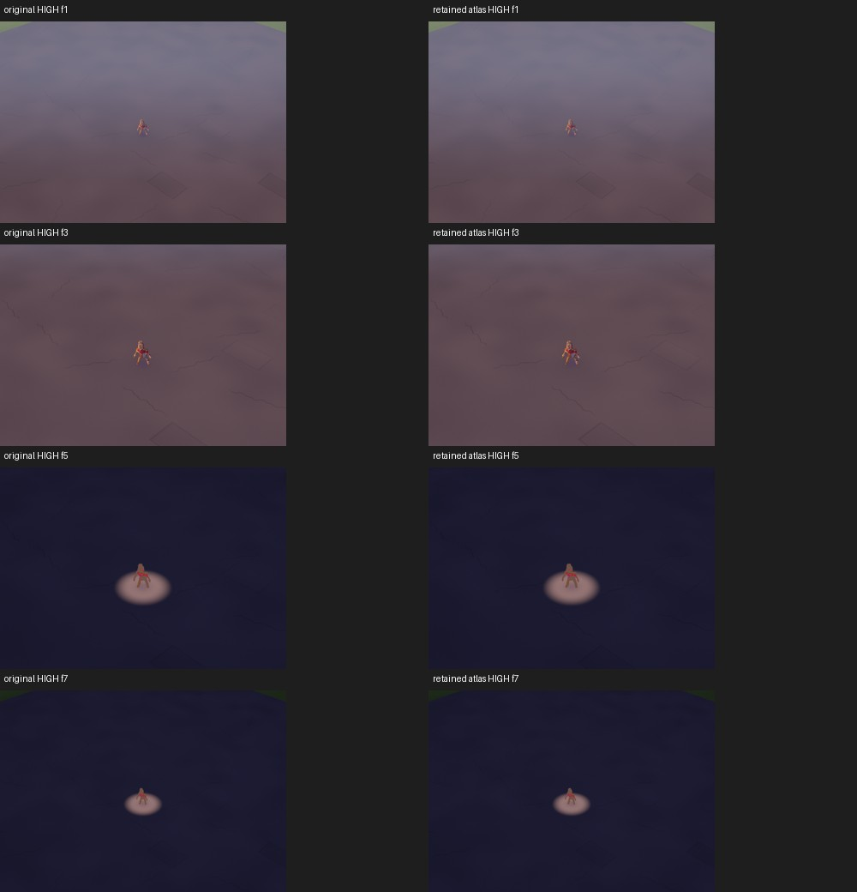

Temporarily replaced only the embedded LOD2 atlas with LOD1's 288×384 KTX2 bytes, retaining the LOD2 document. `cashier-atlas-candidate-proof.json` records accessor comparison and image sizes. Captured corrected cashier HIGH/WebGL2 fixture at both zooms/day/night; checks passed. Opened result shows no meaningful overall score gain (**3/2 remains 3/2**). This is not yet a definitive texture-resolution null result: the drawn LOD and sampled texture must be observed directly, because a delivered bake or another LOD can bypass the modified file. Native captures/receipt are in `test-results/s71-figurediag/cashier-atlas-retained-high/`. Original GLB restored byte-for-byte; no asset replacement retained or recommended.

## Direct cashier draw probe overturns standalone-atlas inference

Temporary instrumentation at active-batch submission confirmed the original HIGH cashier fixture draws both LOD2 and LOD1 with **one shared 576×768 atlas UUID**, each with one instance. Exact output (UUID is session-local):

```json
{"name":"inf.cashier","role":"inf.cashier","lod":"lod2","count":1,"atlas":{"id":"9329dcdd-6262-4bbf-8f6a-0398380437e6","width":576,"height":768,"decodedBytesWithMips":2359276}}
{"name":"inf.cashier","role":"inf.cashier","lod":"lod1","count":1,"atlas":{"id":"9329dcdd-6262-4bbf-8f6a-0398380437e6","width":576,"height":768,"decodedBytesWithMips":2359276}}
```

Therefore the earlier 72×96 standalone-LOD2 bottleneck hypothesis is **not established for this fixture**: the active material binds the shared LOD0-size atlas. The LOD2-file atlas replacement did not test displayed texture resolution, and its unchanged score must not be counted as a valid resolution null result. A proper test must replace or resize the actual shared atlas binding. This probe also directly identifies active LOD2/LOD1, rather than merely prepared batches. Temporary instrumentation/driver removed and runtime source restored.

## HIGH cashier shared-atlas nearest-filter experiment

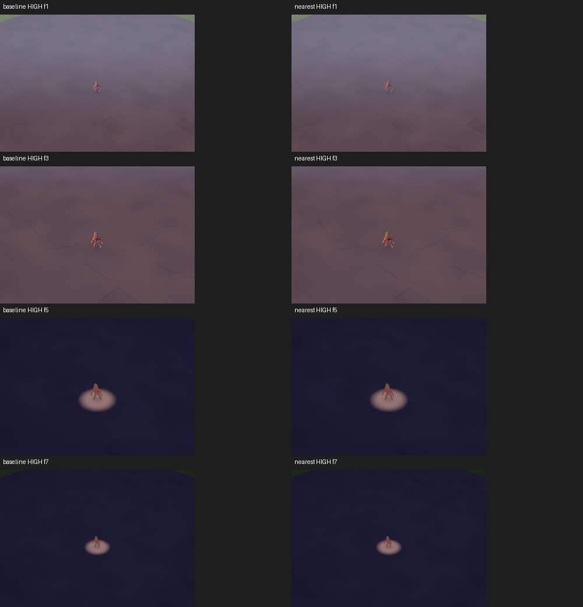

Changed `baked.texture.minFilter` and `magFilter` to Three's `NearestFilter` (1003) immediately before cashier batch construction, setting `needsUpdate`; this targets the actual shared atlas instead of replacing a standalone unused image. All geometry, atlas bytes, lighting and camera stops stayed fixed. HIGH/WebGL2 fixture passed. Opened comparison yields **3 day / 2 night → 3 day / 2 night (+0/+0)**: no meaningful face/apron or overall readability improvement at either zoom. This tests nearest sampling without mip interpolation as one combined sampler choice; it does not isolate each filter parameter. Native captures and receipt remain at `test-results/s71-figurediag/cashier-nearest-high/`. Temporary sampler edit restored byte-for-byte; no change proposed for promotion.

## Higher-scoring ordinary raw-source alternative

BBQ-dad is an eligible higher-scoring ordinary representative (S53 5 day / 3 night). Its durable raw high exists at `/Users/wesner/Workspace/trellis-highs/inf.bbq-dad/tris300000_tex2048.glb`; its SHA256 exactly matches wave1 stage provenance: `81b253b8788c81027518f089773564d5b02b370a892b59b98ef7757857274c87`. This provides a stronger raw starting point than common-worker's missing high. However, the pre-binding bake has not yet been located: provenance names the historical `3dp-wave1/cache/wave1/inf.bbq-dad/body/lod0.glb`, and final delivery is retained. Do not substitute the final bound delivery as stage b. BBQ-dad remains a candidate replacement representative until that intermediate is recovered or faithfully regenerated. No new inference is required for the retained raw.

## HIGH cashier retained-LOD1 experiment

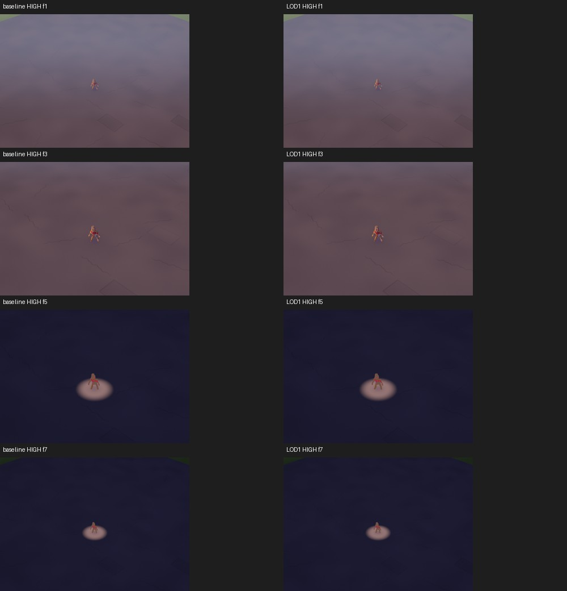

Temporarily forced living cashier selection to `lod1` after the ordinary LOD/hero selection, leaving all other figures and corpse paths unchanged. HIGH/WebGL2 fixture passed at both zooms/day/night. Opened result: **3/2 → 3/2 (+0/+0)**, with no meaningful native-camera readability gain. This is consistent with the inventory finding that cashier LOD1/2 have the same triangle count, matching UV/skin data and the same shared runtime atlas. It does not establish that LOD retention is ineffective for other figures with genuinely different geometry. Captures/receipt: `test-results/s71-figurediag/cashier-force-lod1-high/`. Temporary override removed, source restored byte-for-byte; no production LOD change proposed.

## BBQ-dad calibrated-source mismatch

A retained file at `trellis-highs/wave2-sources/inf.bbq-dad/calibrated.glb` exists, but SHA256 `f7d7ecbbfae21f81071ec5ffeb83cb1010fb464491987bc6010a17561b28c8f8` does not match wave1's calibrated-high provenance (`59d3f8f566ae6ea8e57a8c6a01b1445cbec87944f350f29d7cdf5bec1c12fc6f`). It is excluded from the wave1 stage series. A similarly named retained high is not sufficient lineage evidence. The durable raw high matches wave1, but its exact calibrated and pre-binding outputs still need recovery or regeneration from recorded settings.

## BBQ-dad calibrated high reproduced exactly

Regenerated the calibrated high from the provenance-matching raw with the recorded `wave1_calibrate.py` command, head-bottom Y 0.13321908707618715, target 0.3881857418205289 and retained landmarks. Output `/private/tmp/s71-bbq-calibrated.glb` has SHA256 **59d3f8f566ae6ea8e57a8c6a01b1445cbec87944f350f29d7cdf5bec1c12fc6f**, exactly matching the historical wave1 calibrated artifact. Reproduction measurements are in `bbq-calibration-reproduction.json`. This recovers one missing intermediate with stronger evidence than filename similarity.

The historical calibration enlarged the head by **1.095296×**, changing measured head/height from .3668 to .3881857 before solidification/baking. This is a concrete pre-bake design change to evaluate visually. It reproduces the old pipeline for diagnosis only; current heroine-based shrink-only proportion guidance supersedes that historical target for new production work. Exact pre-binding bake recovery/regeneration and same-camera stage scoring remain open.

## Blender recovery and regenerated BBQ-dad pre-binding bake

After filesystem restrictions were lifted, Blender 5.2.2 successfully started in background mode. The earlier Metal startup crash no longer blocks regeneration. Ran the retained solidify recipe against the byte-identical calibrated high, budgets 5944/2444, head-depth yaw 0, four threads. Both outputs are watertight; reported sliver percentages are .50471% and .32733%. Then ran the recorded LOD0 emission bake at 1024, cage .02 and ray .05. It completed at `/private/tmp/s71-bbq-stages/baked-lod0.glb`, one primitive / 5944 triangles. Regenerated files are pinned in `bbq-regenerated-stage-hashes.json`.

This is a newly regenerated intermediate, not yet certified identical to the historical stage: the original chain additionally applied surface repair, colour matching and later texture processing. Blender also emitted a circular-image-dependency warning during baking, so the baked image must be opened and inspected before scoring. No runtime asset was replaced and no HF inference was made.

## Opened BBQ-dad bake and surface repair

Opened the regenerated unlit bake (`/private/tmp/s71-bbq-bake-cpu.png`): face, teeth, apron graphic, shirt and hand details survive, but a black miss appears near the lower apron edge. Applied the recorded `cast_surface.py inf.bbq-dad 0` nearest-source repair to a separate copy using the exact calibrated high. Transfer covered 583,741 texels with candidate k32 and p99 source distance .0264662 (source-space units); metrics retained in `bbq-surface-transfer.json`. Opened `/private/tmp/s71-bbq-repaired-cpu.png`: the lower apron black miss is replaced with coherent dark apron colour. This is concrete evidence that stopping at the initial bake would misdiagnose a repairable texture defect as reconstruction loss. It does not prove the subsequent colour/flatten/rig stages preserve quality or establish a strict stage score. Original bake retained separately at `/private/tmp/s71-bbq-stages/baked-lod0.glb`; repaired stage at `body/lod0.glb`.

## Regenerated BBQ-dad colour and flatten stage opened

Applied the recorded Lab colour match to a separate repaired LOD0 copy, then regional flattening at default strength .85. The flatten report passes its colour gate: mean ΔE76 5.67724, worst region 7.52861, 2,794 regions. Reports retained as `bbq-regenerated-colour.json` and `bbq-regenerated-flatten.json`. Opened `/private/tmp/s71-bbq-flat-cpu.png`: blood/skin colour becomes stronger, while hair and shirt tonal transitions become broad patches. The geometric silhouette and face/apron identity remain recognizable. This demonstrates why passing the palette-distance metric cannot substitute for a visual score. Colour matching and flattening are bundled in this observation; their individual visual contributions still need separate same-camera comparison. Intermediate copies remain under `/private/tmp/s71-bbq-stages/`, with repaired-before-colour, colour-matched `body/lod0.glb`, and `flat-lod0.glb` retained separately. These regenerated stages have not yet been shown byte-identical to historical final pre-binding output.

## Controlled BBQ-dad pre-rig scores

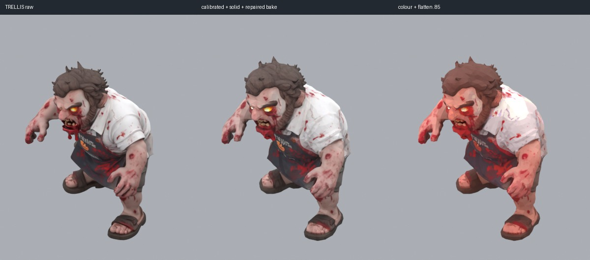

Rendered all three files in Blender with one fixed raw-derived camera, target, orthographic scale, viewport, neutral world and three area lights. Each import uses the same elevated front three-quarter view and default neutral pose; later stages are not independently reframed. Opened strict S53-criteria static ratings: **raw 6/10 → calibrated/solidified/repaired bake 6/10 → colour-plus-flatten .85 5/10**. Raw finger/face/apron identity and broad form mostly survive the bake. Colour-plus-flatten shifts skin/wounds toward stronger reds and loses subtle tonal separation, giving the largest observed pre-rig drop in this controlled set (**−1**). It bundles colour match and flatten, so their individual contributions are not yet isolated.

These are studio stage ratings, not native game scores or proof of the full raw→game biggest drop. Neutral rig and matched-lineage in-game BBQ-dad views still need to join this sequence. The recreated bake is a measured regeneration with recorded settings, not a byte-identical historical bake; its calibration high is byte-identical. Blender renders are retained at `/private/tmp/cashier-stage-{0,1,2}.png` (legacy temporary script output names; actual inputs were BBQ-dad).

## BBQ-dad colour versus flatten contribution isolated

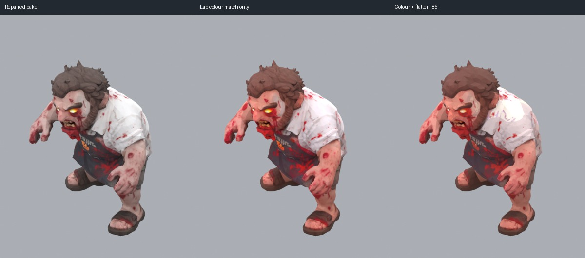

Rendered repaired bake, Lab colour match only, and colour-plus-flatten with one fixed camera/light setup derived from the repaired bake. Geometry is unchanged across these three texture stages. Opened strict static ratings: **repaired bake 6 → colour match 5 → colour plus flatten 5**. The stronger red skin/wound treatment appears in the middle column before flattening; flatten changes tonal structure but adds no further whole-point loss in this view. This refines the earlier bundled −1 attribution: colour matching is the measured whole-point drop in this specific regenerated pre-rig series. It does not establish that every figure should skip colour matching; common-worker's retained colour comparison showed better garment separation. Recipe implication: review each figure's colour correction at game camera, and retain uncorrected/repaired comparison until it demonstrates a visual improvement.

The temporary renderer output names `/private/tmp/cashier-stage-{0,1,2}.png` were reused for this run; committed sheets preserve both the earlier raw/bake/flat comparison and this colour-stage isolation. Native temporary names alone should not be used as immutable evidence references.

## Experimental regenerated-surface binding candidate

The historical wave1 rig command uses `wave1_rig.py` after a three-LOD shared-atlas stage and binds closed rigid pieces; the current game uses a skinned delivery. Created an **experimental**, not historical-identical, neutral candidate with the current `skin-crowd-figure.ts`, existing game BBQ-dad rig, regenerated flat LOD0, `--fit-rig-height --body-rot-y 90 --body-yaw-fixed`. Output is `/private/tmp/s71-bbq-stages/bound-lod0.glb`; report retained in `bbq-experimental-binding.json`. It reports 16 joints, 5,944 body triangles, one component and zero open edges. However, only one eye attachment and a torso/root seam are reported, so ownership/eyes and neutral appearance must be inspected before acceptance or scoring. Do not call this a faithful stage-c reproduction merely because the converter exits successfully. No runtime asset was changed.

## Experimental binding CPU inspection rejected for scoring

Rendered and opened `/private/tmp/s71-bbq-bound-cpu.png` (nine mesh parts, front +X). It shows detached red quads above the head and scattered red triangles around the body. This cannot be accepted as the neutral rig stage. The CPU static renderer does not evaluate glTF skinning or game hidden-stump visibility, so those marks may be inspection artifacts, converter placement problems, or both. A skin-aware Blender render with the game's hidden-part rules is required before attributing them to rigging. The intact body remains recognizable, but no numeric stage-c score is assigned from this invalid inspection. Candidate stays outside runtime assets.

## Skin-aware neutral render confirms experimental eye defect

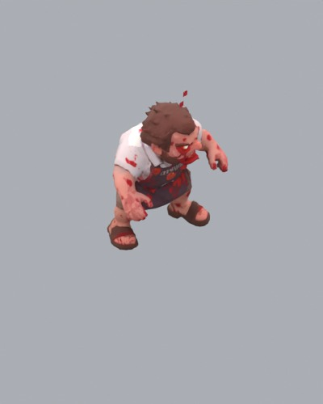

Imported the candidate into Blender, which evaluates its skin. Seven stump meshes carry explicit `hidden: true` and `stumpFor` extras; removed those objects for rendering. The scattered CPU-view red triangles disappear, confirming they were hidden-part inspection artifacts. Two red quads remain above the hair/crown in the skin-aware neutral render, confirming a genuine eye-placement defect in this experimental converter invocation. Body continuity otherwise appears intact. The view is not yet aligned to the raw-stage camera, so no comparable overall rig score is assigned. This candidate must not enter runtime or be presented as accepted historical stage c. The diagnostic distinguishes a real binding risk (stale eye attachment placement) from an inspection artifact (hidden stumps), and gives a concrete requirement for the eventual neutral-rig comparison.

## Eye-binding invocation diagnosis

The current converter retains template eye geometry when present. `--eyes` alone is consulted only when generating new discs, so it leaves stale template eyes unchanged. Retried with the retained calibrated-source landmarks and `--reproject-eyes --eyes …/inf.bbq-dad/eyes.json`: the report now records **zero discs**, not two, and still only a torso/root seam. This is a failed experimental binding, not a visual fix. It suggests inadequate head ownership in this template/body invocation; source inspection shows eye generation requires head-owned vertices before landmark projection. Report retained in `bbq-reproject-binding.json`. The experiment establishes a concrete handoff check: verify head ownership and both eyes after binding rather than relying on converter success or landmark-file presence. No production source/asset changed; the neutral candidate remains rejected.

## Binding experiment corrected to a compatible template

Source inspection of this worktree's converter shows ownership extraction uses the mesh node's nearest named-joint ancestor, without reading template `JOINTS_0`/`WEIGHTS_0`. The earlier experimental invocation supplied an already-skinned game template, so its failed eyes/ownership must **not** be attributed to the shipped pipeline. It is an incompatible-template diagnostic invocation. Retried the same regenerated surface with the retained wave1 **rigid** LOD0 template, fixed +90° yaw, fit-rig-height, and explicit eye reprojection. The new report has two eyes, 16 joints, head/torso and limb seams, and mean template-surface distance .0004407 versus .06017 previously. This supports the ownership-extraction diagnosis.

The compatible-template output is `/private/tmp/s71-bbq-stages/bound-rigid-template.glb`; report is `bbq-rigid-template-binding.json`. It is still a candidate: 65 contact triangles were removed and it reports 418 unrelated seam vertices, so neutral and motion inspection remain necessary. The earlier visible floating-eye defect belongs to the invalid skinned-template experiment, not evidence of production rig-stage loss. No production assets or converter code changed.

## Controlled regenerated BBQ-dad neutral binding comparison

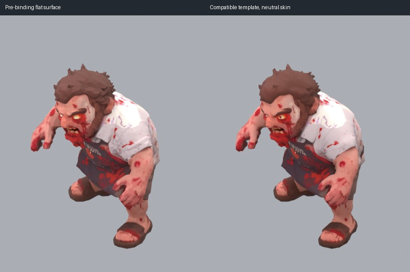

Applied the inverse of the recorded body fit (uniform scale, +90° yaw and translation) to a diagnostic wrapper around the compatible-template bound candidate, aligning it back into the pre-binding source coordinate system. Rendered pre-binding flat surface and aligned neutral skin with the same camera, target, scale, viewport and lights; removed explicitly hidden stump meshes in both imports. The projected eyes sit on the face, body silhouette/apron/hands remain close, and the bound surface has smoother normal shading. Strict static score **5 → 5 (0)**: no whole-point loss at neutral binding for this regenerated candidate. The initial floating-eye failure from the incompatible skinned template is not part of this accepted comparison.

This fills an experimental stage-b→c comparison for BBQ-dad, but does not certify the shipped rig or moving poses: the converter repaired contacts and reports unrelated seams, and the regenerated pre-binding chain is not proven identical to the historical delivery. A same-lineage game capture and motion evidence are still needed before claiming full stage attribution. Aligned scratch file: `/private/tmp/s71-bbq-stages/bound-source-aligned.glb`; original candidate remains separately retained. No production asset changed.

## Same-regenerated-body HIGH game diagnostic

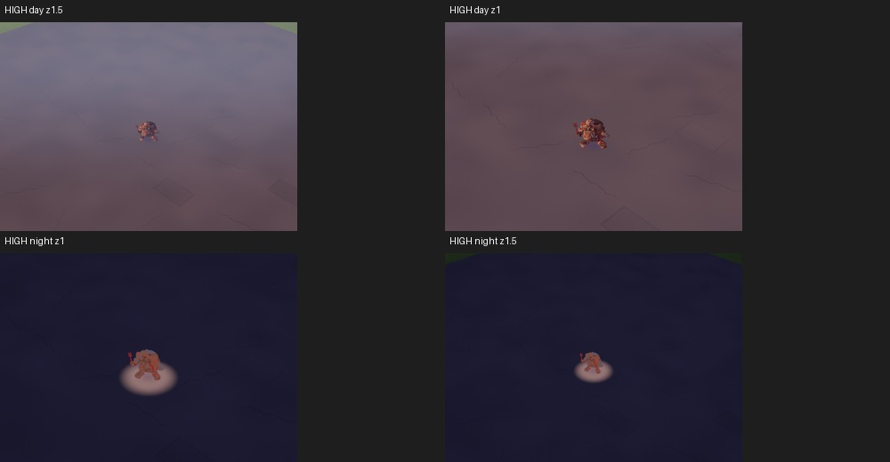

Captured the regenerated compatible-template candidate through session-local Playwright request overrides for BBQ-dad LOD0/1/2 GLB requests. The same candidate was served for every requested LOD deliberately to freeze source geometry for this diagnostic; this is not LOD-switch or performance acceptance. HIGH/WebGL2 checks passed with no reported errors, both zooms/day/night. Repository GLBs were untouched; temporary driver removed. Native receipts/captures: `test-results/s71-figurediag/bbq-regenerated-high/`.

Opened candidate rating: **3 day / 2 night**. At game scale the body/arms read as a crowded fragmented mass; night further flattens the surface. The partial regenerated chain therefore reads **raw 6 → repaired bake 6 → colour/flat 5 → neutral skin 5 → animated HIGH game 3/2**. The largest observed transition in this experimental chain is neutral studio to animated game (−2 day / −3 night), but that transition combines camera scale/light and pose-atlas deformation. It cannot be assigned to lighting alone, and the candidate's known seam/repair concerns prevent generalizing it as the shipped pipeline's measured loss. Next isolate a frozen bind pose under game lighting from the actual idle clip before recommending a fix. This candidate is rejected for delivery; the shipped BBQ-dad S53 5/3 is a separate delivery and must not be conflated with this 3/2 candidate.

## Bind-pose isolation attempt remains inconclusive

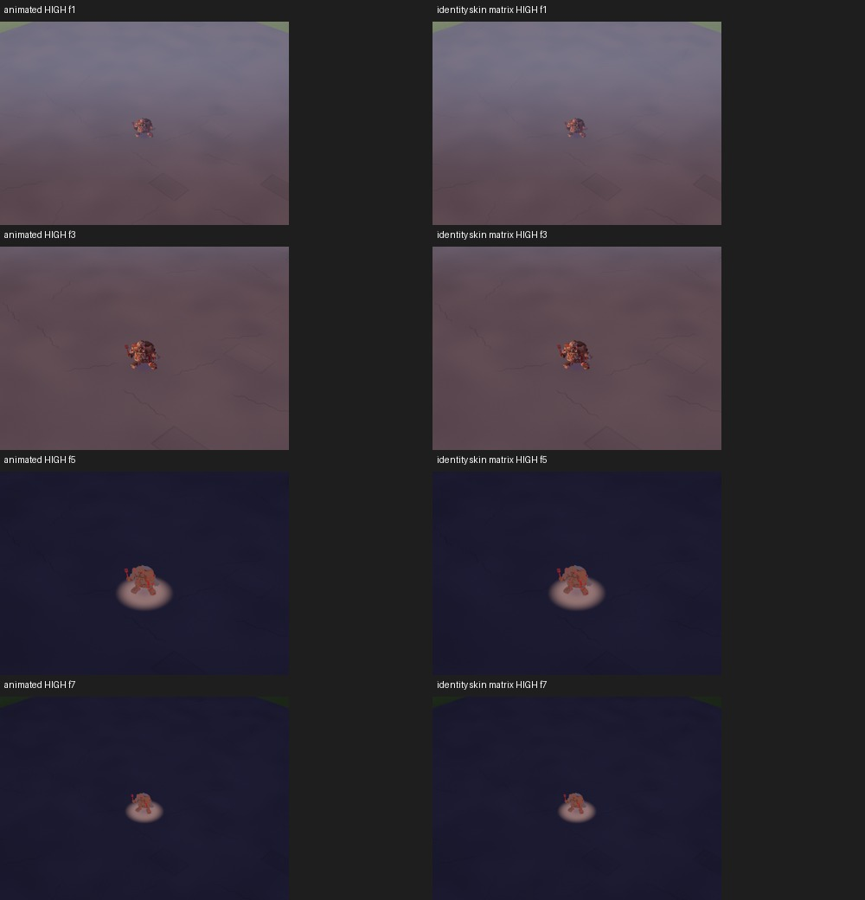

Attempted to replace the BBQ-dad skin matrix with identity during graph construction, while serving the same regenerated candidate through session-local GLB overrides. HIGH fixture checks passed and the opened view remains approximately 3/2. This is **not accepted as proof of a frozen bind pose**: crowd graphs can be shared across assets, so an asset-name condition at graph creation does not guarantee the edited matrix is used by the later BBQ-dad draw. The similar captures do not isolate deformation from lighting until actual per-draw matrix behavior is verified or a dedicated nonshared diagnostic graph is used. Shader source restored byte-for-byte and temporary driver removed. Captures/receipt: `test-results/s71-figurediag/bbq-bindpose-high/`. The earlier neutral-to-game drop remains a combined, experimental transition.

## Global identity-matrix test invalidates the naïve bind-pose method

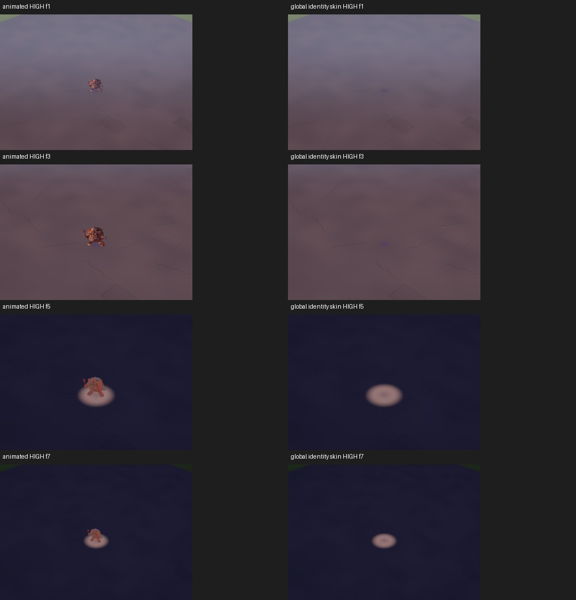

Repeated the candidate fixture with the skin matrix set to identity for **all** crowd graphs, eliminating the asset-name/shared-graph ambiguity. The body disappears while the ground light/contact pool remains. Fixture screenshot checks still pass, illustrating their limited semantic coverage. This confirms an active intervention but **does not produce a valid bind pose**: the packed crowd geometry requires the bake's rest/bind-space transforms, so identity cannot be assumed to preserve its standing position. Do not score the missing body as figure quality or infer that animation improves it. Correct neutral isolation must reconstruct the stored joint rest transforms through the production bake contract. Source restored byte-for-byte, temporary driver removed; native evidence is at `test-results/s71-figurediag/bbq-global-bindpose-high/`.

## Cashier calibration reproduced: large pre-bake proportion change

Replayed cashier's recorded wave1 calibration from its retained raw high. Output SHA256 exactly matches the historical calibrated-high provenance (see `cashier-calibration-reproduction.json`). The operation scales the head by **1.429188×**, changing measured head/height **.392 → .4795598** before baking. This is a substantially larger authored change than BBQ-dad's 1.095296× and a concrete candidate behind the earlier head/hair-dominance defect. It is historical reconstruction of the pipeline, not a recommendation under current heroine-based shrink-only rules; the score impact must still be isolated visually.

Regenerated the recorded 5944/2444 solid targets from that high with four threads and head-depth yaw 0. Actual outputs are 5,920 and 2,418 triangles, both watertight; reported slivers .72635% and .08271%. Scratch outputs are under `/private/tmp/s71-cashier-stages/`. Texture bake, repaired/colour/flat stages and the matched neutral-rig comparison are still pending for cashier. No inference or production asset change.

## Controlled cashier raw-to-calibration score

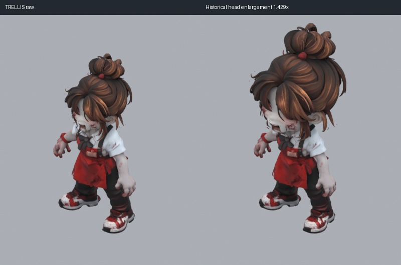

Rendered the retained raw and byte-identical regenerated historical calibration with one raw-derived camera, target, orthographic scale, viewport and studio lighting. Both remain high-resolution textured meshes; no decimation/atlas change separates these columns. Opened strict static ratings: **raw 6/10 → calibrated high 5/10 (−1)**. The 1.429188× head enlargement makes the hair mass dominate the upper body and obscures face/expression further from the elevated view; apron/body landmarks remain fixed. This identifies a concrete readability loss **before baking**, rather than an inevitable TRELLIS detail failure. It supports retaining current heroine-based shrink-only proportion constraints and rejecting the historical old-chibi target for rebuilds. Game-camera impact and subsequent bake/rig drops still need matched stage evidence; this is a static stage judgment, not an 8/10 acceptance claim.

## Controlled cashier bake and texture-stage scores

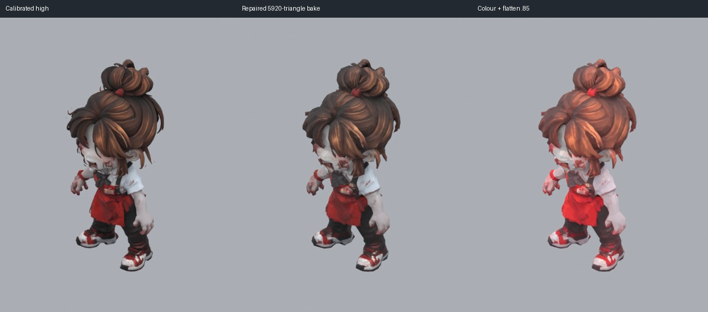

Regenerated the recorded 1024 emission bake (cage .02/ray .05), nearest-source surface repair, Lab match and flatten .85. Preserved initial bake, repaired bake, colour-only and flat copies in `/private/tmp/s71-cashier-stages/`. Repair sampled 536,799 texels, k32, p99 source distance .0235193. Flatten passes its palette gate (mean ΔE76 4.94855, maximum 7.65566; report retained). Rendered calibrated high, repaired 5,920-triangle bake and flat stage at one fixed camera/light setup. Opened strict static ratings: **calibrated high 5 → repaired bake 4 → colour/flat 4**. Face/sleeves/hair become more angular during the geometry/bake transition; later warming/brightening does not restore expression.

Combined with the separately opened raw/calibration pair, cashier's partial pre-rig chain is **raw 6 → calibration 5 → repaired bake 4 → colour/flat 4**. These are two observed one-point pre-rig losses, not a claim that the 6k budget alone causes the bake drop (solidification, reduction and texture transfer are bundled). Neutral binding and matched-lineage game stages are still required to establish the full largest loss. No production assets changed.

## Cashier experimental binding stopped by topology guard

Applied the current binding tool to the regenerated cashier flat surface with its retained compatible wave1 rigid template, fixed +90° yaw, fit-rig-height and explicit eye reprojection. It exits 1: **two components, zero open edges**, with a 2,870-vertex anatomical component and a four-vertex head-owned component reported after processing. The source solid geometry had been one watertight piece; the failure occurs in this experimental binding/contact path. Failure receipt is in `cashier-binding-failure.json`. Guard was retained; no accepted neutral candidate or rig score is claimed. This diagnostic must not be equated with the currently shipped cashier's topology. Next inspect the generated contact cuts/scrap ownership before deciding whether a faithfully replayed historical rig or a corrected experimental bind is the appropriate comparison.

## Retained butcher game checkpoint recovered from Git

The removed S52 worktree's game branch remains available at `lane/s52-trellis-heavies`, tip `439258ca` (reviewable butcher checkpoint). Extracted its committed LOD0 GLB to `/private/tmp/s71-butcher-final-lod0.glb` without checking out or editing that branch. Its SHA256 is `d22835155587ed1c6b51b53a735cbc089e8917bc7d462983de587d34bce9e0a6`; the pipeline cap-fit3 validation receipt names `ab6dd4ea6a0d0e29f8a21fbc88472e7295a4be9c736fb402baa147b2a80fe02d`. Therefore this is a recovered committed checkpoint, not yet proven the exact binary in that validation receipt. Decoded geometry/texture and metadata comparison is needed before linking it to the selected bake and scoring the neutral stage. This avoids treating branch labels as sufficient provenance. No branch was moved or runtime asset replaced.

## Butcher checkpoint validation anchor confirmed

Resolved the apparent hash mismatch: `tools/assets/validate.ts` emits `geometryHash(document)` for model validation, not the raw GLB SHA256. Computing that exact function on the recovered S52 branch checkpoint yields **ab6dd4ea6a0d0e29f8a21fbc88472e7295a4be9c736fb402baa147b2a80fe02d**, exactly matching the cap-fit3 receipt. The earlier comparison of binary SHA256 to geometry hash was invalid. Inventory confirms 5,773 triangles, 16 named joints, skin_body + seven stumps + eyes, and one 384×264 KTX2 atlas. Details in `butcher-checkpoint-inventory.json`. This confirms the validated geometry anchor, while byte/texture identity is a separate claim. The recovered committed delivery can now be used for neutral-rig inspection instead of an arbitrary experimental butcher rebind.

## Selected butcher checkpoint neutral skin opened

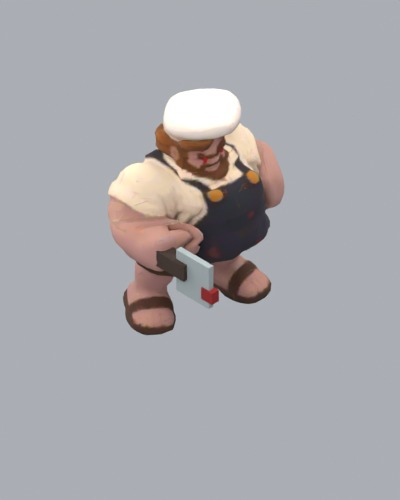

Decoded the recovered geometry-validation-matching S52 checkpoint's meshopt/KTX2 payload and imported it into Blender with skin evaluation. Removed objects explicitly tagged hidden/stumpFor, preserving eyes and the cleaver. Opened strict neutral studio rating: **5/10**. Eyes are attached, limbs continuous and cleaver retained. Cap/chef silhouette reads clearly, but cap occludes much of the face and the arms have little fine structure. No floating eyes or scattered visible stumps appear in this selected checkpoint. This is stronger rig-stage evidence than the invalid experimental template invocations above.

The view is still independently framed in game-space orientation; it must be aligned to raw/pre-binding source cameras before a numerical inter-stage delta is defensible. S52's previously opened selected-delivery runtime sheet rates 5 day / 4 night, but its exact pose/camera differs from this neutral studio view. No runtime assets changed; decoder scratch cache inside the worktree was removed.

## Aligned selected butcher source-to-rig stages

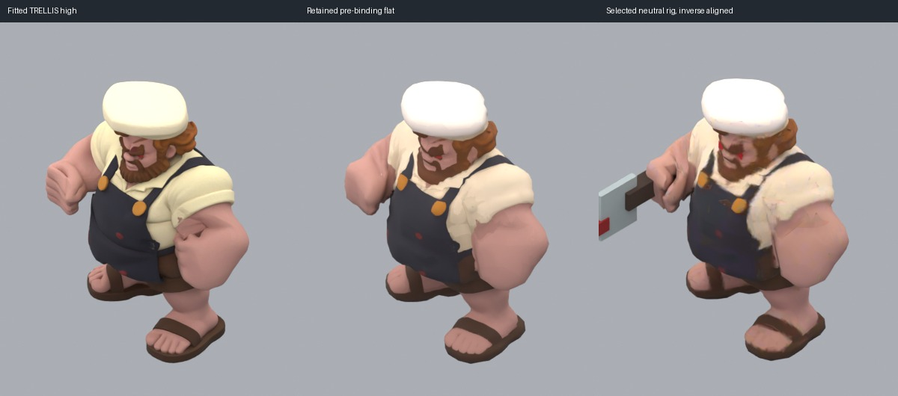

Used the retained anatomical binding's inverse uniform scale/+90° yaw/translation to align the selected checkpoint into source coordinates, then rendered fitted cap-fit1 high, retained cap-fit1 pre-binding flat and selected neutral skin under one high-derived camera/light setup. Explicit hidden stump meshes are excluded. Opened strict static ratings: **fitted high 6 → pre-binding flat 5 → selected neutral delivery 5**. Finger and sandal definition become blunt during reduction/bake/flatten; selected delivery further softens texture while restoring the cleaver. No additional whole-point neutral-binding loss is visible. These ratings identify a −1 pre-rig processing drop in this selected butcher subseries; they do not isolate reduction from flattening or equate fitted high with untouched raw. The selected delivery's geometry hash matches cap-fit3 validation; raw-to-fit and exact game-pose comparisons remain separate requirements. Alignment uses retained binding metadata, and the displayed body envelopes correspond closely; accessories intentionally differ because the cleaver is restored downstream.

## Controlled untouched butcher raw-to-fit comparison

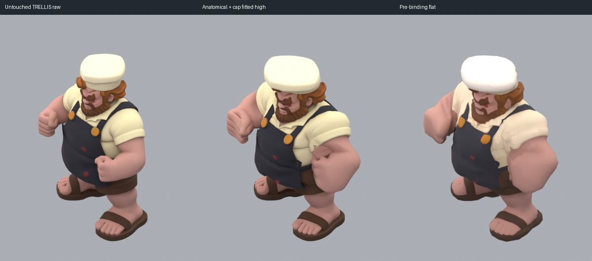

Rendered untouched run2 raw, cap-fit1 fitted high and retained pre-binding flat under a single raw-derived camera/light setup. Opened strict static ratings: **raw 6 → fitted high 6 → pre-binding flat 5**. Anatomical/cap fitting changes arm mass and cap width while retaining fine finger/sandal cues; it produces no whole-point score change in this view. The one-point reduction/bake/flatten drop remains distinct, with fingers and toes becoming blunt. Combining the overlapping controlled studio comparisons gives selected-butcher studio stages **raw 6, fitted high 6, pre-binding 5, neutral delivery 5**. The prior S52 selected-delivery game sheet was opened at 5 day / 4 night; fresh same-lineage game captures through this worktree are still required before the full stage table can treat those contexts as one controlled series. The current worktree's older butcher 4/3 remains a separate baseline.

## Selected butcher GLB-only runtime override rejected


Loaded the exact S52 branch LOD0/1/2 GLBs via session-local routes, HIGH then LOW, preserving current repository assets. Both technical fixtures passed, with route hits retained under `test-results/s71-figurediag/selected-butcher-{high,low}/override-receipt.json`. However, the opened matrix shows a dark day cap and fragmented body treatment, inconsistent with the selected checkpoint's cream-cap neutral render and the opened S52 runtime sheet. These are **rejected as same-delivery game scores**. GLB-only substitution is insufficient evidence: the selected geometry/UVs must be paired with its matching official pose/UV bake binaries and integration metadata. Current-branch bake reuse is a candidate cause to verify, not a proven art regression in the selected delivery. Next extract the S52 `civilianBakes.json` mapping and corresponding committed binaries, then repeat with matched overrides. Temporary capture driver removed; no production files changed.

## Matched official butcher bakes restore the selected HIGH appearance

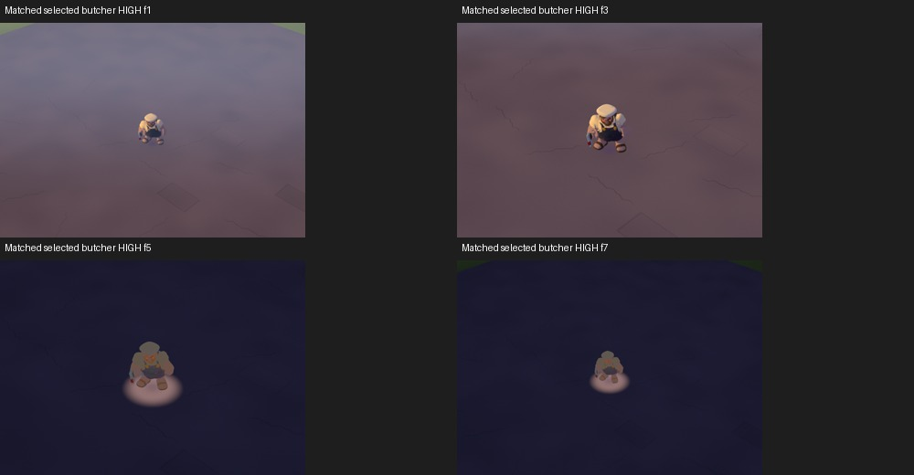

Extracted the S52 branch's `civilianBakes.json` and its committed official infected bake binaries (LOD0 `5ada6567ffd351f1`, LOD1 `9978c624025d9d3e`, LOD2 `5fb9a27ac47190dc`). Session-local overrides served these alongside the selected GLBs when current-branch URLs were requested. All six route hits are retained in `butcher-matched-overrides.json`. HIGH/WebGL2 fixture passed; opened sheet covers both zooms/day/night. Cream cap, chef body and cleaver are coherent again. Strict game rating **5 day / 4 night**, consistent with the earlier S52 selected-delivery review. Native captures/receipt: `test-results/s71-figurediag/selected-butcher-matched-high/`.

The previous GLB-only integration mismatch is now causally localized to mismatched official bake data: pairing the selected geometry/UV delivery with its matching pose/UV binaries removes the visible corruption. This is a major integration hazard, distinct from the selected model's remaining art limitations. **Recipe requirement:** treat GLBs and official bake mappings/binaries as one versioned delivery; validate source-geometry/UV provenance before accepting cached pose data. Successful loading and finite buffers alone did not catch the mismatch. No repository runtime assets changed; temporary driver removed.

Selected-butcher evidence now supports studio raw **6**, fitted high **6**, pre-binding **5**, selected neutral rig **5**, and matched HIGH game **5 day / 4 night**. The observed art loss is one point before binding plus a night presentation penalty; stale-bake corruption is a separate avoidable failure, not a necessary TRELLIS loss. Studio/game camera contexts still differ, so inter-context deltas retain that qualification. Matched LOW capture remains pending for this selected lineage.

## Cashier topology failure localized to omitted source cleanup

Retried binding with the recorded explicit scale 1.5288209712814274 and without optional fit/contact processing: the same two-component guard fails. Audited welded source connectivity at solid, initial bake and flat stages. Each already contains a 5,916-triangle main component plus a detached **four-triangle / four-vertex watertight component**. Full audit is `cashier-source-components.json`. Thus the earlier suggestion that binding created the scrap is withdrawn: it is present before binding. Watertightness alone did not establish the required single component. The recorded pipeline includes `readable_components.py` cleanup, which the regenerated diagnostic sequence had not yet replayed. Apply that recorded step and audit its exact removed fraction before retrying; do not bypass the binder guard or call this a shipped rig defect.

## Recorded tiny-component cleanup resolves cashier bind rejection

Replayed the retained `readable_components.py` algorithm with only its loop scoped to LOD0 in a scratch copy. It retained all original volume/area guards and removed exactly four faces, area fraction **.000438655 (0.0438655%)**, leaving 5,916 triangles. Retried the compatible rigid-template bind with recorded scale 1.5288209712814274, fixed +90° yaw and explicit eye reprojection: it now passes with **one component, zero open edges, 16 joints, two eyes**. Cleanup and bind reports are `cashier-cleanup.json` and `cashier-clean-binding.json`. This causally resolves the experimental topology rejection without weakening a guard.

Cleanup was applied to a preserved flat scratch copy to isolate the four-face difference; the historical chain cleaned before colour processing, so this candidate is not claimed byte-identical to historical pre-binding output. Neutral appearance and motion remain unverified. Candidate: `/private/tmp/s71-cashier-stages/bound-clean.glb`. No production asset or converter source changed.

## Controlled cleaned cashier neutral-rig score

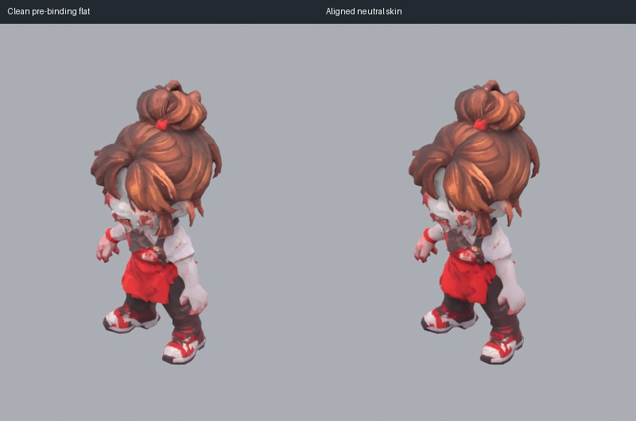

Applied the inverse recorded body transform to the cleaned bound candidate, then rendered clean pre-binding flat and neutral skin with the same camera/light setup, skin evaluation and hidden-stump exclusion. Opened strict static rating **4 → 4 (0)**. Silhouette, apron and facial limitations remain close; the large hair mass still dominates, but neutral binding adds no visible whole-point quality loss. This completes the regenerated cashier studio sequence **raw 6 → historical head calibration 5 → repaired bake/flat 4 → cleaned neutral rig 4**. It does not certify motion, compression or historical delivery identity. The current shipped HIGH 3/2 remains a separate game-delivery observation until the candidate is integrated with its own matching official pose/UV bake. Scratch aligned model: `/private/tmp/s71-cashier-stages/bound-aligned.glb`.

## Matching official bakes generated for regenerated ordinary candidates

Encoded both regenerated bound candidates with the existing `compressSkin` ETC1S/meshopt route, then called official `skinCrowdBakes` using scratch asset definitions. Generated candidate geometry and official pose/UV bakes are retained in `/private/tmp`; mapping is `ordinary-diagnostic-deliveries.json`. Registry and `civilianBakes.json` were not edited. Temporary preparation driver, scratch public GLBs and newly generated public bake files were removed after copying to scratch.

Both candidates emitted LOD1/2 **dimensions fallback** diagnostics because one diagnostic body was deliberately supplied for all requested LODs. Their three resulting bake contents are identical within each figure. This is suitable only for a fixed-geometry stage diagnostic, not validation of authentic distance LODs, performance or production delivery. Future request overrides must pair the scratch encoded GLB and scratch official bake for each figure, record route hits and retain these fallback limitations. Generation alone is not visual evidence.

## Matched regenerated ordinary HIGH game stages accepted

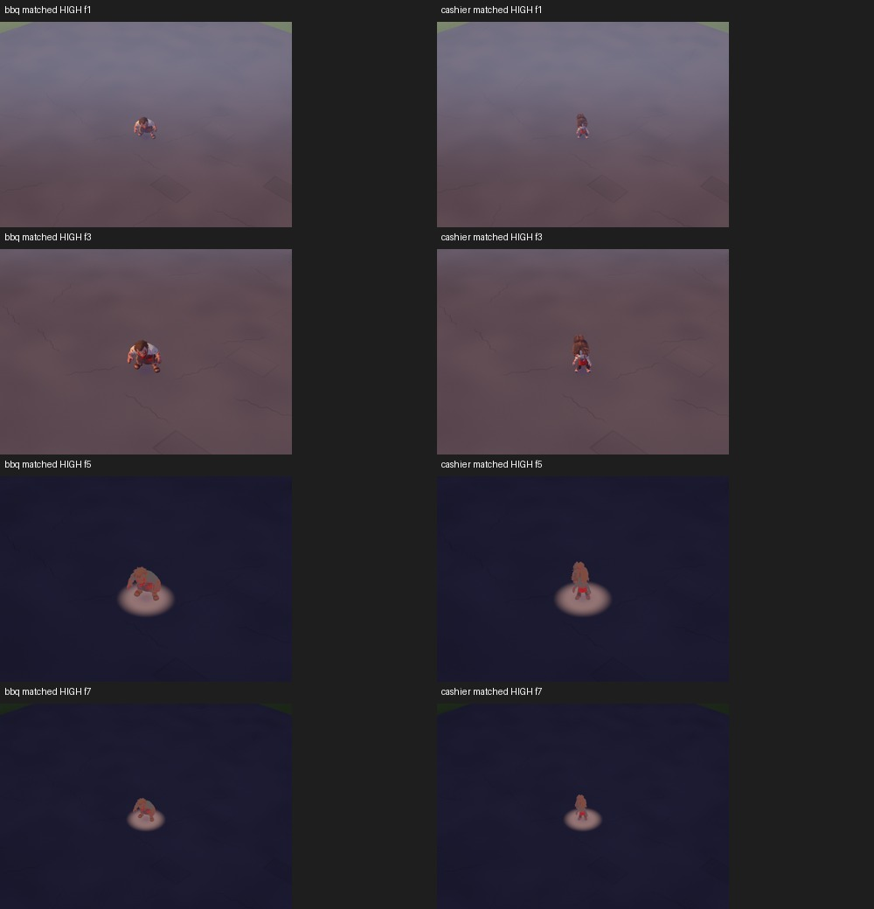

Served each encoded regenerated GLB with its freshly generated official pose/UV bake through session-local routes. Both corrected explicit-variant HIGH/WebGL2 fixtures passed and were opened at both zooms/day/night. Coherent model identities replace the earlier stale-bake fragmentation. Strict game judgments: **BBQ-dad 5 day / 3 night; cashier 4 day / 3 night**. Receipts and route-hit logs remain under `test-results/s71-figurediag/{bbq,cashier}-matched-candidate-high/`. Temporary driver removed; production assets/mappings untouched.

These complete same-regenerated-body HIGH stage observations: BBQ-dad **raw 6 → repaired bake 6 → colour/flat 5 → neutral rig 5 → HIGH game 5/3**; cashier **raw 6 → calibration 5 → repaired bake/flat 4 → cleaned neutral rig 4 → HIGH game 4/3**. Camera/light differ between controlled studio and native game contexts, so the night losses are presentation observations rather than isolated lighting coefficients. One candidate body/bake deliberately serves all requested LODs, with recorded dimension fallbacks; these are fixed-geometry diagnostics, not authentic distance-delivery or performance validation. Matched LOW candidate matrices remain pending.

## Matched secondary LOW candidate matrices completed

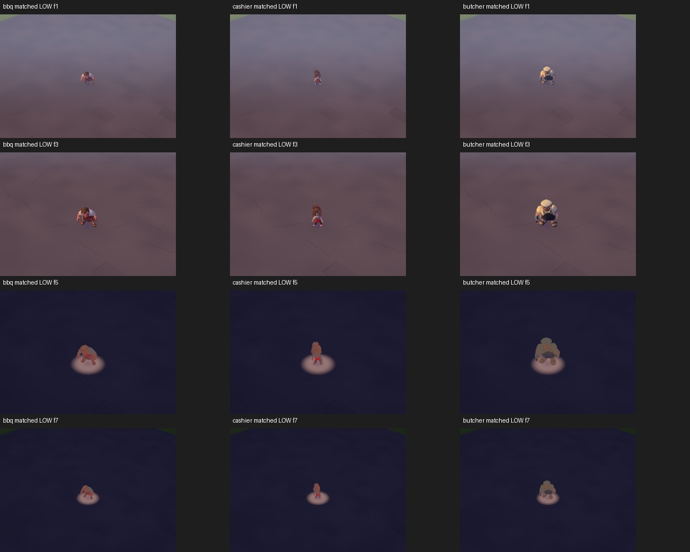

Captured regenerated BBQ-dad and cashier with their matching official bakes, plus selected S52 butcher with its authentic three GLBs/bakes, at LOW/WebGL2. All three fixtures passed; opened rows cover day zoom 1.5/1 and night zoom 1/1.5. Overall LOW judgments match the HIGH observations: **BBQ-dad 5/3, cashier 4/3, selected butcher 5/4**. HIGH remains primary. Native captures and override logs: `test-results/s71-figurediag/{bbq,cashier,butcher}-matched-candidate-low/`. Temporary driver removed, registry/mappings/assets unchanged.

This closes the requested tier/zoom/time capture coverage for the stage candidates. The ordinary candidates intentionally use one regenerated body and matching bake at all requested LODs, with documented dimension fallbacks; their matrix is valid fixed-geometry diagnostic evidence, not authentic distance-LOD acceptance. Remaining task scope is the untested cheap levers, final concise recipe/expected-score synthesis and completion audit of the controlled-stage limitations.

## HIGH cashier visual-scale lever

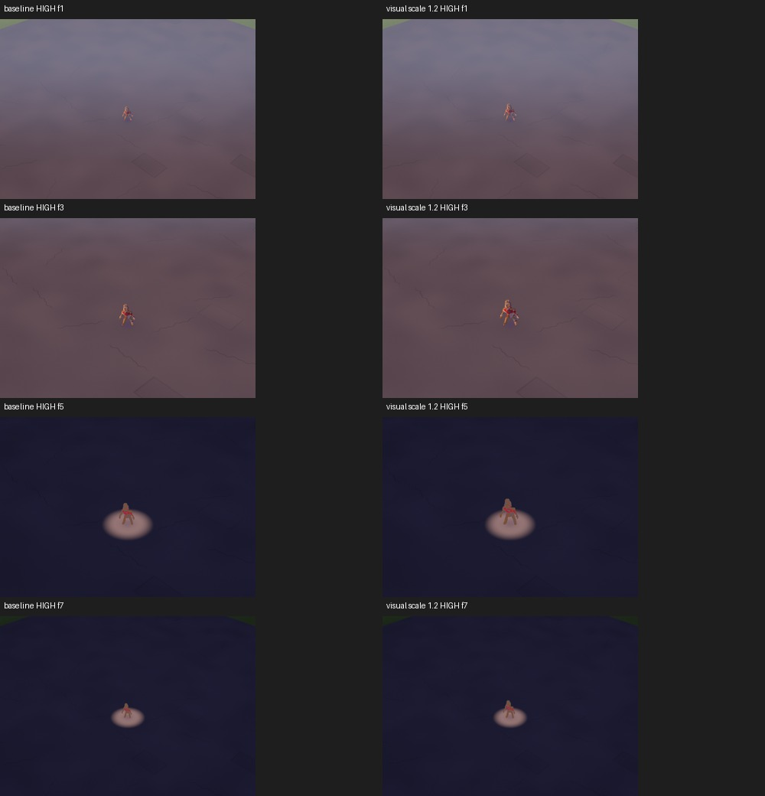

Temporarily multiplied posed crowd vertex positions by 1.2 before the instance transform in this single-figure HIGH/WebGL2 cashier fixture. Gameplay stats/collision and asset geometry were unchanged. Both zooms/day/night captured with passing fixture checks. Opened result: figure is visibly larger but expression/material finish remains weak; strict overall rating **3/2 → 3/2 (+0/+0)**. This tests a 20% whole-figure visual scale increase, not a redesigned silhouette or head/body correction. Native evidence: `test-results/s71-figurediag/cashier-scale12-high/`. Shader source restored byte-for-byte. No scale change proposed for promotion; stronger screen coverage alone did not close the quality gap.

## HIGH cashier normal-shading lever

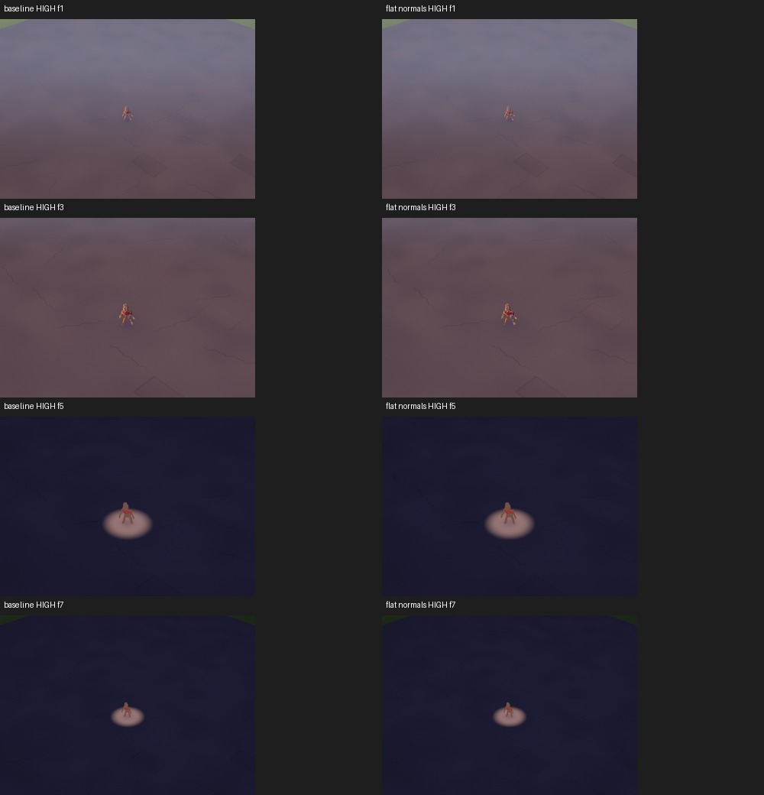

Temporarily replaced the crowd material's interpolated skinned normal node with TSL `normalFlat` for this isolated cashier HIGH/WebGL2 capture. Atlas, positions, clips, lights and camera stops stayed fixed. Fixture checks passed; opened result remains **3/2 → 3/2 (+0/+0)**, without meaningful native-camera expression or material improvement. This tests geometry normal interpolation only; it is not an authored normal-map or AO bake test. Those maps are absent from the inspected current material inventory and would require additional asset/shader integration. Evidence: `test-results/s71-figurediag/cashier-flat-normals-high/`. Temporary import/normal-node edit restored byte-for-byte; no normal change proposed for promotion.

## HIGH shared-atlas resolution sensitivity test

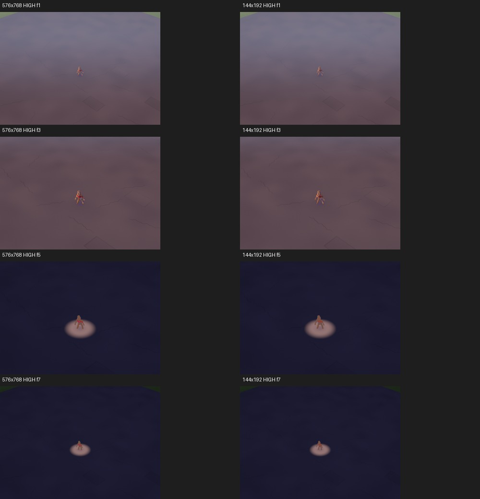

Used the existing class-aware encoder to make a 144×192 atlas from cashier's 576×768 shared source, then copied only those KTX2 image bytes into the original LOD0 document. Decoded accessor hashes remain exactly identical (`cashier-shared-resize-proof.json`), so geometry/UV/skin data were not changed. Session-local override targeted the shared LOD0 source rather than the previously ineffective standalone LOD2 image. HIGH/WebGL2 fixture passed at both zooms/day/night; opened overall rating remains **3/2 → 3/2 (+0/+0)**, despite a 16× texel-area reduction. Some fine colour cues soften, but neither version provides readable expression or convincing material detail at native game scale. This is a downsampling sensitivity test, not proof that upscaling or rebaking from a higher-detail source cannot help. Direct candidate per-draw atlas dimensions still need a receipt before treating this as fully verified sampler coverage. Native evidence: `test-results/s71-figurediag/cashier-shared-small-high/`. All changes were scratch/session-local; temporary tools removed.
